# Eidoria 概念设计 v3

> **性质：设计评审稿，不是应用实拍。** `00–05` 是把 v0.11 已落地界面重新抛光后的“当前基线”；`06–15` 是下一阶段界面的样式预演。凡标为“规划 / Phase 2 / 远期 / 最后”的画面，都不表示功能已经实现。
>
> 本轮只完善概念图与设计说明，**不修改应用代码**。后续实现时，以本文的画面结构、[响应式布局](RESPONSIVE-LAYOUT.md) 的尺寸规则和 [开发文档](DEVELOPMENT.md) 的功能边界共同验收。


## 1. 这套图解决了什么

旧概念图只有 Compact 与 Large 两张浅色 AI 方向稿，而且已与当前产品漂移：应用名仍是 “Files”、桌面图出现 Google Drive、手机图有账号头像与语音搜索、搜索仍是整行搜索框，也没有 v0.11 的搜索岛、预览双页签与悬浮窗。v2 因此先重做为可编辑的结构稿，再以其为布局参考直接生成高保真 AI mockups；第二轮直接生成图仍有说明文字过密、文件标签页被画成内嵌胶囊的问题；v3 以 `material-3-skill` 做 MD3 审计后重新生成，对外评审以 `assets/mockups/ai-v3/` 为主：

- 以 **Eidoria（万象屿）** 与折页图标为统一品牌入口；
- 同一界面提供 **浅色 / 深色成对稿**，先验证颜色角色而非临时反色；
- 当前基线覆盖 Large、Compact、Medium 三种形态；
- 下一阶段界面按路线图分层：近期核心、Phase 2、远期，以及明确排最后的插件与本地 AI；
- **AI 直接生成图位于 `docs/assets/mockups/ai-v3/`**；`ai-v2/` 保留为上一轮对照，`v2/` 的 SVG/PNG 只保留为结构参考，不再作为主视觉稿；
- 旧路径 `mockup-compact-phone.png` / `mockup-large-desktop.png` 已同步为本轮 AI 直接生成的 Compact/Large 浅色基线；
- 结构稿生成脚本为 `scripts/generate-concept-mockups.py`；AI 高保真图以对应结构稿为布局参考直接生成，不由 SVG 导出。
- **v3 已覆盖 15 个界面场景**：Large/Compact/Medium 基线，以及搜索索引、双窗格、存储洞察、压缩包、冲突/任务、编辑/PDF、媒体、扩展/Lua、本地 AI 与 Android 存储规划。`00` 是需要精确 Token 与组件状态的规范板，不属于界面 mockup，继续保留可编辑结构稿。

## 2. 视觉语言定版

### 2.1 共同原则

1. **本地文件优先**：导航与空态只出现本地卷、已知文件夹和 Android 已授权目录；禁止云盘、账号头像和网络位置暗示。
2. **工作面分层**：应用底板用低层表面，浏览器是主工作卡，预览是独立卡；浮层只用于搜索面板、悬浮预览、任务与确认，不把整页做成漂浮卡片堆。
3. **搜索岛是全局手势**：文件夹页只常驻一个迷你入口；所有断点默认只留搜索图标，索引状态用小徽标或环形进度表达，不常驻状态句。展开后的悬浮面板在所有断点保持同一种结构。
4. **预览永远双页签**：文件头与“打开”常驻，内容进“预览”，路径、时间、大小、校验和等进“属性”；窄屏用悬浮窗，宽屏用侧栏，但不换信息架构。
5. **选中态靠容器色**：选中项用 `secondaryContainer`，主色只做细描边、指示线和关键动作，避免整屏高饱和青色。
6. **先给安全感，再给效率**：删除、覆盖、清空、解压覆盖等动作必须显示影响范围、恢复路径和当前进度；危险动作默认不抢焦点。
7. **滚动边界可见**：菜单、筛选、属性、日志和长表单都必须在自身 `MdScrollViewer` 内滚动；虚拟化列表不外包第二层滚动。
8. **动效服从任务**：搜索岛展开、目录层级切换和浮窗出现只做短距离淡入/位移；“减少动态效果”打开时全部降为即时切换。

### 2.2 深浅主题角色

概念稿使用同一青色种子 `#006A6A` 的近似 Material 3 角色。实现时仍应引用 Md3.Avalonia 的主题 Token，不把下表 HEX 直接散写进业务 XAML。

| 角色 | 浅色 | 深色 | 用途 |
|---|---|---|---|
| `surface` | `#FAFCFA` | `#0E1714` | 主工作面、卡片 |
| `surfaceContainerLow` | `#F0F5F1` | `#131E1A` | 抽屉、次级面板 |
| `surfaceContainer` | `#E4EEE8` | `#18241F` | 工具面、未选中容器 |
| `surfaceContainerHigh` | `#D5E5DB` | `#1F2E28` | 输入、浮层、表格头 |
| `primary` | `#006B67` | `#8ADBC9` | 主动作、焦点、进度 |
| `primaryContainer` | `#9CE9DC` | `#00534D` | 强调卡、FAB、开关轨道 |
| `secondaryContainer` | `#CDE8E1` | `#2B4A44` | 选中态、色调按钮 |
| `onSurface` | `#15201D` | `#E7F1EC` | 主文本 |
| `onSurfaceVariant` | `#61706A` | `#ACBBB4` | 次文本、元数据 |
| `outlineVariant` | `#C4D3CC` | `#35453E` | 卡片与输入描边 |
| `error` | `#B3261E` | `#FFB4AB` | 危险与失败 |

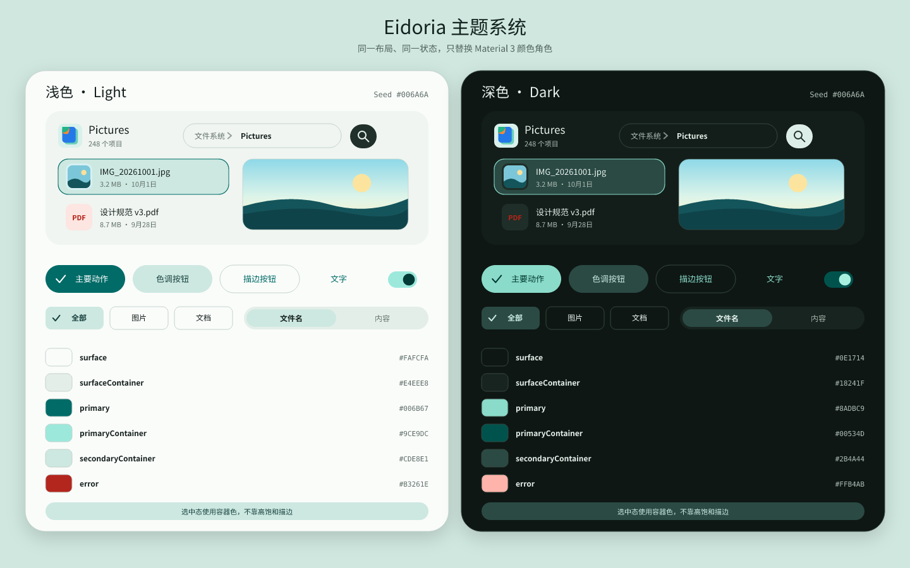

深色稿的三条硬规则：

- 图片、PDF 纸张和代码编辑器不跟随应用表面一起“压黑”；PDF 保持纸色，代码保持自己的深色语法面。
- 文件类型色只用于小面积图标井和图表，不给正文染色；深色下图标井统一先落到容器色，再放类型色字形。
- 浮层阴影在深色下改靠一档表面提亮 + 1px 描边分层，不能只堆黑影。

### 2.3 画布与断点

| 概念稿 | 画布 | 形态 |
|---|---:|---|
| Large 浏览器 | 1440 × 900 | 永久抽屉 + 标签 + 网格 + 预览侧栏 |
| Compact 浏览器 | 390 × 844 | 顶部导航 + 搜索岛图标 + 悬浮预览 + 底部导航 |
| Medium 悬浮预览 | 768 × 1024 | 导轨 + 网格 + 可移动悬浮预览 |
| 双窗格 | 1600 × 1000 | ExtraLarge 双会话 + 活动窗格预览 |
| 其余桌面规划页 | 1440 × 900 | 沿用同一抽屉和主工作卡，不另 invent 一套壳 |


### 2.4 Material 3 Skill 审计：文字预算与标签页

v3 的生成约束来自 [hamen/material-3-skill](https://github.com/hamen/material-3-skill) 的 `SKILL.md` 及 Tabs/导航、排版与形状、响应式布局参考；它是设计审计依据，不是运行时依赖。落到 Avalonia 时仍使用 Md3.Avalonia 的语义 Token，不在业务 XAML 散写 HEX。

**文件标签页回到初版概念图的连接形态：**

- 桌面标签条位于主工作面的**顶缘**，与窗口标题区同排；活动页签与下方工作面使用同一 `surface`，顶部圆角、底边无缝相连，未激活页签平放在 `surfaceContainerLow` 层架上，只带小图标、短标题、关闭 ×，末尾是新建 +。
- 文件页签不是分段按钮：禁止把整组页签画成漂浮胶囊、卡片内第二层页签或每个窗格各一份胶囊标签。活动指示只保留细线或同面连接，不再叠加整圈描边。
- “预览 / 属性”是 MD3 **Secondary Tabs**：只有两个短标签，活动项用 `primary` 文本和顶部圆角的 3dp 指示线，基线使用 `outlineVariant`；不要在它上方再重复一遍“预览 / 属性”标题。
- Compact 不硬塞桌面标签条：顶栏用叠层页签图标 + 数量徽标表示已折叠的会话；底部 Navigation Bar 仍按 MD3 保留图标与短标签，不能与文件页签混为一谈。

**文字预算（概念图和后续实现共同执行）：**

| 类型 | 处理 |
|---|---|
| 应用名、导航目的地、面包屑、文件名、查询词 | 保留短文本 |
| 每张文件卡的元数据 | 只留一个数值：大小、项目数或页码，不并列类型/日期/路径说明 |
| 新建、剪切、复制、粘贴、重命名、删除、排序、视图、筛选 | 图标按钮；实现时必须补 Tooltip 与无障碍名称 |
| 存储类别、索引状态、权限、文件类型 | 图标 + 进度/开关/数字，不写解释句 |
| 分区标题、功能介绍、快捷键提示、状态长句、页脚说明 | 删除 |
| 删除/覆盖等破坏性确认 | 例外：只保留一行影响范围和恢复动作，不用纯图标替代安全信息 |

**统一的 MD3 几何与层级：** 8dp 间距体系（Compact 边距 16dp、栏距 8dp，桌面栏距可放大到 24dp）；卡片 `medium` 12dp、浮窗/抽屉优先 28dp 大圆角、芯片 8dp、按钮与搜索 `full`；深度首选色调表面而非阴影；选中态使用配对的 `secondaryContainer / onSecondaryContainer`；分隔线用 `outlineVariant`，`outline` 只留给输入框等重要边界。标题、文件名和按钮分别落到 Title、Body、Label 字阶，不用正文段落填补界面层级。

---

## 3. 当前基线（对齐 v0.11，只做视觉抛光）

### 3.1 Large 浏览器 · 深浅成对


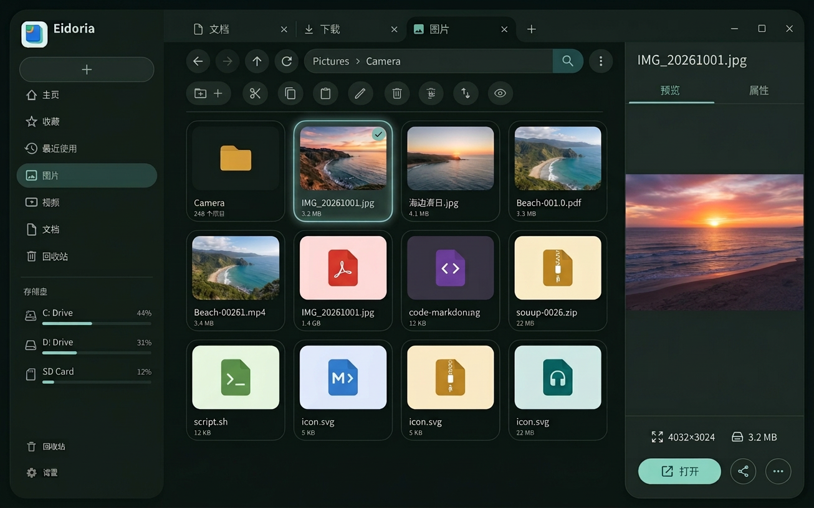

定版要点：

- 标签、路径胶囊、搜索岛和溢出按钮同处导航层；点路径分段只跳转，点空白才进入编辑。
- 网格卡的缩略图区域占主导，文件名与大小退到卡底；代码、PDF、图片用真实内容微缩预览，其余类型才用图标井。
- 预览标签下只保留内容与 3 个快速事实 Chips；完整元数据不再挤回预览页。
- 深色与浅色保持同尺寸、同选集、同滚动位置，方便逐像素对照状态色。

### 3.2 Compact 浏览器 · 深浅成对

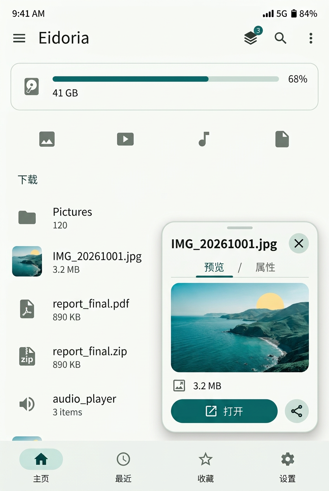

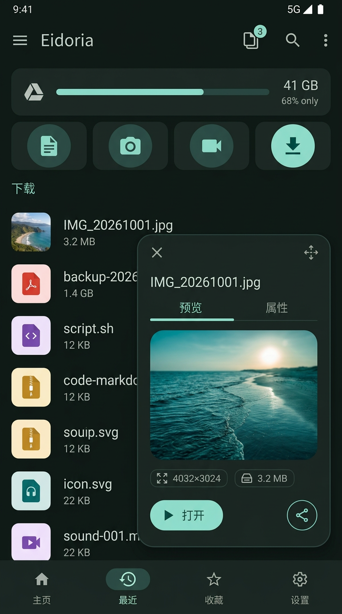

定版要点：

- 悬浮窗从导航行下方出现，不能遮住路径胶囊与搜索岛；用户始终知道自己还在哪个文件夹。
- 浮窗标题栏、文件名和双页签三层不能互相抢标题：标题栏给窗口控制，正文标题给文件身份。
- 预览图下方只放尺寸、大小、所在文件夹三枚快速事实；长属性进入第二页滚动。
- 底部导航保持可见，浮窗关闭后选集与滚动锚点不变。

### 3.3 Medium · 属性页悬浮窗

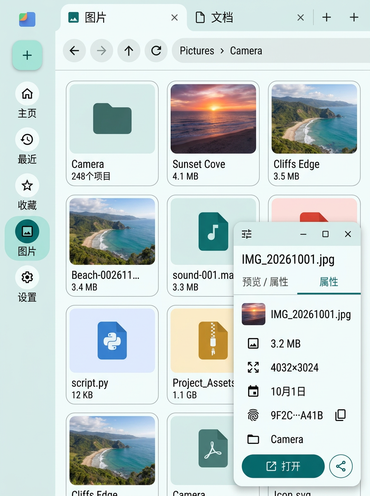

Medium 不提前长成桌面三栏：导轨与网格仍是主角，预览以可移动浮窗覆盖右侧，利用平板空间但不永久吃掉一列。此图特意停在“属性”页，证明双页签不是只为图片预览服务；校验和被做成一张可复制的事实卡，而不是埋在长菜单末尾。

---

## 4. 近期核心规划（建议实现顺序）

### 4.1 ① 搜索与索引中心（M3）

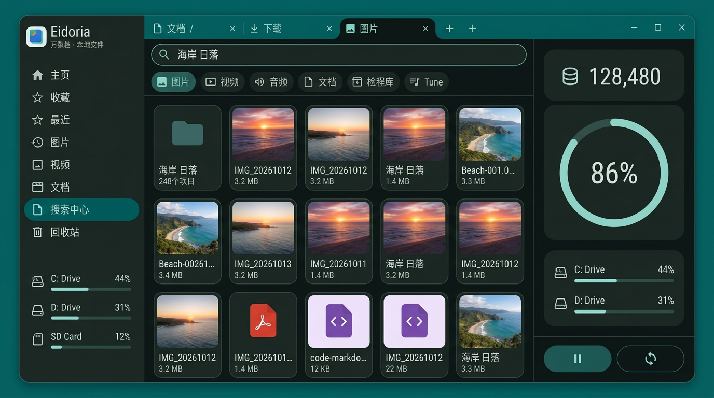

**样式结构：**

- 搜索岛展开后仍负责“当前文件夹即时筛选 / 递归搜索”；搜索中心是独立目的地，负责跨根索引、筛选与索引健康，不替代迷你搜索岛。
- 顶部模式分段只先启用“文件名 / 正文”；“语义”明确标注为后续，避免把本地 AI 偷跑进近期范围。
- 左列是可滚动筛选：索引根、类型、时间；中列结果必须显示父路径与正文片段；右列固定显示索引体积、更新时间、失效条目和正文索引开关状态。
- 隐私卡不是装饰：清空索引、移除根目录、暂停维护必须与搜索结果同屏可达。

**响应式：** Large 为三列；Expanded 合并右列为可展开的索引状态条；Compact/Medium 改为“搜索框 → 筛选 Sheet → 结果列表”，索引管理进入设置子页。

### 4.2 ② 存储洞察（P2）

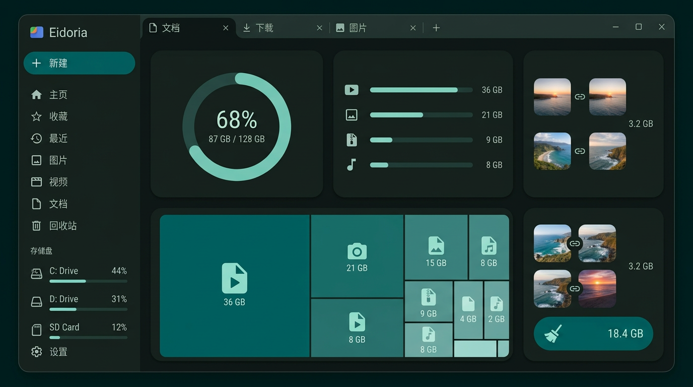

**样式结构：**

- 首屏先回答三件事：总共用了多少、什么类型占得最多、哪些空间只是“可复核”而不是可直接删除。
- 空间地图用面积块定位文件夹；点击块只定位，不在图上直接放删除按钮。
- 重复文件按组复核：缩略图并排、默认保留一份、其余标为候选；“加入复核”之后仍要经过任务确认，绝不做一键清理。
- 大文件列表给定位与预览两个非破坏动作；删除入口留到文件上下文中。

**响应式：** Compact 改为总览卡 → 类型条 → 大文件列表的单列滚动；重复组改成一次只看一组的全宽卡。

### 4.3 ② Android 存储授权与应用内回收站（P2）

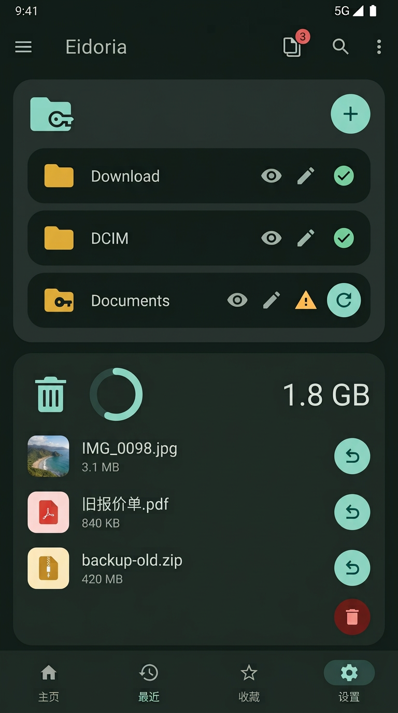

**样式结构：**

- 已授权文件夹必须逐项显示读写范围与有效状态；失效授权用错误文本 + “重新授权”，不自动从列表消失。
- 应用内回收站单独显示配额与自动清理周期；还原是每行主动作，永久删除只用图标并走强确认。
- “授权新文件夹”是页面唯一实心主按钮；“清空回收站”用错误容器色，但不与主按钮同权。

**边界：** 此图不引入“所有文件访问”侧载变体，仍沿用 SAF 授权优先的既定决策。

### 4.4 ③ 压缩包工作台（近期增强）

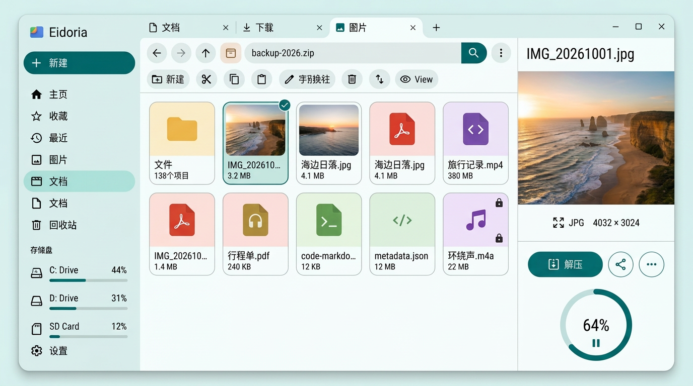

**样式结构：**

- 压缩包被当作只读虚拟文件夹：左树、中表、右条目预览，面包屑第一段是压缩包本身。
- 表格同时显示原始大小与压缩后大小；单条目可以直接预览，不要求先整包解压。
- 解压目标、保留结构、覆盖前询问、完成后打开文件夹四项在右侧一次说清；开始后转为底部任务条。
- “解压全部”与“解压所选 / 仅提取”分开，避免一个含糊的“提取”按钮承担三种语义。

**响应式：** Compact 收为条目列表，目录树与解压选项改为底部 Sheet；条目预览继续走悬浮窗。

### 4.5 ③ 冲突解决与任务详情（近期增强）

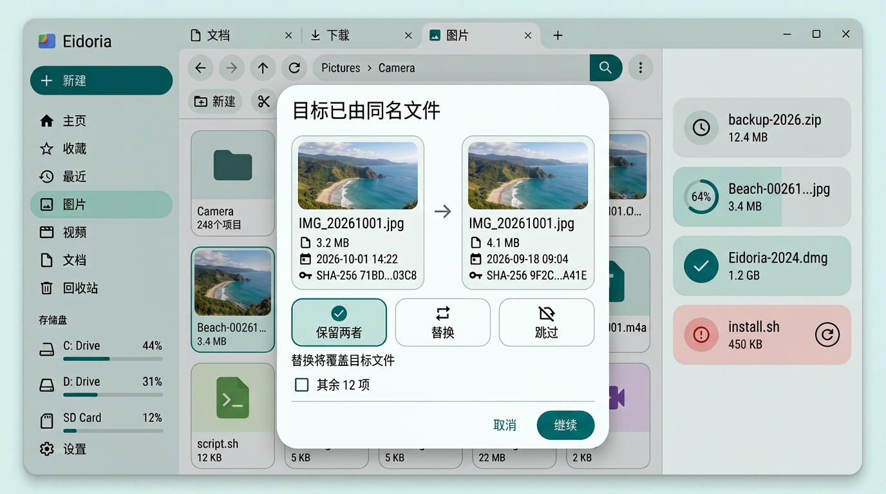

**样式结构：**

- 冲突对话框先并排展示来源/目标的缩略图、大小、时间和校验和，再让用户选保留两者、替换或跳过。
- 默认推荐“保留两者”；“应用到剩余同类冲突”是显式勾选，不预选。
- 任务中心展开为右侧详情栏：等待确认、排队、完成、失败四态同屏；失败给具体原因与重试，不只显示红条。
- “取消任务”与“继续任务”分置两端，危险动作不放在回车默认焦点上。

**响应式：** Compact 对话框改为全屏单列比对卡，任务中心变为底部 Sheet；冲突计数必须常驻。

---

## 5. Phase 2 规划

### 5.1 ExtraLarge 双窗格

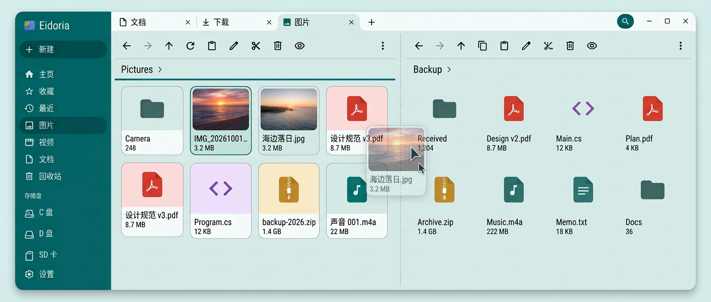

定版方向：

- A/B 是两个完整 `BrowserSession`，各自有面包屑、选集和滚动位置；活动窗格用主色描边与“活动”标示，B 不靠降低文字对比度假装禁用。
- 跨窗格拖放默认移动，拖影上直接写明 `Ctrl = 复制`；工具栏只作用于活动窗格，跨窗格动作收在预览侧栏的专用区。
- 宽度跌回 Large 时，B 自动收为后台标签并保留会话；恢复双窗格不重建路径。
- Medium/Compact 不做双窗格，继续用标签与系统返回完成跨文件夹操作。

### 5.2 文本轻编辑与 PDF 阅读工作台

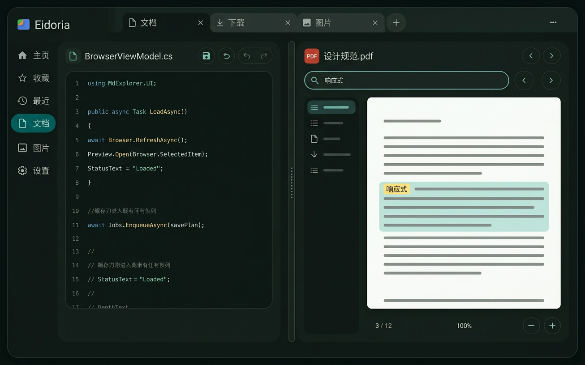

定版方向：

- 预览默认只读；进入编辑后才出现“已修改”点、保存与格式化。保存仍进入既有任务队列，并在落盘前显示差异与外部修改冲突。
- PDF 从单页分页升级为连续滚动 + 目录 + 文档内搜索；命中高亮留在纸面内，纸张在深色主题下不反色。
- 文本朗读入口放在编辑/预览工具栏，而不是 AI 页面；它属于无障碍能力，不把 OS 原生 TTS 包装成本地模型。
- Compact 不做左右对照：同一文件类型一次只占满一个悬浮窗或整页。

> **v0.20 实现对齐（第一切片）**：真实界面已落地独立文档工作台的本地文本显式轻编辑、任务化安全保存、外部修改冲突与有界差异摘要；PDF 已有单页纸面、缩略图轨、缩放/旋转重渲染、跳页与密码解锁。Compact 实拍收起缩略图轨与次级 PDF 动作。
>
> **v0.22 实现对齐（第二切片）**：PDF 已支持与单页共用状态的连续滚动，页面进入视口后按需渲染并同步当前页；概念图中的目录、文档内搜索高亮和文本朗读仍是后续目标，不得据图宣称完成。

---

## 6. 远期与最后轨道

### 6.1 内置媒体播放（D-03 之后再议）

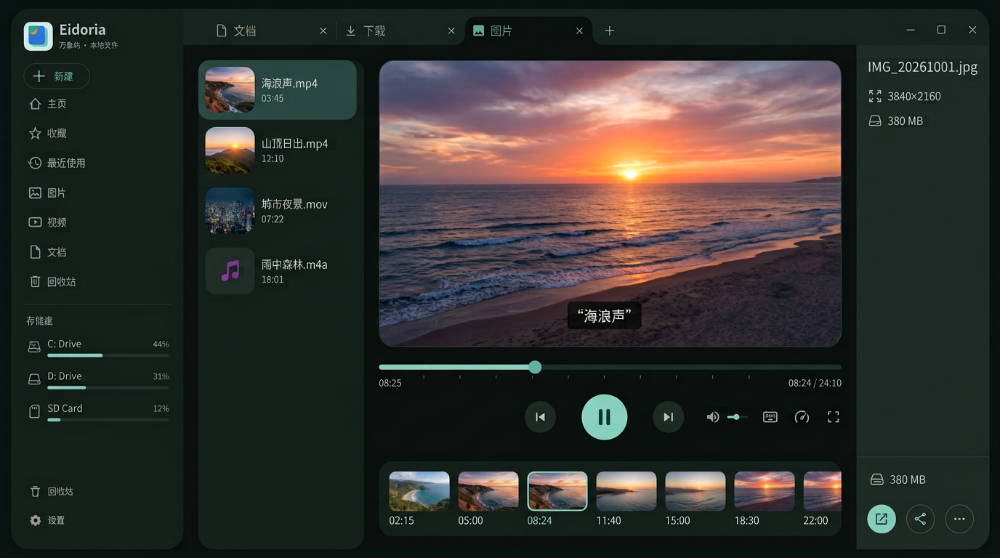

这张图只锁定未来样式，不改变“当前版本音视频仍为元数据卡 + 系统打开”的范围。若将来引入播放器：左侧是队列，中央是舞台与章节时间线，下方字幕区可直接跳转；音频复用同一队列，不另造一个音乐应用壳。是否落地仍取决于 LGPL 动态链接、体积和三平台后端结论。

### 6.2 插件中心与 Lua 脚本（最后）

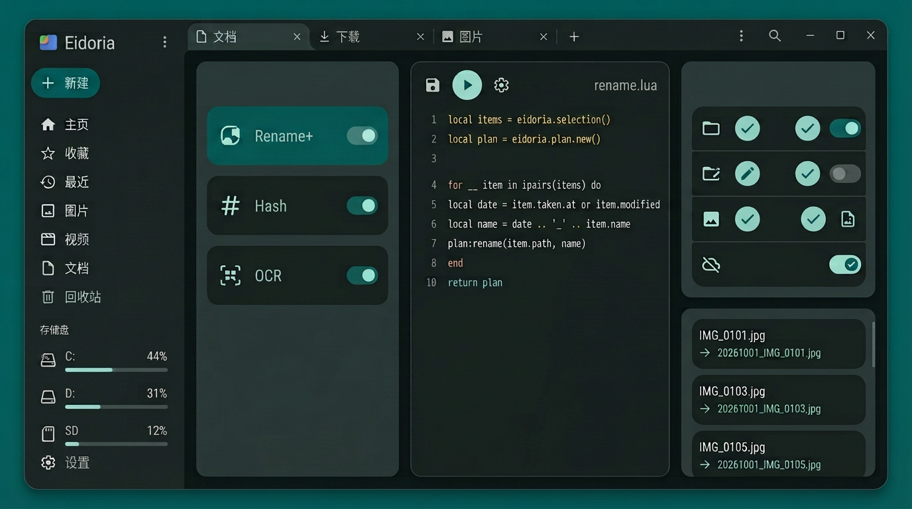

界面顺序必须与安全模型一致：**已安装与权限 → 脚本/配置 → 操作计划确认**。脚本输出区要明确写“等待确认，尚未写入磁盘”；任何批量写操作都以旧名 → 新名逐项呈现。Android 商店版限制以错误卡常驻说明，不能用灰色开关含糊带过。

### 6.3 本地 AI 语义搜索（最后）

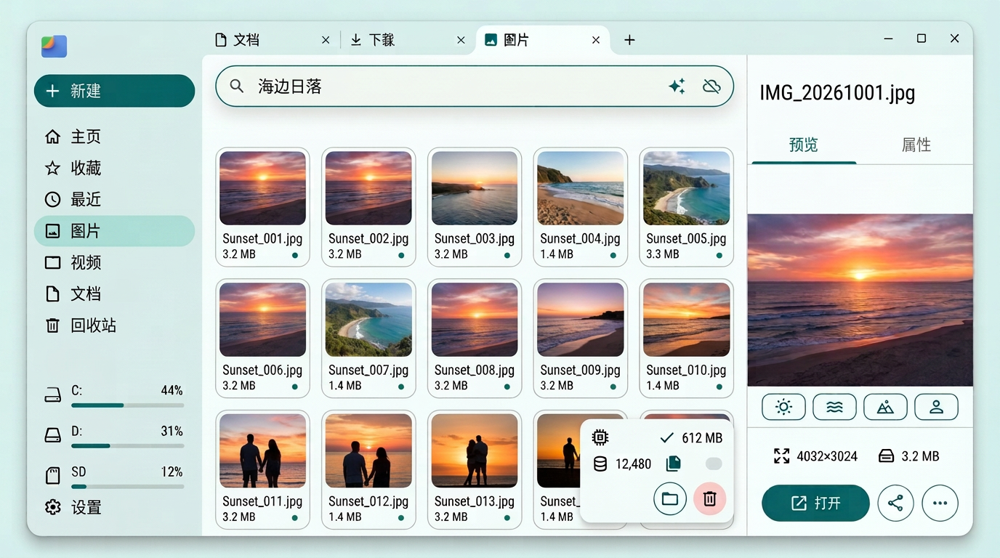

本地 AI 入口不做聊天机器人首页：第一屏仍是搜索框、结果网格和文件预览。模型卡必须同时显示模型体积、下载状态、索引根和可删除入口；结果徽标只表达相对相关度，不把百分比伪装成事实置信度。标签默认只进入本地索引，不修改 EXIF 或原文件。

---

## 7. 推荐实现顺序（只排设计优先级）

| 顺序 | 界面 | 理由 |
|---:|---|---|
| 1 | 搜索与索引中心 | 路线图 M3 的核心出口，且能复用现有悬浮搜索面板的查询状态 |
| 2 | 存储洞察 + Android 存储管理 | 都是只读或低风险管理面，先建立“复核而非自动清理”的安全心智 |
| 3 | 压缩包工作台 + 冲突/任务详情 | 直接补强现有 ZIP 与任务中心，收益覆盖所有平台 |
| 4 | 双窗格 + 编辑/PDF 工作台 | Phase 2 的桌面效率项，焦点、拖放与保存冲突成本最高 |
| 5 | 内置媒体播放 | 受 D-03、许可与分发形态约束，后议 |
| 6 | 插件中心 + 本地 AI | 已明确排最后；先 spike，再谈正式入口 |

## 8. 从概念图落到实现时的验收单

- [ ] 同一页面的浅色、深色截图只换颜色角色，不换布局、选集和文案。
- [ ] Compact 触控目标不小于 48dp；搜索岛、路径分段和浮窗控制不重叠。
- [ ] 所有长内容都有明确的 `MdScrollViewer` 边界，菜单与 Sheet 不把动作挤出屏幕。
- [ ] 预览与属性仍是两个页签；切换页签不重新加载文件，也不丢 PDF 页码/文本选区。
- [ ] 破坏性动作先显示影响范围与恢复方式；默认焦点不在删除、替换或清空上。
- [ ] 空态、加载、失败、无权限和离线卷都有与本套图一致的卡片层级，而不是临时文字页。
- [ ] 规划页在未实现前不进入正式导航，README 与商店截图不得把概念图冒充实拍。
- [ ] 每张文件卡最多一行元数据；工具栏默认图标化，但 Tooltip/无障碍名称齐全，破坏性确认仍保留一行影响说明。
- [ ] 桌面文件页签位于工作面顶缘且活动页签同面相连；预览使用 MD3 Secondary Tabs，Compact 使用带徽标的页签图标折叠会话。

## 9. 重新生成结构稿

```bash
# 只需要 Python 3；有 resvg_py 时会同时导出结构 PNG 与 contact-sheet.png
python3 scripts/generate-concept-mockups.py

# 中文 PNG 渲染建议显式提供 Noto Sans CJK / Noto Sans SC
EIDORIA_FONT_REGULAR=/path/to/NotoSansCJKsc-Regular.otf \
EIDORIA_FONT_BOLD=/path/to/NotoSansCJKsc-Bold.otf \
python3 scripts/generate-concept-mockups.py
```

SVG 只作为结构源稿：改配色先改生成器中的 `LIGHT` / `DARK`，改布局先改对应场景函数。`ai-v3/` 高保真图须以结构稿为参考、用图像模型重新直接生成，不能用上面的 SVG 导出结果替代。
