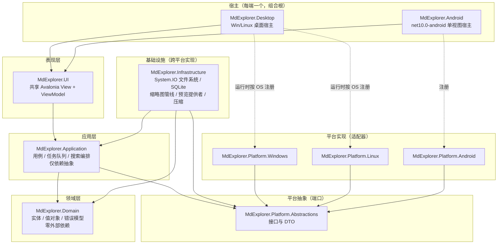

# Eidoria（万象屿）开发文档（内部代号 MdExplorer）

> 基于 **Avalonia 12 + .NET 10** 的跨平台（Windows / Linux / Android）本地文件资源管理器，采用 **Material Design 3** 风格，**Native AOT 优先、响应式（Adaptive）优先、核心平台无关**。

| 元数据 | 说明 |
|---|---|
| 文档版本 | v1.0（2026-10-25） |
| 文档状态 | 评审稿 — §17 列出仍需拍板的决策，决策闭合后冻结为 v1.0 正式版 |
| 适用范围 | MdExplorer 首个可发布版本（MVP）及紧随其后的一个增强阶段（Phase 2） |
| 技术基线 | .NET `10.0`（LTS）、C# 14、Avalonia `12.1.x`（锁定 `12.1.4` 起）、`Md3.Avalonia 0.5.0-preview.2` |
| 配套文档 | [响应式布局设计（RESPONSIVE-LAYOUT.md）](RESPONSIVE-LAYOUT.md) · [布局图提示词（IMAGE-PROMPTS.md）](IMAGE-PROMPTS.md) |

**本文档如何读：** §1–§3 回答「做什么、用什么做」；§4–§6 是架构与功能的规范主体，编码时以此为准；§7–§11 是跨端一致性、平台差异与 AOT 合规的硬约束；§12–§16 是质量、发布与排期；§17 是风险与待决策清单。所有接口签名、项目结构、断点数值均为**规范性**的（实现不得自行更改数值，如需调整走变更：改文档 + 改代码同一提交）。标注 `Spike` 的条目须先写最小验证工程跑通（含 AOT 发布）才可进入主干，见 §16 M0。

---

## 目录

1. [项目概述](#1-项目概述)
2. [设计原则](#2-设计原则)
3. [技术选型与版本锁定](#3-技术选型与版本锁定)
4. [总体架构与分层设计](#4-总体架构与分层设计)
5. [核心抽象设计](#5-核心抽象设计)
6. [功能规格](#6-功能规格)
7. [响应式（Adaptive）设计总纲](#7-响应式adaptive设计总纲)
8. [Material Design 3 规范与 UI 实现](#8-material-design-3-规范与-ui-实现)
9. [平台适配设计](#9-平台适配设计)
10. [数据与存储设计](#10-数据与存储设计)
11. [AOT 与 Trim 合规规范](#11-aot-与-trim-合规规范)
12. [性能设计与指标](#12-性能设计与指标)
13. [安全与隐私](#13-安全与隐私)
14. [测试策略](#14-测试策略)
15. [构建、发布与 CI/CD](#15-构建发布与-cicd)
16. [开发路线图与里程碑](#16-开发路线图与里程碑)
17. [风险与待决策事项](#17-风险与待决策事项)
18. [附录](#18-附录)

---

## 1. 项目概述

### 1.1 产品定位

MdExplorer 是一款**仅面向本地磁盘**的跨平台文件资源管理器：一套共享 UI 与业务逻辑，同时交付 Windows、Linux 桌面端与 Android 移动端；三端提供一致的心智模型（浏览 → 选择 → 操作/预览），但按屏幕尺寸与输入方式呈现**不同的布局形态**（见 §7 与配套布局文档），而不是把同一个窗口拉伸缩放。

同时，MdExplorer 是 `Md3.Avalonia` 组件库的**旗舰验证应用**：文件管理器对导航、搜索、列表虚拟化、对话框、菜单、Snackbar、底部工作表（Bottom Sheet）等组件有高频、真实的压力，适合反哺组件库在真机与 AOT 场景下的缺陷。因此选型上优先使用 `Md3.Avalonia` 已有组件；缺口组件（如面包屑的紧凑形态、大列表的分组头）先在 MdExplorer 内部实现，成熟后再评估回流组件库（见 §17 R-01）。

### 1.2 目标与非目标

**目标（MVP 必须全部达成）：**

1. 三端可用：Windows 10/11（x64、arm64）、主流 Linux 发行版（x64、arm64；X11 与 Wayland）、Android 9（API 28）及以上（arm64 为主，兼顾 x86_64 模拟器）。
2. 完整的本地文件管理闭环：浏览、搜索、预览、创建/重命名/复制/移动/删除（含回收站语义）、压缩与解压、属性查看、用系统应用打开与系统共享。
3. 真响应式：五档断点（Compact / Medium / Expanded / Large / ExtraLarge）各有独立布局形态；同一 ViewModel 驱动多套 View；旋转、折叠屏展开、桌面窗口拖拽跨越断点时状态不丢失。
4. Native AOT 可发布：桌面端 `PublishAot=true` 零 IL2xxx/IL3xxx 警告（白名单除外且须登记理由）；Android 端开启 Trimming + AOT 编译且功能完整（见 §11 对两种 AOT 的区分）。
5. 性能达标：1 万个条目的文件夹可流畅滚动（指标见 §12）；冷启动桌面 ≤ 800 ms、Android 中端机 ≤ 1.2 s。

**非目标（明确不做，避免范围蔓延）：**

- ❌ 网络存储：WebDAV、SMB、FTP、NFS、云盘——本期一律不做。但抽象层**不得把「文件 = 本地路径字符串」写死**，以便未来增加 Provider 时不推翻核心（见 §5.2 `FileLocator` 设计；注意：仅预留定位符抽象，不预留任何网络代码）。
- ❌ 完整编辑器：文本/代码仅做预览 + 轻量编辑（小文件）；图片不做编辑；Office 文档不做排版级渲染（见 §6.5 降级策略）。
- ❌ 同步、备份、重复文件清理、磁盘清理类「管家」功能。
- ❌ root / 提权浏览系统目录；需要权限时引导用户走系统授权（Android SAF）或给出明确的无权限提示，不绕过系统安全模型。
- ❌ iOS / macOS / WebAssembly 交付——架构保持可移植（不写死桌面假设），但本期不做宿主、不做测试矩阵。

### 1.3 目标用户与使用场景

| 用户 | 典型场景 | 对设计的含义 |
|---|---|---|
| 桌面效率用户 | 大文件夹批量整理、双窗格对照、键盘全程操作、按条件筛选 | 多标签、详细信息视图、完整快捷键、批量冲突处理（§6.2、§6.3、附录 B） |
| Android 移动用户 | 找刚下载的文件、看照片/PDF、把文档共享给聊天应用、清理大文件 | SAF 授权引导、类别入口（图片/视频/文档…）、大触控目标、底栏导航（§6、§7） |
| 开发者 | 浏览代码目录、看源码与日志、校验文件哈希、解压日志包 | 代码高亮预览、Hex 兜底、校验和（Phase 2，§6.5/§6.10） |

### 1.4 成功标准（发布门槛）

MVP 发布须同时满足：三端功能清单 §6 中全部 `MVP` 项在真机/实机验收通过；AOT 门（§11.5）全绿；自动化测试与断点截图测试（§14）在 CI 常绿；大目录性能指标（§12）达标；第三方许可证清单（§3.5）随包分发且无 AGPL/GPL 依赖混入。

---

## 2. 设计原则

以下七条原则优先级从高到低，冲突时按序裁决。Code Review 时以原则编号引用（如「违反 P2」）。

- **P1 核心平台无关。** 领域与应用层禁止出现 `OperatingSystem.IsXxx()`、盘符、`\` / `/` 拼接、`System.IO` 具体路径假设、P/Invoke、Android 类型。平台差异只能经 §5 的接口进出；平台项目只能被宿主（Host）引用，UI 与应用层连平台项目的程序集都不引用。
- **P2 AOT 优先于便利。** 凡有两条路可选、一条要反射/动态代码、一条要源生成/显式注册，永远选后者。引入新 NuGet 的准入条件：宽松许可证 + `IsAotCompatible`（或有本仓库的 Spike 实测证据）+ 支持 Avalonia 12 / .NET 10。达不到就换方案或自己写最小实现（§3、§11）。
- **P3 响应式是布局切换，不是缩放。** 禁止用 `Viewbox` 或整体 `RenderTransform.Scale` 适配小屏。断点变化要改变**导航形态、栏数、信息密度与操作入口位置**（§7）。同一功能在不同断点可以「入口不同」，但能力必须等价（手机上能完成的事，不能仅因为断点低就缺席，只能收纳到菜单/工作表中）。
- **P4 一套状态，多套视图。** ViewModel 不感知断点之外的 View 细节；View 按断点拆分、共享 ViewModel。断点切换（旋转、拖窗、折叠展开）是 View 的替换，绝不重建导航栈与选择状态。
- **P5 文件操作要可预期、可取消、可追溯。** 一切写操作走任务队列（§5.5）：有进度、可取消、冲突策略显式、结果可通知；删除默认进回收站（平台支持时），彻底删除二次确认；任何失败要给出可读原因与下一步（重试/跳过/授权），禁止吞异常后假装成功。
- **P6 本地优先与隐私默认关。** 无账号、无网络请求、无默认遥测。缩略图与搜索索引只存本机应用数据目录；全文内容索引属增强能力，默认关闭、开关明确（§6.4、§13）。
- **P7 先验证最险处。** 排期上把「Android SAF 全流程、Md3 大列表虚拟化、AOT 发布链路」放在 M0 先打通（§16），而不是先做顺手的桌面列表页。上游选型结论如与实测冲突，以实测为准并回写 §3/§17。

补充约定：优先用成熟第三方库而非手写（文件格式解析、图片解码、压缩、语法高亮等「手写必错」的领域尤其如此），但 P2 与许可证门槛（§3.5）不过关的库一律不用；确无合适库时，宁可砍功能或做隔离的平台实现（如视频播放，见 §3.3、§6.5），也不让问题库污染核心。

---

## 3. 技术选型与版本锁定

### 3.1 基线版本（锁定表）

依赖版本全部收口到仓库根 `Directory.Packages.props`（Central Package Management），各 `.csproj` 只写 `PackageReference Include` 不写 `Version`。升级基线须单独 PR 并附 AOT 回归结果。

| 组件 | 锁定 | 说明 |
|---|---|---|
| .NET SDK / TFM | SDK `10.0.1xx`、`net10.0` / `net10.0-android` | .NET 10 为 LTS；Avalonia 12 对 Android/iOS 宿主仅支持 .NET 10，故不设多目标 `net8.0` 兼容分支，简化矩阵。`global.json` 固定 SDK 大版本 |
| 语言 | C# 14 | 可用 `field` 关键字、扩展成员等新特性；禁止依赖运行时反射语法的「魔法」特性 |
| Avalonia | `12.1.4`（以立项时最新稳定版为准） | MIT。12 的关键收益：Android 后端重构（官方称 NativeAOT 冷启动 1960→460 ms 级）、编译绑定默认开启、SkiaSharp 3.0、开源 WebView（本期不依赖）。注意：12 大版本二进制不兼容，所有第三方 Avalonia 库须为针对 12 的构建 |
| Md3.Avalonia | `0.5.0-preview.2`（`Md3.Avalonia` + `Md3.Avalonia.Icons.Lite`，按需加 `.DataGrid` / `.AvaloniaEdit` / `.Markdown` / `.Extra` / `.NodifyM` / `.Notifications` 主题与控件包） | Apache-2.0，自有库；核心与 Extra 包目标 `net8.0;net10.0`，声明 `IsTrimmable` / `IsAotCompatible`，HCT 动态配色（49 色角、6 方案、3 对比度），组件覆盖导航/搜索/对话框/列表/自适应布局（`MdAdaptiveLayout` 优先评估复用，见 §7.3）；`.Extra` 自 v0.11 起只取 `MdFloatingWindow` 承载窄断点悬浮预览；v0.21 起 `.NodifyM` 只在自动化页局部注册 `MaterialNodifyMTheme`，`.Notifications` 只经自有平台端口适配。风险：仍处 preview，API 可能变更——缓解：版本钉死、升级走独立 PR、UI 层对 Md3 类型的使用收敛在自有控件/主题资源中（§17 R-01） |
| MVVM | `CommunityToolkit.Mvvm 8.x` | MIT。纯源生成（`[ObservableProperty]` / `[RelayCommand]`），零运行时反射，AOT 安全。禁止 `ReactiveUI`（其当下版本在 Avalonia AOT 下仍有大量 trim 警告与破坏性迁移） |
| DI | `Microsoft.Extensions.DependencyInjection 10.x` + **显式注册** | MIT。仅用运行时容器做组合根注入；**禁止**程序集扫描/`Scrutor` 式约定注册；注册表集中写在各宿主 `CompositionRoot`。单测时可直接 `new`，ViewModel 构造注入口面要小 |
| 序列化 | `System.Text.Json` **源生成**（`JsonSerializerContext`） | MIT。禁止无 Context 的反射重载、禁止 `Newtonsoft.Json` |
| 本地数据库 | `Microsoft.Data.Sqlite 10.x` + 手写 SQL（索引/收藏/历史） | MIT，Native AOT 兼容；自带 `e_sqlite3` 原生库。禁止 EF Core（Native AOT 仍为实验状态）。`sqlite-net` 等反射式 ORM 同理禁用；数据访问保持薄（Repository + 手写映射） |
| 图像 | `SkiaSharp 3.x`（随 Avalonia） | MIT（Skia 本体 BSD-3）。解码/缩略/EXIF 方向/编码均走它，不再引入第二套图像库（`ImageSharp` 许可证为分置许可、商用需确认，且与 Skia 功能重叠——禁用） |
| 日志 | `Microsoft.Extensions.Logging` 抽象 + 自有文件 Sink | 抽象为 MIT且 AOT 友好；重型日志框架（如依赖动态配置的）不引入。日志永不记文件内容与完整路径以外的敏感信息（§13） |
| 测试 | `xUnit v3` + `Avalonia.Headless.XUnit` + `Microsoft.NET.Test.Sdk` | 均为宽松许可；断点截图基线用仓库内 PNG + 像素容差比较（§14） |

### 3.2 功能库选型表

结论列：**首选** = 直接采用；**Spike** = 先验证 AOT 与 Avalonia 12 兼容再采用（M0）；**隔离** = 仅放在平台/预览模块、核心不感知；**禁用** = 不得引入并在 PR 模板中列为检查项。

| 能力 | 候选 | 许可证 | AOT / A12 状态 | 结论与用途边界 |
|---|---|---|---|---|
| 文本/代码预览与轻编辑 | `AvaloniaEdit` + `Md3.Avalonia.AvaloniaEdit` 主题 | MIT | 须确认为 Avalonia 12 构建；其 XML 高亮定义加载路径要验证 Trim 后可用 | **Spike 后首选**。只读预览为主；大文件（>2 MB）禁用语法高亮只显纯文本片段（§6.5） |
| Hex 查看 | `AvaloniaHex`（对应 `Md3.Avalonia.AvaloniaHex` 主题）或自写虚拟化只读十六进制视图 | 以所选包为准（采用前登记） | 未知 | **Spike** 后二选一；兜底方案是自写只读视图（功能小、可控），定位为「未知二进制」的最后降级 |
| Markdown 预览 | `Markdig`（解析）+ 渲染控件（`Markdown.Avalonia` 系或 Md3 Markdown 主题对应上游） | Markdig BSD-2；渲染控件以所选为准 | 渲染控件历史上有反射式样式绑定，需实测 | **Spike**。渲染控件若 AOT 不过关，则用 Markdig 生成文档对象 + 自有 `TextBlock`/`Inline` 只读渲染子集（标题/段落/列表/代码/链接/图片），禁止内嵌 WebView 渲染本地 Markdown |
| PDF 预览（桌面） | `PDFtoImage 5.2.1`（PDFium + SkiaSharp，页渲染为位图） | MIT；PDFium 本体 BSD-3 类许可 + `bblanchon.PDFium.*` 原生包 Apache-2.0 | 包声明 `IsAotCompatible`，目标含 `net10.0`；PDFium 非线程安全，宿主全进程串行（§6.5） | **v0.6 已采用**。原生库按 RID 打包，体积进 §12 预算 |
| PDF 预览（Android） | 同一 `PDFtoImage 5.2.1`（目标含 `net10.0-android`） | MIT；PDFium Android Apache-2.0 | 包声明 `IsAotCompatible`；Android 宿主直接引用以选中 Android 原生资产；上游标注 API 31+ | **v0.6 已采用**（调整原“系统 `PdfRenderer` 首选”）：一套流式入口可同时覆盖本地与 SAF 字节流，避免为 `ParcelFileDescriptor` 复制临时文件；API <31 时不进入原生渲染并回落系统打开提示。代价是 APK 原生体积，后续以 §12 预算复核 |
| 压缩包 | `SharpCompress` | MIT；纯托管 | 现行版本对 `net8+` 标注 `IsTrimmable/IsAotCompatible`；仅处理数 MB 卷时托管 LZMA 速度可接受 | **首选**（浏览/解压/建包）。RAR 仅解压；加密包提示输密码但密码不落盘。备选 `GrindCore.SharpCompress`（MIT、原生加速、声明 AOT）只在性能实测不达标时启用并复核原生库许可 |
| 内置 ZIP | `System.IO.Compression` | MIT（.NET） | AOT 安全 | 用作 ZIP 快速路径（列表/解压小文件）与 SharpCompress 并存，以接口 `IArchiveService` 收口 |
| 媒体元数据（音视频/图片 EXIF） | `MetadataExtractor`（EXIF 等）/ 图片走 Skia `SKCodec`；音视频标签候选 `TagLibSharp` | MetadataExtractor Apache-2.0；TagLibSharp **LGPL-2.1** | 均需 Spike 验证 Trim | EXIF 首选 Skia + MetadataExtractor（**Spike**）；`TagLibSharp` 为 LGPL 且增加体积——**默认不用**，MVP 只读平台可得的基本元数据（时长/码率经平台层，§9），不足时再评估 LGPL 的动态链接合规（§3.5） |
| 音视频播放 | `LibVLCSharp(.Avalonia)` / 平台播放器（Android `MediaPlayer`、桌面调系统应用） | **LGPL-2.1**（LibVLC） | Avalonia 适配包对 12 的支持与 NativeAOT 静态单文件冲突（LGPL 要求动态链接可替换） | **MVP 不内置播放器**：音频提供封面/元数据/系统打开；视频提供海报帧+元数据+系统打开。是否 Phase 2 引入（且桌面放弃静态单文件形态）列为待决策 D-03 |
| CSV 预览 | 自写流式轻量解析（RFC 4180 子集）或 `CsvHelper` | CsvHelper MS-PL/Apache-2.0 双许可 | CsvHelper 反射映射重 | **自写子集优先**：只用于只读网格预览（前 N 行），不引入映射框架 |
| JSON/XML 预览 | `System.Text.Json`（`JsonDocument`）+ 自有树视图；XML 用 `XDocument` | MIT | AOT 安全 | **首选自写树形预览**（纯展示，无编辑语义） |
| 文件监控 | `System.IO.FileSystemWatcher`（桌）/ Android 平台层 `FileObserver` | MIT / 系统 API | AOT 安全；Linux inotify 上限需处理 | **首选**，封装为 `IDirectoryWatcher` 并做防抖与降级（§9） |
| 哈希（Phase 2） | `System.Security.Cryptography`（SHA-256 等） | MIT | AOT 安全 | 自写流式计算纳入任务队列可取消（§6.10） |
| 全文索引（可选） | SQLite **FTS5** | Public Domain（SQLite） | 随 `e_sqlite3` 原生支持 | **首选**；拒绝 Lucene.NET（AOT 下编解码工厂反射扫描会报 IL2026，且体积过重） |
| 节点编辑器（自动化） | `Md3.Avalonia.NodifyM 0.5.0-preview.2` + 上游 `NodifyM.Avalonia 12.0.0` | Apache-2.0 / MIT | Md3 包装目标 `net10.0` 并声明 `IsTrimmable` / `IsAotCompatible`；上游目标 `net8.0`、显式 `IsAotCompatible=true`，依赖 Avalonia 12、CommunityToolkit.Mvvm 与 `System.Reactive`；声明不替代本项目 Linux Native AOT + Android trimming/AOT 发布门 | **v0.21 已采用但收窄使用面**：只用 Node/Connector/Connection 线性单链与页面局部 `MaterialNodifyMTheme`，不用上游 `ControlStyles`、连线文本标签、连接分裂或 Knot；图定义、校验和执行均由 Domain/Application 自有模型收口，编辑器退出时可替换画布而不迁移数据模型 |
| 系统通知 | `Md3.Avalonia.Notifications 0.5.0-preview.2` | Apache-2.0 | 项目声明 `IsTrimmable` / `IsAotCompatible` 且开启 Trim Analyzer；Windows 资产要求宿主 `net10.0-windows10.0.19041.0`，Android 资产要求宿主直接引用包，Linux 运行时依赖 `libnotify.so.4` 与 freedesktop 通知服务 | **v0.21 已采用并隔离**：Application/UI 只依赖 `ISystemNotificationService` 的标题+正文和四态结果；Windows AppUserModelID 快捷方式与 Android 运行时权限由宿主懒准备。第一版不支持点击回跳、按钮、进度更新、替换/关闭通知；发送失败不得改判已完成的文件任务 |

**禁用清单（PR 检查项，CI 以 `PackageReference` 黑名单脚本拦截）：** `ReactiveUI.*`、`Newtonsoft.Json`、EF Core 全家、`ImageSharp`、`iText.*`（AGPL）、任何 GPL/AGPL 许可的包、Avalonia Accelerate 商业组件（许可证与离线发布约束与本项目开源定位冲突）、依赖 `Assembly.Load*`/代码生成加载插件的框架。Avalonia 官方 `DataGrid` / `TreeDataGrid` 历史上有 Trim 警告（IL2104）——仅当 Spike 证明在 12.1 下零警告时才允许在详细信息视图中使用，否则详细信息视图用虚拟化 `ListBox` + 表头行自实现（§14 亦有对称测试要求）。

### 3.3 关于「优先第三方库」的执行方法

每引入一个 §3.2 之外的新依赖，PR 描述必须附四行结论：① 包与版本、② SPDX 许可证、③ `IsAotCompatible` 元数据或 Spike 证据链接、④ 若不可用/涨体积的退出方案（我们是否已用接口将其隔离）。CI 增加 `scripts/check-licenses.py`：解析 `project.assets.json` 的传递依赖，许可证不在白名单（`MIT, Apache-2.0, BSD-2-Clause, BSD-3-Clause, MS-PL, MPL-2.0(按组件审批), LGPL-2.1(按组件审批)`）即失败。原生库（PDFium、Skia、SQLite）的许可文本随发布物进入 `THIRD-PARTY-NOTICES.md` 并在应用「设置 → 关于 → 开源许可」页可达。

### 3.4 运行时与框架细节

- Avalonia 12 已将编译绑定设为默认（`AvaloniaUseCompiledBindingsByDefault=true`），工程仍显式写入该属性防止模板差异；所有 XAML 必须声明 `x:DataType`。
- 桌面宿主使用 `IClassicDesktopStyleApplicationLifetime`（多窗口、系统托盘属 Phase 2）；Android 宿主使用 `ISingleViewApplicationLifetime` + Avalonia 12 的 `AvaloniaActivity` 多 Activity 能力仅在调系统选择器/共享时经平台层使用，UI 主体保持单 View 栈（§9.3）。
- 字体：UI 字体用各平台系统字体回退（Windows Segoe UI / Linux Noto Sans / Android Roboto+Noto），**不内嵌整套 CJK 字体**（体积）；图标以 `Md3.Avalonia.Icons.Lite` 的 Material Symbols 子集字体为基（Apache-2.0 字体许可），文件类型图标以符号图标 + 扩展名徽标组合，不依赖各平台原生图标主题一致性（桌面可选叠加 Shell 图标为 Phase 2）。等宽字体用于路径/代码预览（Consolas / DejaVu Sans Mono / 系统等宽回退）。
- 本项目源码许可证建议与 `Md3.Avalonia` 对齐为 **Apache-2.0**（利于组件间代码回流），仓库补 `LICENSE` 与 `THIRD-PARTY-NOTICES.md`——属待决策 D-01，未闭合前不对外发布。

### 3.5 许可证合规红线

1. 不得链接 GPL/AGPL 代码进发行物（包括以原生库形式静态链入）。
2. LGPL 组件（未来如启用 LibVLC/TagLib）须保持**独立动态库可替换**分发、附许可与对应源码获取说明，且不得启用会把其静态吞入单文件的发布选项（如 StaticLink 单文件 AOT 形态）——该约束直接影响 D-03 的取舍。
3. Apache-2.0 组件须保留 NOTICES；字体（Material Symbols）保留其许可文件。
4. 每次 Release 由 CI 生成依赖清单（直接 + 传递 + 原生），与 `THIRD-PARTY-NOTICES.md` diff 审核后入包。

---

## 4. 总体架构与分层设计

### 4.1 分层与依赖方向

采用「整洁分层 + 端口/适配器」的务实变体：内层不知道外层，外层经接口使用内层；平台是适配器，不是地基。依赖箭头只允许向下（图中外 → 内）。



要点说明：

- `MdExplorer.Infrastructure` 实现的是「三端行为一致」的逻辑：基于 `System.IO` 的目录枚举与文件读写（桌面全量可用；Android 仅对应用专属目录与已映射为真实路径的位置可用）、SQLite、缩略图解码算法、预览内容提供者、压缩。它通过 `ABS` 的少量钩子（如回收站、打开方式）与平台层协作，自己不做 `IsWindows()` 判断。
- Windows 与 Linux 同属桌面宿主（单一 `MdExplorer.Desktop` 工程按 RID 发布两次），组合根在启动时按 `OperatingSystem` 注册对应平台实现——该判断**只出现在组合根**。
- Android 的 SAF 文件访问与桌面路径模型有本质差异（URI 授权而非路径），由 `MdExplorer.Platform.Android` 内部实现同一组文件系统接口（§5），UI/应用层无感（§9.3）。

### 4.2 解决方案结构（规范）

```text
MdExplorer.slnx                      # .NET 10 SLNX 格式
Directory.Build.props                # 语言/AOT/代码分析全局属性（见 §11.2）
Directory.Packages.props             # 中央包版本管理（唯一版本来源）
global.json                          # SDK 钉版
src/
  MdExplorer.Domain/                 # net10.0，零依赖（连日志抽象都不引）
    Files/  Errors/  Search/  Operations/
  MdExplorer.Platform.Abstractions/  # net10.0，仅依赖 Domain
    FileSystem/  Shell/  Media/  Lifecycle/
  MdExplorer.Application/            # net10.0，依赖 Domain + Abstractions
    Browsing/  Operations/  Search/  Preview/  Settings/  Navigation/
  MdExplorer.Infrastructure/         # net10.0，依赖 Application + Abstractions
    FileSystem/  Persistence/  Thumbnails/  PreviewProviders/  Archives/  SearchIndex/
  MdExplorer.Platform.Windows/       # net10.0，LibraryImport 源生成互操作
  MdExplorer.Platform.Linux/         # net10.0，XDG/freedesktop 规范实现
  MdExplorer.Platform.Android/       # net10.0-android，SAF/MediaStore/PdfRenderer
  MdExplorer.UI/                     # net10.0，依赖 Application + Md3（不引用任何 Platform 实现）
    Views/            # 按断点分：Compact/ Medium/ Expanded/ Shared/
    ViewModels/  Controls/  Themes/  Localization/  Resources/
  MdExplorer.Desktop/                # net10.0 桌面宿主（Win/Linux 按 RID 发布）
  MdExplorer.Android/                # net10.0-android 宿主
tests/
  MdExplorer.Domain.Tests/
  MdExplorer.Application.Tests/      # 假文件系统驱动用例测试
  MdExplorer.Infrastructure.Tests/   # 临时目录真实 IO 测试
  MdExplorer.UI.HeadlessTests/       # 断点布局/绑定/截图基线
  MdExplorer.AotSmoke/               # 最小 AOT 发布冒烟工程（CI 专用）
scripts/
  check-licenses.py  publish-*.sh|ps1  generate-layout-wireframes.py
docs/
  DEVELOPMENT.md  RESPONSIVE-LAYOUT.md  IMAGE-PROMPTS.md  assets/  adr/
```

引用规则用工程级检查锁死（`Directory.Build.props` + 一个遍历 `.csproj` 的 CI 脚本，或架构测试）：`Domain` 不得有 `PackageReference`；`UI` 不得引用 `Platform.*`（含 Abstractions 之外的具体包）；仅宿主可引用平台实现；任何工程不得引用宿主。

### 4.3 组合根与应用生命周期

每个宿主有且仅有一个 `CompositionRoot.Build()`：构造 `ServiceCollection`，按序注册 平台实现 → 基础设施 → 应用服务 → ViewModel（瞬态）→ View 工厂映射表（见下），并在 `App.OnFrameworkInitializationCompleted` 里按生命周期形态装配根 View：桌面 `MainWindow`、Android `MainView`（`UserControl`）——同一 `ShellViewModel`、同一套按断点分发的 View（§7.3），Android 的 Compact 形态与桌面窗口缩到最窄时的 Compact 形态**共用同一批 AXAML**，保证行为被同一套 Headless 测试覆盖。

View 定位禁止约定反射（`ViewLocator` 按类型名拼字符串 + `Activator.CreateInstance` 在 Trim 后会失效）。用**显式映射表**：`IViewFactory` 内部维护 `Dictionary<Type, Func<Control>>`（或按断点三列映射），在组合根逐项 `Register<TViewModel, TView>()`。映射缺失时 Debug 断言 + 返回兜底占位 View 并记一条错误日志。

### 4.4 MVVM 与导航

- ViewModel 基类统一 `ObservableObject`（CommunityToolkit 源生成），异步命令统一 `AsyncRelayCommand` 且带 `CancellationToken`；ViewModel 不引用任何 Avalonia 控件类型，需要弹窗/选文件一律走 §5.7 的 UI 端口接口（`IDialogService` 等在 UI 层实现、接口下沉 Application 层）。
- 导航模型（与断点解耦的「逻辑导航」，物理呈现见 §7）：
  - **浏览器会话 `BrowserSession`**：一个标签页 = 一个会话，持有当前位置、前进/后退栈、选择集、排序/视图模式、搜索态。桌面多标签 = 多会话（上限建议 10）；Android 单会话（系统返回 = 后退栈弹出 → 终止到主页 → 退出）。
  - **路由目的地**：统一为值对象 `Destination`（`Home` / `Folder(FileLocator)` / `Category(图片|视频|…)` / `Recent` / `Favorites` / `Search(query, scope)` / `Trash` / `Settings`），导航 = 对活动会话应用目的地变换，天然支持状态在断点切换时保留。
  - **预览呈现**：单选且预览开 → 预览通道（Expanded+ 为侧栏窗格、Compact/Medium 为全屏查看页或底部上滑 Sheet）；快速查看（桌面空格键）为浮层形态。三者共用同一 `PreviewViewModel`。
- 跨 ViewModel 通信：强类型事件用 CommunityToolkit `WeakReferenceMessenger`（源生成友好）或显式事件聚合接口；禁止字符串键消息与反射分发。

### 4.5 并发与线程模型

- UI 线程只做绑定与布局；目录枚举、缩略图解码、索引、文件复制全部走后台（`Task.Run` / 有界 `Channel` 管线），结果经 `Dispatcher.UIThread` 以**分批**（burst 合并，≤ 每个 vsync 周期一批）方式回填可观察集合，避免逐条通知刷爆 UI。
- 目录内容以 `IAsyncEnumerable<FileItem>` 流式产生：先到先显（文件夹与首屏文件优先），排序在增量数据上最终一致（流结束前显示「正在加载」细进度条而非阻塞空窗）。
- 全局并发预算按设备分级：缩略图并行度 桌面 4 / Android 2；搜索遍历并行度同理；文件写操作全局单队列串行（避免同盘抖动与冲突竞态）。所有长操作接受取消、页面销毁即取消其作用域令牌。

---

## 5. 核心抽象设计

本节给出**规范性接口草案**（命名空间示例）。实现时允许增减参数，但职责边界与「定位符不等于路径」「写操作必经任务队列」两条不可动。

### 5.1 基线值对象与错误模型

```csharp
namespace MdExplorer.Domain.Files;

/// 文件定位符：跨平台统一寻址，刻意不等于本地路径字符串。
/// 桌面是绝对路径；Android 可能是 SAF 树 URI 下的文档定位。
/// 序列化形式带 scheme 前缀，旧数据可迁移识别。
public readonly record struct FileLocator(string Value)
{
    public static FileLocator FromPath(string absolutePath) => new("file:///" + Uri.EscapeDataString(absolutePath));
    public static FileLocator FromAndroidTreeDocument(string treeUri, string documentId) => new($"saf://{...}");
    public bool IsLocalPath => Value.StartsWith("file:", StringComparison.OrdinalIgnoreCase);
    /// 仅当 IsLocalPath 时可调用；路径拼接/父级计算由 IPathService 按平台规则完成，禁止字符串手拼。
    public string ToLocalPath() => ...;
}

public enum FileKind { Folder, Image, Video, Audio, Document, Archive, Code, Text, Executable, Unknown }

public sealed record FileItem(
    FileLocator Locator, string Name, FileKind Kind,
    long? Length,                    // 文件夹为 null（不递归算大小）
    DateTimeOffset LastWriteTime,
    bool IsHidden, bool IsSymlink, bool IsReadOnly,
    string? Extension, string? MimeType);

public sealed record StorageVolume(
    string Id, string DisplayName, FileLocator Root,
    long? TotalBytes, long? FreeBytes, bool IsRemovable, bool IsPrimary);
```

错误模型：应用层之下不抛裸异常跨界。服务接口返回 `Result<T>` / `Result`（自有轻型实现）或以文档化异常集（`FileServiceException` + `FileErrorKind`）表达，二选一并全仓统一——推荐 **`Result<T>` + `FileError`**：

```csharp
public enum FileErrorKind { NotFound, AccessDenied, NameConflict, InvalidName, DiskFull,
                            PathTooLong, IoError, PermissionNotGranted, Unsupported, Cancelled, Unknown }
public sealed record FileError(FileErrorKind Kind, string Message, FileLocator? Locator = null, Exception? Cause = null);
```

`AccessDenied` 与 `PermissionNotGranted` 必须区分：前者是文件系统拒绝（桌面 ACL/Unix 位），后者是「尚未获得授权、授权后可能成功」（Android SAF）。UI 对后者的动作是**发起授权流程**，对前者是解释+系统设置引导。同盘同名、不合法字符等要在触盘前由 `INameValidator`（按目标卷规则校验，规则来自平台层）拦截。

### 5.2 文件系统端口（最重要的接口）

```csharp
namespace MdExplorer.Platform.Abstractions.FileSystem;

public interface IFileSystemService
{
    IAsyncEnumerable<FileItem> ListAsync(FileLocator folder, ListOptions options, CancellationToken ct);
    ValueTask<Result<FileItem>> StatAsync(FileLocator locator, CancellationToken ct);
    ValueTask<Result<Stream>> OpenReadAsync(FileLocator file, CancellationToken ct);       // 调用方负责 Dispose
    ValueTask<Result<Stream>> OpenWriteAsync(FileLocator file, bool overwrite, CancellationToken ct);
    ValueTask<Result<FileLocator>> CreateFolderAsync(FileLocator parent, string name, CancellationToken ct);
    ValueTask<Result<FileLocator>> CreateFileAsync(FileLocator parent, string name, CancellationToken ct);
    ValueTask<Result<FileLocator>> RenameAsync(FileLocator source, string newName, CancellationToken ct);
    ValueTask<Result<FileLocator>> GetParentAsync(FileLocator locator, CancellationToken ct);
    ValueTask<bool> ExistsAsync(FileLocator locator, CancellationToken ct);
}

public sealed record ListOptions(bool IncludeHidden = false, int? MaxCount = null);

/// 卷与已知目录：UI 永不自己推导「文档/下载」在哪。
public interface IVolumeService
{
    ValueTask<IReadOnlyList<StorageVolume>> GetVolumesAsync(CancellationToken ct);
    event EventHandler VolumesChanged;          // U 盘/SD 卡插拔（不可用平台可永不触发并标注能力位）
}

public enum KnownFolder { Home, Documents, Downloads, Pictures, Music, Videos, Desktop, AppData, Cache }
public interface IKnownFoldersService
{
    // 返回 null 表示该平台无此概念或未授权（Android 上多数需 SAF 授权，见 §9.3）
    ValueTask<FileLocator?> GetAsync(KnownFolder folder, CancellationToken ct);
}
```

设计要点：

- **桌面实现**（Infrastructure）：`System.IO.Directory.EnumerateFileSystemEntries` + `FileInfo`/`DirectoryInfo` 惰性枚举；排序与隐藏过滤在应用层管道完成，服务只负责「如实地快速吐条目」。
- **Android 实现**（平台层）：定位符为 SAF 文档 → 经 `DocumentFile`/目录游标枚举；定位符为应用专属目录真实路径 → 回落 `System.IO`。一个实现类内按定位符 scheme 分发，对上透明。
- 软链接/联接点：`IsSymlink` 如实上报；跟随策略（打开时跟随、批量删除只删链接本体、搜索默认不穿越目录链接）由应用层统一规定，防止循环与误删（§13）。

### 5.3 平台 Shell 端口

```csharp
public interface ITrashService           // 能力不可用时 IsSupported=false，UI 改显「永久删除」
{
    bool IsSupported { get; }
    ValueTask<Result> MoveToTrashAsync(FileLocator item, CancellationToken ct);
    IAsyncEnumerable<TrashedItem> ListTrashAsync(CancellationToken ct);
    ValueTask<Result> RestoreAsync(string trashItemId, CancellationToken ct);
    ValueTask<Result> DeletePermanentlyAsync(FileLocator item, CancellationToken ct);
    ValueTask<Result> EmptyTrashAsync(CancellationToken ct);
}

public interface IFileLauncherService    // 用系统方式打开 / 选择打开应用
{
    ValueTask<Result> OpenAsync(FileLocator file, CancellationToken ct);
    ValueTask<Result> OpenWithChooserAsync(FileLocator file, CancellationToken ct);
    ValueTask<Result> RevealInSystemExplorerAsync(FileLocator file, CancellationToken ct); // Android 不支持则返回 Unsupported
}

public interface IShareService { ValueTask<Result> ShareAsync(IReadOnlyList<FileLocator> files, CancellationToken ct); }

/// 与系统剪贴板的文件级互通（资源管理器 ↔ 本应用复制粘贴）。
/// Avalonia IClipboard 的文件格式支持在三端差异大，MVP 内以应用内剪贴板为 guaranteed 能力，
/// 系统互通做能力探测 + 最佳努力（见 §9，桌面 Windows CF_HDROP 优先）。
public interface IFileClipboardService
{
    ValueTask SetAsync(IReadOnlyList<FileLocator> items, ClipboardOperation op, CancellationToken ct);
    ValueTask<(IReadOnlyList<FileLocator> Items, ClipboardOperation Op)?> GetAsync(CancellationToken ct);
}

public interface IPermissionService      // 桌面多为恒真/受限目录探测；Android 驱动 SAF 授权流
{
    ValueTask<PermissionState> CheckAsync(FileLocator scope, CancellationToken ct);
    ValueTask<PermissionState> RequestAsync(FileLocator? scopeHint, CancellationToken ct);  // Android：拉起 OPEN_DOCUMENT_TREE
    ValueTask<IReadOnlyList<GrantedScope>> GetGrantedScopesAsync(CancellationToken ct);      // 已持久化授权（重启不丢）
    ValueTask RevokeAsync(string scopeId, CancellationToken ct);
}

public interface IDirectoryWatcher : IAsyncDisposable
{
    event EventHandler<DirectoryChangedEvent>? Changed;   // 经 300ms 防抖批量合并后触发
    ValueTask StartAsync(FileLocator folder, CancellationToken ct);
}
```

另有次要端口（接口形态从简，文档以职责为据）：`IPathService`（父级/拼接/规范化/相对化，按平台大小写与分隔符规则）、`INameValidator`（非法字符、保留名 CON/PRN…、长度上限、尾随空格/点）、`IMimeTypeService`（扩展名→MIME/Kind；内置静态表 + Android 走系统 `MimeTypeMap`、Linux 可读 `mime.types` 兜底）、`IPlatformCapabilities`（能力位汇总：`HasTrash, HasSystemFileClipboard, HasRevealInExplorer, SupportsMultiWindow, TouchFirst`…，UI 据此显隐入口而非猜平台）。

### 5.4 缩略图与预览端口

```csharp
/// 缩略图两级：内存 LRU → 磁盘缓存 → 生成器。生成器可插拔（图片/PDF/视频海报…）。
public interface IThumbnailService
{
    // 返回 null 表示无缩略图（UI 回落类型图标）；请求侧传目标像素尺寸，禁止解码原图直绑 UI。
    ValueTask<ThumbnailResult?> GetAsync(FileItem item, int targetPx, CancellationToken ct);
    ValueTask ClearCacheAsync(CancellationToken ct);
    ValueTask<long> GetCacheSizeAsync(CancellationToken ct);
}
public interface IThumbnailGenerator   // 每种可出图类型一个实现
{
    bool CanHandle(FileItem item);
    ValueTask<DecodedImage?> GenerateAsync(FileItem item, int targetPx, CancellationToken ct);
}

/// 预览提供者链：按 Priority 从高到低首个 CanPreview 者胜出；
/// 提供者产出「内容模型」而非控件，View 按内容模型类型选模板渲染（保 AOT、保断点切换重排）。
public interface IPreviewProvider
{
    int Priority { get; }
    bool CanPreview(FileItem item);
    ValueTask<PreviewContent> LoadAsync(FileItem item, PreviewOptions options, CancellationToken ct);
}
// PreviewContent 为可辨识联合（判别式基类 + sealed 子类）：
// ImageContent / TextContent(可带语言) / PdfContent(经 IPdfRenderer 分页出图) /
// AudioContent(封面+标签) / VideoContent(海报+元数据) / ArchiveContent(内含条目树) /
// TreeContent(JSON/XML) / TableContent(CSV) / HexContent / MetadataOnlyContent(最终兜底)

/// PDF 渲染：桌面 PDFium、Android PdfRenderer 各一实现。
public interface IPdfRenderer : IAsyncDisposable
{
    ValueTask<int> GetPageCountAsync(FileLocator pdf, string? password, CancellationToken ct);
    ValueTask<DecodedImage?> RenderPageAsync(FileLocator pdf, int pageIndex, int targetWidthPx,
                                              string? password, CancellationToken ct);
}
```

`DecodedImage` 定义为与 UI 无关的中立像素载体（尺寸 + BGRA 字节或 `SKBitmap` 适配二选一，经 Spike 定；倾向在 Infrastructure 边界内用 Skia 类型、到 UI 边界转 Avalonia `Bitmap`），防止平台位图类型渗入应用层。

### 5.5 文件操作与任务队列（应用层核心）

UI **永远不直接调用**会写盘的底层 API；一切写操作构造 `FileOperationJob` 交 `IFileOperationQueue` 串行执行，统一获得：冲突预检、进度聚合、取消、部分失败明细、可恢复性（复制先写临时名再改名，同盘移动优先 `Rename/同卷 Move`）。

```csharp
public enum ConflictPolicy { Ask, Overwrite, Skip, KeepBoth }      // KeepBoth → 「name (2).ext」自动改名
public enum FileJobKind { Copy, Move, DeleteToTrash, DeletePermanently, Compress, Extract, CreateFolder, Rename }

public sealed record FileOperationJob(
    FileJobKind Kind, IReadOnlyList<FileLocator> Sources, FileLocator? DestinationFolder,
    ConflictPolicy Conflict = ConflictPolicy.Ask, string? NewName = null, ArchiveOptions? Archive = null);

public sealed record OperationProgress(
    Guid JobId, double Fraction,           // 0..1，未知总量时 -1 表示不确定进度
    string CurrentItemName, long BytesDone, long? BytesTotal, int ItemsDone, int? ItemsTotal);

public interface IFileOperationQueue
{
    // Enqueue 立即返回任务句柄；冲突询问经 IUInteractionService 回主线程弹窗（可对「其余全部」一次决策）。
    OperationHandle Enqueue(FileOperationJob job);
    IReadOnlyList<OperationHandle> ActiveJobs { get; }
}
public sealed class OperationHandle
{
    public Guid Id { get; }
    public Task<OperationOutcome> Completion { get; }
    public IProgress<OperationProgress> ProgressInput { get; }
    public void Cancel();
    public event EventHandler<OperationProgress>? ProgressChanged;
}
public sealed record OperationOutcome(bool Success, IReadOnlyList<FileError> Errors,
                                      IReadOnlyList<FileLocator> ProducedItems);
```

规则：① 跨卷「移动」 = 复制成功后删源（源仅在全量成功后删除，失败保留已复制部分并给出明细，禁止静默丢数据）；② 删除文件夹默认整体进回收站（平台不支持时逐项确认后真删）；③ 粘贴到原地且为复制 → `KeepBoth` 自动改名；粘贴到原地且为剪切 → 无操作并提示；④ 任何批处理中单个失败不中断其余（`Ask` 策略下冲突项除外）；⑤ 操作完成发布领域事件 `ItemsChanged(affectedFolders)`，浏览器会话据此局部刷新（能与 `IDirectoryWatcher` 事件合并去重）。

### 5.6 搜索与索引端口

```csharp
public sealed record SearchQuery(
    string Text, FileLocator Scope, bool Recursive = true,
    SearchFilters? Filters = null, bool SearchContents = false);
public sealed record SearchFilters(IReadOnlySet<FileKind>? Kinds = null,
    long? MinSize = null, long? MaxSize = null,
    DateTimeOffset? ModifiedAfter = null, DateTimeOffset? ModifiedBefore = null,
    string? Extension = null, bool IncludeHidden = false);

/// 搜索编排：当前文件夹过滤 → 实时递归遍历 → 已建索引（启用时优先，未命中再遍历兜底）。
/// 结果流式增量到达；编排策略对 ViewModel 透明，只暴露这一个入口。
public interface ISearchService
{
    IAsyncEnumerable<SearchHit> SearchAsync(SearchQuery query, CancellationToken ct);
}

/// 索引是可选增强：仅索引用户勾选纳入的根（默认无），以 SQLite 表存名字索引、FTS5 存文本内容。
public interface ISearchIndexService
{
    ValueTask<IndexStatus> GetStatusAsync(CancellationToken ct);
    ValueTask SetIndexedRootsAsync(IReadOnlyList<FileLocator> roots, bool includeContents, CancellationToken ct);
    IAsyncEnumerable<SearchHit> QueryAsync(SearchQuery query, CancellationToken ct);
}
```

### 5.7 UI 端口（接口在 Application、实现在 UI 层）

```csharp
public interface IDialogService          // 全部对话框/工作表收口，ViewModel 不碰控件
{
    ValueTask<string?> PromptTextAsync(string title, string? initial, string? hint, CancellationToken ct);
    ValueTask<bool> ConfirmAsync(string title, string message, string confirmLabel, bool destructive, CancellationToken ct);
    ValueTask<ConflictDecision> ResolveConflictAsync(ConflictContext ctx, CancellationToken ct); // 返回策略 + 是否应用到其余
    ValueTask ShowPropertiesAsync(FileItem item, CancellationToken ct);
    ValueTask ShowErrorAsync(FileError error, CancellationToken ct);   // 带「下一步」建议文案
}
public interface ISystemPickerService    // 内部走 Avalonia StorageProvider（选目录做「另存为/授权」时）
{
    ValueTask<FileLocator?> PickFolderAsync(string title, CancellationToken ct);
}
public interface INotificationService    // 应用内 Snackbar/横幅优先；系统通知仅长任务在后台完成时用（需能力探测与用户开关）
{
    void ShowTransient(string message, string? actionLabel = null, Action? action = null);
}
public interface ISettingsService { T Get<T>(...); ValueTask SetAsync(...); IObservable<AppSettings> Changed; }
```

对话框呈现形态是 View 的事：Expanded+ 用居中 `MdDialog`，Compact/Medium 多数改底部 `Sheet`/全屏对话框（§8.3）——同一 `IDialogService` 调用在不同断点出不同形态，再次印证「接口在表达语义、不表达像素」。

---

## 6. 功能规格

优先级记号：`MVP` 首发必备、`P2` 紧随增强、`Later` 路线图之外先记账。平台列：`全` 三端；差异单注。

### 6.1 导航与浏览

| # | 功能 | 级别 | 说明 |
|---|---|---|---|
| F-01 | 主页聚合：存储卷与容量、类别入口（图片/视频/音频/文档/下载/压缩包）、最近使用、收藏 | MVP | Compact 首屏即主页；桌面主页为独立目的地（各断点布局见布局文档）。类别聚合在桌面以已知目录 + 扩展名分类近似实现，Android 叠加 MediaStore 实现（§9.3） |
| F-02 | 文件夹浏览：列表/网格/详细信息（桌面）三视图 + 每文件夹记忆视图与排序（可全局默认） | MVP | 视图模式与排序是会话级状态，支持「按文件夹记住」（P2 开关，默认关） |
| F-03 | 位置导航：桌面面包屑（点击任意段跳转、中键新标签打开、点击空白变路径输入框）、Compact 折叠面包屑（仅显当前名 + 点击展开全路径 Sheet）、前进/后退/上一级、历史长按/右键菜单 | MVP | Android 返回键/手势接后退栈（支持预测性返回动画为 P2） |
| F-04 | 多标签页（桌面 Expanded+）：新建/关闭/拖拽重排/右键菜单（在新标签打开、复制标签、关其它）、`Ctrl+T/W/Tab` | MVP（桌面） | Compact/Medium 不做标签（单会话 + 后退栈），属布局形态差异而非功能阉割（P3） |
| F-05 | 快速访问：收藏（星标文件夹/文件）、最近（访问与最近修改两种口径切换）、固定到侧栏 | MVP | 存储在本地库；目标失效时置灰保留并可移除 |
| F-06 | 排序（名称/日期/大小/类型，正逆序，文件夹默认在前可关）与分组（按类型/日期，P2）、过滤（迷你搜索岛展开悬浮面板，输入即筛当前列表、回车递归，`Ctrl+F`/`Ctrl+K`） | MVP / 分组 P2 | 排序在应用层以自然序比较（`2` 在 `10` 前、大小写与平台规则经 `IPathService`） |
| F-07 | 显示隐藏文件开关、扩展名恒显、文件夹条目数徽标（可关，后台惰性计算不阻塞滚动） | MVP | 隐藏判定：Windows `Hidden` 属性、Linux/Android 点前缀 + `.nomedia` 不作隐藏处理 |
| F-08 | 空目录/无权限/卷未就绪等状态页（MD3 空状态：图标+说明+下一步动作） | MVP | 未授权（Android）状态页直达授权流（§9.3） |

### 6.2 文件 CRUD 与写操作

全部经 §5.5 队列；成功后优先 Snackbar（含「撤销」仅当操作可逆：回收站删除、重命名、移动），失败进可展开错误明细。

| # | 功能 | 级别 | 说明 |
|---|---|---|---|
| F-10 | 新建文件/文件夹（对话输入校验、同名实时提示） | MVP | 模板文件（空文本）即可，不做 Office 模板 |
| F-11 | 重命名：行内编辑（桌面、选中扩展名前部分）与对话框（移动端）；批量重命名（规则：序号/替换/大小写） | MVP / 批量 P2 | 非法名规则见 §13 与 `INameValidator` |
| F-12 | 复制/剪切/粘贴：工具栏、菜单、快捷键；跨标签/跨窗格粘贴；与系统剪贴板互通按能力最佳努力（§9） | MVP | 粘贴进度入任务中心（F-16） |
| F-13 | 拖拽：内部拖放（到侧栏/面包屑/标签/另一窗格）、外部拖入（复制）/拖出到系统（能力探测，优先桌面） | MVP（内部+拖入） | 触控端拖拽以长按 300 ms 起拖，与长按多选冲突规则见布局文档：长按先多选，起拖需二次长按已选集 |
| F-14 | 删除：默认回收站（`Del`）、永久删除（`Shift+Del` + 确认）、回收站浏览/还原/清空 | MVP；桌面系统回收站、Android 应用内回收站（v0.16） | Android 无统一系统回收站：删除先把应用专属目录与 SAF 项目复制/移动到应用数据目录，默认 1.0 GB 配额、30 天自动清理；配额拒绝保留原项目，还原冲突/原父级失效保留回收站副本；桌面 Linux/Windows 继续使用既有系统回收站边界 |
| F-15 | 冲突处理：逐项保留两者/替换/跳过，显式勾选后才对其余冲突应用同一策略；执行前比较来源与目标 | MVP（v0.17 第一切片） | 复制与移动都在真实任务的零写入规划阶段逐个询问顶层冲突；目标已有项与批内同名来源都占用目标名，同目录复制自身与同目录移动不弹框：前者自动保留两者、后者无操作跳过。比较卡在可得时显示缩略图/类型字形、大小、修改时间、SHA-256 与位置；64 MiB 以上文件、文件夹或读取失败时校验和明确降级。顶层文件夹内部成员继续沿用该文件夹的已选策略，不在 v0.17 递归逐成员询问；规划取消返回取消结果且不开始写入 |
| F-16 | 任务中心：排队/运行/等待确认/完成/失败/取消、进度、单项取消、结构化错误、计数与产物定位、失败项重试 | MVP（暂停仍 P2；v0.17 补任务详情） | 任务保留完成/跳过/失败/产物计数、逐项错误（可得时带来源定位串）、产物路径与开始/结束时间；传输重试只重放能精确映射回原计划且来源仍存在的失败顶层项，继续使用原冲突策略，成功启动后旧任务的重试入口一次性失效。删除等未登记可安全重放回调的操作不显示假重试；Compact 为贴底 Sheet，非 Compact 为右下浮层 |
| F-17 | 属性：名称/路径（可复制）/大小（文件夹按需异步统计可取消）/时间/类型/权限（桌面显可读位、Linux 显八进制位）/打开方式重置引导 | MVP | 修改只读位、Linux 权限位编辑为 P2 |
| F-18 | 压缩（选集→zip，可选 7z）与解压（解压到当前/指定目录、解压并打开）、压缩包只读浏览（虚拟文件夹进入、单文件提取预览） | MVP | 写入压缩包内改文件不做（需重打包，留 Later）；防 Zip Slip 见 §13 |

### 6.3 选择模型

桌面：单击选中、双击打开、`Ctrl/Shift` 增选连选、键盘方向键移动焦点、`Space` 快速预览、 `Ctrl+A` 全选、橡皮筋框选（网格/详细信息，P2）。触控：点按打开；**长按进入选择模式**（顶栏被上下文操作栏取代：已选计数、全选、共享、删除、更多菜单；再次点按切换勾选；返回/✕ 退出选择模式）；选择态与断点切换的保持见布局文档。选中集的批量动作随上下文收敛：含文件夹时不显「共享」需先压缩等语义以禁用+提示说明，而非隐藏（可达性）。

### 6.4 搜索

三层递进，UI 统一为迷你搜索岛 → 悬浮控制面板内的 `MdSearchBar`（全断点不离页；输入做当前列表过滤、回车升级递归搜索，`Esc`/系统返回先收面板）：

1. **当前列表过滤**（MVP）：关键词即时过滤已加载条目（300 ms 防抖），零 IO，结果数即时回显；清除即恢复。
2. **实时递归搜索**（MVP）：从当前目录（或所选根）深度优先遍历按名匹配（子串 + 大小写策略随平台：Windows 不敏感、Linux 可切换默认不敏感以对齐用户直觉、扩展名/类型过滤可加）。流式上屏、随时取消、硬顶上限（10 万条或 60 s 先到先停）并明确声明截断；默认不穿越目录符号链接、默认跳过隐藏目录（可在高级选项打开）。
3. **索引搜索**（MVP 仅文件名索引，内容索引默认关）：用户在设置里显式添加要索引的根（外加「曾经浏览即被动记录名字」的零配置层，P2）；后台增量维护（目录监听 + 周期校准）；文本类内容索引以白名单扩展与单文件 ≤ 512 KB 正文抽取入 FTS5，设置里可一键清空索引数据并显示其体积。

> **v0.13 第一切片（已落地）**：新增独立“搜索中心”页与 `IFileNameIndexService`。用户把当前本地文件夹显式加入索引根后，可跨根按文件名与文件类型查询；浏览器递归搜索在根被一份当前快照覆盖时走 `IndexedSearchService`，否则回落实时扫描。快照先以源生成紧凑 JSON 存入应用数据目录（不为文件名层提前引入 SQLite 原生依赖，SQLite/FTS5 仍留给后续内容索引），单快照硬顶 50 万条、无权限子树标为部分、命中返回前复核真实文件。运行期只做变更失效：索引根内增删/改名会把快照标为需重建并回落扫描；手动重建经任务中心执行。内容索引、被动零配置层、真正增量更新、大小/日期筛选与最近搜索仍未实现，不在 v0.13 冒充完成。

搜索筛选器（类型/大小区间/日期区间/扩展名/是否含隐藏）以 Filter Chip 呈现，结果项显相对路径注脚、支持从结果定位「打开所在文件夹」。最近搜索词本地保存可一条清空。索引维护期间展示状态（进行中/已最新/根不可达），结果若来自过期索引要诚实标注时间。

### 6.5 预览

原则：**预览是只读的、带资源硬顶的、永不执行被预览文件中的代码**。每个提供者有大小/页数/行数上限，超限降级到「元信息 + 用系统应用打开」。

| 类型 | 提供者与上限 | MVP | 备注 |
|---|---|---|---|
| 图片 jpg/png/gif/webp/bmp/svg* | Skia 解码下采样；动图仅首帧+徽标（播放 P2）；SVG 以 Avalonia `Svg` 能力评估（Spike，Svg.Skia 系许可为 MIT）或位图化 | ✔ | 支持缩放手势（双击/捏合）与 EXIF 方向；超大图（>8000px 边）只解预览尺寸 |
| 文本/代码/日志 | 预览为 AvaloniaEdit 只读高亮并只截取前 512 KiB；独立文档工作台完整读取 ≤2 MiB 的本地文本，严格识别 UTF-8/16/32 与 BOM | ✔（v0.20 轻编辑第一切片） | 默认只读、显式进入编辑；保存保留编码、BOM 与主导换行，旧代码页不猜测解码；完整 IDE、SAF 写回与超限分片编辑仍未实现 |
| Markdown | 渲染阅读视图（§3.2 路线）；本地相对图片允许加载、外链图片禁止自动加载（隐私） | ✔ | 不执行 HTML/脚本内嵌 |
| PDF | 预览为单页分页；工作台可在单页纸面与连续滚动之间切换，连续页按视口懒渲染并与缩略图轨/页码同步，缩放/90° 旋转按需重渲，密码仅驻内存、页码可跳转 | ✔（v0.20 第一片 + v0.22 连续阅读） | 目录/书签与文字层/文档内搜索仍为 P2；PDFtoImage/PDFium 5.2.1 公开 API 无文本提取、命中位置或目录接口 |
| 音频 | 封面 + 标签 + 时长 + 「用系统播放」；（内置播放见 D-03）迷你播放为 P2 候选 | ✔（信息卡） | — |
| 视频 | 海报帧（平台层：Android `MediaMetadataRetriever`、Windows Shell 缩略可选、Linux 无则类型卡）+ 元信息 | ✔（信息卡） | 内置播放默认不交付（§3.2） |
| 压缩包 | 条目树（名/原大小/压后大小/日期）、单文件提取到内存预览（上限 10 MB)、整包解压入口 | ✔ | 嵌套压缩包只开一层 |
| JSON / XML | 格式化树（可折叠、搜索键为 P2） | ✔ | >2 MB 回落代码预览 |
| CSV / TSV | 网格只读（前 500 行 × 64 列，分隔符嗅探） | ✔ | — |
| 字体 ttf/otf | 示例串渲染 + 元信息 | P2 | 加载到 Skia typeface，不安装到系统 |
| 未知/二进制 | 元信息卡 + Hex 视图（前 64 KB 窗滑动） | ✔ | 永远兜底，永不白屏 |
| Office docx/xlsx/pptx、epub | 不渲染排版：元信息卡（自 zip 内读 `docProps`)+ 系统打开 | ✔（元信息） | docx 纯文本抽取为 P2（解 zip 读 XML 拉文本） |

预览窗格（Expanded+ 侧栏）与 Compact/Medium 悬浮查看窗共用同一 `PreviewView` 与装卸逻辑：文件头与「打开」常驻，内容与属性分「预览 / 属性」双页签（文件默认内容、文件夹默认属性）；切文件即取消上一加载；加载骨架屏；失败明确区分「格式不支持/文件损坏/无权限/文件已消失」并保持元信息卡可达。

### 6.6 缩略图与元数据

列表/网格缩略图来源优先级：平台原生（若 Spike 证明快且许可面净，如 Windows Shell `IShellItemImageFactory`、Android `loadThumbnail`/`MediaStore`、`ContentResolver.loadThumbnail`)→ 自生成（Skia/PDF 首页）。缓存键 = 定位符哈希 + 修改时间 + 尺寸档（96/192/384 三档）；内存 LRU ≤ 设备分档（桌面 128 MB、Android 48 MB），磁盘 LRU 默认 256 MB 可在设置清理与改上限。视频海报、PDF 首页生成较重，只在网格/预览需要时生成，列表小档图标优先。生成失败负缓存 24 h 防反复重试烧电。元数据抽取（图片 EXIF 尺寸/方向、音视频时长）异步补显不阻塞名称上屏。

### 6.7 设置与个性化

分节：外观（浅/深/跟随系统、主题色种子与 MD3 方案/对比度、是否用系统动态色——Android 12+ 壁纸取色为 P2 经平台层取种子）、默认视图与排序、搜索（索引根管理、内容索引开关、索引维护)、缩略图（开关/仅 Wi-Fi 无关项不出现/缓存清理与上限）、行为（删除确认强度、粘贴冲突默认策略、双击/单击打开（桌面）、显示隐藏默认)、存储授权管理（Android 已授权目录列表与撤销）、关于（版本、开源许可、日志导出）。设置即时生效持久化（JSON 源生成串行化，§10）；预留「导出/重置设置」。

### 6.8 其他 MVP 能力

- **打开方式**：双击/回车/点按文件 = 系统默认应用打开（`IFileLauncherService`)；长按/右键「打开方式…」。可执行文件（Windows exe/Linux 可执行位）双击前桌面端给出运行确认（防误触）。
- **系统共享**：选集共享（Android `ACTION_SEND_MULTIPLE` 经 FileProvider 授权 URI；桌面能力探测：Windows `DataTransferManager` 的 COM 在 AOT 下受限（§17 R-06），MVP 桌面允许降级为隐藏该入口而非假功能）。
- **在系统资源管理器中显示**（桌面）。
- **复制路径**（桌面菜单与 `Ctrl+Shift+C`）。
- **存储分析**：卷容量条 + 当前文件夹大小分布（按类型聚合、异步）为 MVP 的只读版本；大文件 Top 榜与重复文件为 P2。

> **v0.14 第一切片（已落地）**：新增独立“存储洞察”页与 `IStorageInsightsService`。用户以当前本地文件夹或存储卷为根手动分析，页面呈现卷用量、分析总量/文件与文件夹数、类型占用、一级子文件夹占用条和大文件 Top 20；点击只定位或打开所在文件夹，子文件夹可继续下钻分析。精确重复查找以尺寸两遍预筛后流式计算 SHA-256，按组显示每份大小、可复核空间与短哈希；页面不提供删除、勾选候选或“一键清理”，处置仍回文件上下文。扫描不穿目录符号链接，25 万条目与 1 万重复候选为硬顶，无权限/截断会明确标为部分或已截断。面积式空间地图、重复缩略图并排复核、候选处置、Android SAF/MediaStore 存储分析与应用内回收站仍未实现。

> **v0.15 压缩包工作台第一切片（已落地）**：本地 `.zip/.jar/.apk` 可从文件上下文菜单或预览进入独立只读页。`IArchiveService` 新增带 `ArchiveExtractOptions` 的全部/所选解压与单条目有界读取；旧 `ExtractAsync` 只保留兼容语义，UI 已改走显式选项。工作台由显式目录条目与文件父链推导虚拟文件夹，面包屑第一段为压缩包，条目行/详情同时展示原始大小、压缩后大小与比率，筛选可跨全部文件条目，勾选可跨虚拟文件夹保留。文本、代码、数据与图片条目在 16 MiB 读取上限内免整包解压预览（文本最多解码前 256 KiB 并标记截断），其他类型只显示元数据。解压目标默认是同级同名文件夹且可编辑；“解压所选”与“解压全部”分开，保留结构/扁平化、同名两者保留/跳过/覆盖、完成后打开均在执行前可见，默认两者保留。全部写出继续逐条做 Zip Slip 与当前文件系统文件名校验，任务经任务中心显示进度、取消与逐项错误。工作台最多载入 10,000 条、单次最多呈现 2,000 行并显式标记截断。本切片不处理 7z/RAR/Tar、加密包、包内写入/编辑、直接进入嵌套压缩包或 Android SAF 定位串中的压缩包。

> **v0.16 Android 存储授权管理 + 应用内回收站（已落地）**：`AuthorizedRootModel` 现在保留书签与“可用/仅本次会话/需重新授权”状态；启动恢复会探测根可达性，失效书签保留管理行并可定点续授。设置页顶部在 Android 显示逐根读写范围、持久状态、打开/重新授权/移除，以及应用内回收站占用；主页与抽屉同步显示状态。移除只清 Eidoria 的书签与会话注册树，不删除文件，也不声称撤销系统侧授权。`ITrashService` 增条目大小、统计与清空；桌面实现保持 Linux freedesktop 浏览/还原/清空与 Windows 仅送站边界，Android 组合 `AppTrashService`。新服务把 payload 与源生成 JSON 元数据保存在应用数据目录 `app-trash-v1/`，本地同卷优先移动、跨形态流式复制完成并校验后才删源；默认 1.0 GB、30 天，先清过期项再做配额判定。还原不覆盖同名项，SAF 父级先经注册表或 `StorageProvider.TryGetFolderFromPathAsync` 恢复，失败保留 payload。真实 SAF 书签、OEM 文档提供者与重启后嵌套父级恢复仍需 Android 模拟器/真机验收，当前证据为委托层内存树、单元测试与 Android APK 构建。

> **v0.17 逐项冲突确认 + 任务详情（第一切片，已落地）**：`OperationError` 新增可选 `ItemPath`，`OperationOutcome` 新增可选 `SkippedCount`；本地与委托/SAF 操作的逐项失败在可得时回填来源定位串。`IDialogs.AskConflictAsync` 改为接收 `TransferConflictPrompt` 并返回 `TransferConflictDecision`，`RunOperationAsync` 可登记一次性失败重试回调。`TransferItemsAsync` 先创建真实任务，再在任务内按目标占用名（磁盘已有项 + 已规划的批内来源）逐项预检全部顶层冲突；默认策略为保留两者，只有 `MdCheckBox` 明确勾选时才把当前策略应用到其余冲突，策略按钮只改变选择、由“继续”统一提交，替换不占默认焦点且说明目标会被来源取代。快照通过 `IFileSystemService.OpenReadAsync` 对非文件夹且不超过 64 MiB 的项目流式计算 SHA-256，并对不超过 32 MiB 的图片解码 320px 缩略图；过大、文件夹或读取失败均显示“未计算”而不是伪值。确认完成后按顶层项各自策略调用操作服务并聚合成功/跳过/失败/产物；同目录复制自身直接保留两者、同目录移动计为跳过，规划取消零写入。任务新增 `WaitingConfirmation` 状态与结果明细，传输失败只按错误来源定位回映射到已执行计划（旧错误无定位时仅容忍唯一同名映射），核对来源仍存在后以原策略新建重试任务。Compact 冲突改用横向紧凑比较卡确保策略与继续按钮首屏可达，任务中心在 Compact 为贴底 Sheet；独立右侧任务详情栏、递归到文件夹成员的逐项冲突与暂停仍未实现。

> **v0.18 ExtraLarge 双窗格第一切片（已落地）**：Shell 在原 `Browser` 旁创建第二个 `BrowserViewModel` 作为对照窗格 B，两侧拥有独立的 `CurrentPath`、前进/后退栈、条目、选集、列表控件滚动与目录监视，并共享一个 `BrowserClipboardState`，保证任一侧剪切后都能在另一侧粘贴。B 以 `PersistSessionTabs=false` 防止覆盖 A 的 `OpenTabPaths`，以 `DrivesSharedPreview` 保证只有活动窗格发布或清空共享预览；`ShellViewModel.ActiveBrowser` 统一承接主工具栏、键盘、系统返回和预览语义。双窗格只在浏览器页且 `SizeClass=ExtraLarge` 时显示，A/B 以 `VerticalSplit` 开关、`Ctrl+Shift+D` 与 `F6` 操作，`DualPaneEnabled`、`DualPanePath` 与限制在 360–760 dp 的 `DualPaneWidth` 写入设置。B 支持独立面包屑、列表/网格、排序、新建与剪切/复制/粘贴/删除、上下文菜单、拖放来源与投放目标，并提供“复制/移动到 A/B”显式命令；所有跨窗格写入仍走来源会话的 `TransferItemsAsync`，继续经过 v0.17 任务中心与逐项冲突规划，完成后刷新另一窗格受影响目录。窗口跌出 ExtraLarge 时 B 不销毁：活动窗格切回 A，B 的当前路径去重加入 A 后台标签，B 会话继续保留在进程内，路径则可跨启动恢复。第一切片边界是全局文件标签、悬浮搜索、地址栏编辑与详细信息 DataGrid 仍只属于 A，B 在详细信息模式下回落列表，也没有独立标签条、搜索岛或跨启动的历史/选集恢复。

> **v0.19 文件行菜单修复、标签拖拽重排与桌面无边框窗口（已落地）**：文件行/卡片的 `MoreVert` 按钮在模板内挂载同一 `ItemMenu`，点击时只允许 `button.ContextMenu?.Open(button)`；不得再对未登记的控件调用共享 `ContextMenu.Open`，否则 Avalonia 12.1.2 会以目标未挂载该菜单抛错。`BrowserViewModel.MoveTab` 钳制目标下标并以 `Tabs.Move` 移动同一标签对象，不改变活动会话、历史、筛选与选集，复用既有标签持久化恢复顺序。视图把标签抽为共享 `BrowserTabTemplate`，由标签条 Tunnel 阶段处理按下/移动/释放/捕获丢失：7px 后进入拖拽、被拖标签平移且同级让位、中心到达目标槽位即视为跨过、释放才提交，取消则清变换并抑制紧随的误触激活。桌面 `MainWindow` 使用 `WindowDecorations=BorderOnly` 与扩展客户区 48px 高度提示；Expanded+ 在 `PaneGrid` 顶行显示与抽屉品牌对齐的窗口 Chrome，浏览器页承载同一标签模板，非浏览器页显示 `PageTitle`，右侧最小化/最大化或还原/关闭使用 Avalonia Chrome 角色并保留 `BeginMoveDrag`/`BeginResizeDrag` 回退。最大化/全屏关闭 8 向缩放热区且同步还原图标与无障碍名；Compact/Medium 的桌面宿主在顶栏保留窗口按钮，选择模式栏预留 120px，Android/普通单视图宿主继续使用工作区回落标签条且不显示桌面按钮。真实指针覆盖三个点按钮、窗口顶部标签拖拽与尺寸/最大化状态切换；Windows/Linux 的原生非客户区、Snap 与 Wayland 差异仍须真机或桌面会话验收，不能由无头截图冒充。

> **v0.20 文档工作台（编辑/PDF 第一切片，已落地）**：新增独立 `ShellPage.DocumentWorkbench`、`DocumentWorkbenchViewModel` 与 `DocumentWorkbenchView`，从文件上下文菜单或只读预览进入；Shell 打开前以 `StatAsync` 刷新元数据，同一路径重复打开回到已有脏文档，打开另一文档或从工作台返回时先确认放弃。保存成功会刷新浏览器并重载同路径预览。经全局导航直切页面只令工作台 VM 驻留而不销毁，窗口关闭的统一脏文档守卫仍待后续补齐。
>
> 文本资格由 `FileKind.Text/Code` 加 `.json/.jsonc/.xml/.yaml/.yml/.toml/.ini/.cfg/.conf/.csv/.tsv/.reg` 等明确文本型 Data 扩展共同限定，`.db/.sqlite/.sqlite3` 等二进制 Data 不开放。平台抽象新增 `ITextFileService`/`TextFileSnapshot`/`TextFileChangedException`，本地实现先识别 UTF-32 BOM 再识别 UTF-16、无 BOM 时严格 UTF-8，非法字节或解码后含 NUL 即拒绝；文件、编码后新内容均以打开快照的 2 MiB 为硬顶，只读文件与符号链接拒绝编辑。编辑默认只读，显式进入后提供 AvaloniaEdit 查找、撤销/重做、Markdown 源稿/渲染、JSON/XML 安全格式化（XML 禁 DTD 与外部解析）和有界增删行摘要。保存经 `IDialogs.RunOperationAsync` 进入串行任务队列，以 SHA-256 快照在同目录临时文件写入并刷盘、替换前再次验指纹后 `File.Replace`/移动，保留原编码、BOM、主导换行并尽量复制 Unix 模式；冲突只允许重载磁盘版或用户明确覆盖。
>
> PDF 仍由串行栅格化收口层调用 PDFtoImage/PDFium，新密码、宽度与旋转参数追加在既有 `CancellationToken` 之后；原始字节和密码只在当前文档驻内存。页面模型用 `MdList.ContainerPrepared` 按视口懒生成约 180px 缩略图，最多缓存 36 张并释放远离当前页者（原生 `ListBox` 在 Md3 主题下无无键模板，继续遵守全仓 `MdList` 不变量）。缩放档为 50%–300%，可 90° 旋转与输入页码；Compact 隐藏缩略图轨及首末页/旋转/系统打开等次级动作，只留翻页、跳页与缩放。第一切片明确不含 PDF 连续滚动、目录/书签、文本层搜索与命中高亮，也不含 Android SAF 文本写回——现有 SAF 删除同名再写的复制原语不得冒充原子保存。

> **v0.21 Windows 窗口动画修复、系统通知与自动化第一切片（已落地到代码与无头验证）**：v0.19 的 `BorderOnly` 在 Avalonia 12.1.2 Win32 后端不带 `WS_CAPTION`，因而 Windows 11 的最小化/最大化/还原没有 DWM 缩放动画；这不是按钮事件问题。`MainWindowChromePolicy` 现在只在 Windows 返回 `WindowDecorations.Full`，Linux 保持 `BorderOnly`。Windows 在切 Full 前先绑定空白 `WindowDrawnDecorations` 主题（零标题栏/边框/阴影自绘几何），所以原生窗口语义和动画保留、框架不再绘制第二套标题/按钮，现有顶部标签 Chrome 与 `MinimizeButton`/`MaximizeButton`/`CloseButton`/`TitleBar` 角色继续负责视觉与命中。无头测试只能证明策略与资源接线，Windows 11 的实际 DWM 动画、Snap Layouts 与任务栏按钮仍须在真实桌面会话验收。v0.21 的 CI 证据包括 Ubuntu/Windows 单元测试各 163/163、无头 UI 测试 48/48、正式截图 44 张，以及 Windows/Linux 自包含发布、Linux Native AOT 与 Android trimming/AOT 发布全绿；通知与窗口动画的平台呈现仍不以无头证据冒充实机验收。
>
> 平台抽象新增 `ISystemNotificationService` 与 `Sent/Unsupported/PermissionDenied/Failed` 结果；UI 的 `MdSystemNotificationServiceAdapter` 懒创建 `Md3.Avalonia.Notifications` 后端并串行化宿主准备。桌面项目仅在 Windows 构建机切到 `net10.0-windows10.0.19041.0` 并直接引用通知包，进程创建窗口前设置 `MdExplorer.Eidoria` AppUserModelID，首次真正发送时才为当前用户创建同 ID 的开始菜单快捷方式；Linux 继续普通 `net10.0`，运行时需要 `libnotify.so.4` 与 freedesktop 通知服务；从 Linux 交叉发布的普通 Windows 产物不得声称 WinRT Toast 可用。Android 宿主直接引用 android 资产、声明 `POST_NOTIFICATIONS`，由前台 `MainActivity` 在首次发送时请求 Android 13+ 运行时权限。设置中的任务通知默认关闭，开启后失败任务立即通知、成功任务仅运行时长至少 3 秒才通知、取消不通知；测试通知可显式发送。通知只有标题+正文，没有点击回跳、按钮或进度更新，且通知结果不得并入 `OperationOutcome`。
>
> 自动化定义以 Domain 的 `AutomationWorkflowDefinition` 类型化嵌入 `AppSettings`，经既有源生成 JSON 与原子写持久化。Application 校验器只接受恰好一个 `CurrentFolder`、零或多个 `KindFilter`/`NameContains`、恰好一个 `TransferToSubfolder`、至多一个终点 `SystemNotification` 的单链，并拒绝重复 ID、多入多出、环、未连节点、文件夹类型筛选、路径型目标名与未知通知占位符。执行器只读取运行瞬间主浏览器的本地当前文件夹顶层文件（拒绝 `content:` SAF 定位串），先过滤、仅有匹配时建一级目标夹，再以 `ConflictPolicy.KeepBoth` 复用 `IFileOperationService`；整体经 Shell 任务队列运行，文件结果与流程内通知结果分开呈现。NodifyM 画布只在自动化页局部注册 Md3 主题，节点 VM 对连线再做单入单出与终点限制，并禁用连接分裂/Knot；默认示例为图片复制到“图片整理”后通知。分支、条件、循环、多工作流、定时/监听触发、递归、任意目标路径和 SAF 自动化仍未实现。

> **v0.22 文档工作台第二切片（PDF 连续阅读 + 关闭守卫，已落地到代码与无头验证）**：`DocumentWorkbenchViewModel` 新增单页/连续阅读模式。连续面继续遵守 Md3-only 主题下的 `MdList` 不变量，以每页已知宽高比预留纸面尺寸，容器进入视口后才通过既有串行 PDFium 收口层按当前缩放与旋转渲染整页；当前页附近会预取相邻页，滚动锚点反向同步 `PdfPageIndex`、缩略图轨、页码输入与翻页命令。缩放或旋转会以视觉代次废弃旧渲染，整页位图同时受最多 10 页与约 96 MiB 未压缩像素估算双预算约束，优先释放远离当前页者；单页模式、密码仅驻内存与 64/128 MiB 输入上限不变。桌面 `MainWindow.OnClosing` 统一拦截脏文本与正在保存状态：前者必须明确选择放弃并关闭，后者直接阻止关闭，避免窗口自绘关闭按钮和系统关闭路径出现不同语义。本版 CI 证据包括 Ubuntu/Windows 单元测试各 165/165、无头 UI 测试 52/52、正式截图 47 张，以及 Windows/Linux 自包含、Linux Native AOT 与 Android trimming/AOT 发布覆盖。目录/书签、文本层提取、文档内搜索/命中高亮与 Android SAF 安全写回仍未实现。

### 6.9 Phase 2 候选池（先定边界不排期）

双窗格第二切片（B 侧地址编辑、搜索与详细信息 parity）、校验和计算与校验文件、批量重命名、文件夹大小常显、文档工作台后续切片（PDF 目录/文搜与 SAF 文本安全写回）、自动化第二切片（多工作流、显式来源文件夹与 SAF 安全原语；分支/定时触发须先另立安全模型）、图片动图播放、系统托盘与长任务后台运行、桌面右键菜单与 Shell 集成（发到/属性跳转系统面板）。

### 6.10 不做清单（防止 PR 夹带）

网络位置、媒体服务器、root 浏览、APK 安装器/应用管理、图片编辑、PDF 编辑、Office 编辑、云同步、广告与统计 SDK。评审时先比对「功能是否在 §6 中有编号」，无编号默认拒绝合入并先走文档变更。

---

## 7. 响应式（Adaptive）设计总纲

> 本节为规范总纲；逐断点的布局图、组件清单、状态变体见配套文档 **[RESPONSIVE-LAYOUT.md](RESPONSIVE-LAYOUT.md)** 与 `docs/assets/layouts/*.svg` 线框图。两文档数值冲突时以本节断点表为准并立即修正他处。

### 7.1 断点定义（与 Material 3 窗口大小类一致）

以**内容区逻辑宽度**（Avalonia 的设备无关像素，等价 dp）判定，与物理设备类型无关：桌面窗口拖到 500 dp 宽就是 Compact，行为与手机竖屏一致；手机横屏 840 dp 即进入 Expanded。

| 尺寸类 | 内容宽 | 典型场景 | 布局形态（一句话） |
|---|---|---|---|
| **Compact** | `< 600` | 手机竖屏、桌面窄窗口 | 单栏全屏；底部 `NavigationBar`；搜索全屏；详情整页 |
| **Medium** | `600 – 839` | 平板竖屏、折叠内屏竖握、大屏手机横屏 | 单栏加宽；侧边 `NavigationRail`；搜索停靠；详情全屏或大 Sheet |
| **Expanded** | `840 – 1199` | 平板横屏、桌面小窗 | 导航抽屉/栏 + 内容双区；预览侧栏可开；详情侧栏或独立页 |
| **Large** | `1200 – 1599` | 桌面主流窗口 | 永久导航抽屉 + 多标签 + 工具栏；预览侧栏常驻可关 |
| **ExtraLarge** | `≥ 1600` | 大屏/超宽屏 | Large 之上允许详细信息宽列；v0.18 起可手动打开第二浏览器会话形成 A/B 双窗格 |

高度类（`Compact 高度 < 480`，如手机横屏）单独处理：顶栏压缩、FAB 降小、底栏改为侧 Rail 若宽度允许——规则在布局文档。**输入方式是与尺寸正交的第二维**：触控目标 ≥ 48 dp、指针密集模式行高可降与右键菜单常备、键盘模式保证可见焦点环与全键可达。尺寸类、高度类、输入方式三者的现状由单一 `WindowAdaptiveState` 对象发布（§7.3），View 只订阅它。

### 7.2 导航形态随断点演进（核心不变量）

同一逻辑目的地集合（主页/最近/收藏/分类/卷/回收站/设置）在五档下分别为：Compact 底部栏（≤4 主项 + 「更多」聚合页/抽屉）→ Medium 左侧导轨 → Expanded 模态/准永久抽屉 → Large+ 永久抽屉（含卷容量与固定项）。**切换形态不改目的地枚举，不改当前所在地，不丢各标签会话栈**；从 Compact 转入 Expanded 时若当前在搜索激活态，搜索形态从全屏平滑迁到停靠（查询与已出结果保留）。

### 7.3 实现机制（规范）

1. **状态源**：UI 层 `IAdaptiveLayoutService`（订阅根 `TopLevel` 的 `Bounds`/缩放 + 指针能力探测）对外暴露只读 `SizeClass / HeightClass / InputMode` 及其变更事件；防抖 100 ms 合并窗口拖拽中的中间值；断点切换要过滞回（Hysteresis ±8 dp）防边界抖动反复重排。若 `Md3.Avalonia` 的 `MdAdaptiveLayout` 能覆盖断点监听与窗格切换则优先复用、只在其外包一层服务隔离（Spike S-02 结论决定）。
2. **视图分发**：复合页面（浏览器主页、搜索、预览宿主）实现为「`ShellView` 按尺寸类实例化子 View」的显式映射（§4.3 映射表带尺寸类维度）；单个简单控件（列表行样式等）用样式类 + `Style Selector` 与 `Classes.compact/medium/…` 切换局部度量。禁止在 View 里写 `if (OperatingSystem.IsAndroid())` 决定布局——布局只认尺寸类与输入方式，平台差异认能力位（§5.3）。
3. **文件列表的列/密策略**：网格列数由内容宽与卡片最小宽（Compact 76 dp / 指针模式 96 dp）自适计算，断点只给「最小宽与密度」参数；列表行高：触控 56–64 dp、指针 40–48 dp（详细信息更紧）；这些数值在布局文档定为逐断点的规格表。
4. **微布局约束**：边距与 gutter 遵 MD3：Compact 边距 16 dp、Medium 24 dp、Expanded+ 24 dp（桌面以 24/32 分级）；主体内容最大行宽不随 4K 无限拉开——列表可拉满，设置/属性等表单页最大宽 720 dp 居中。
5. **动效**：跨断点变形用 MD3 Shared Axis/Container Transform 的可用子集（`Md3.Avalonia` Motion/Morph 能力按 Spike 结论采用）；旋转重排只许淡入，低动效偏好（系统 Reduce Motion / 应用内开关）时全关。

### 7.4 验证口径

每个导航目的地都有五份 Headless 截图基线（Compact 390×844、Medium 768×1024、Expanded 1100×760、Large 1440×900、XLarge 1920×1080，与线框画布一一对应），断言：无溢出截断、无小于 48 dp 触控目标（触控模式）、导航形态正确、选择模式工具栏可达。手动验收另做「窗口从 1920 连续拖到 360」的横扫用例（§14）。

---

## 8. Material Design 3 规范与 UI 实现

### 8.1 主题系统

唯一主题入口 `Md3.Avalonia` 的 `MaterialTheme` + `Md3.Avalonia.Extra` 的 `ExtraTheme`（+ 可选主题包），不混 Avalonia Fluent/Simple 样式；需要 Avalonia 原生控件处（`DataGrid` 等）经对应 Md3 主题包罩皮。品牌种子色默认青色 `#006A6A`（与高保真设计方向图一致），经 HCT 生成浅/深两色板；设置里可选方案（TonalSpot 默认、Expressive 等）与对比度，切换经 `MdThemeManager.Apply` 式入口即时生效。**颜色只引用 Token/DynamicResource 角色**（`surface / surfaceContainer / primaryContainer …`），业务 XAML 禁写裸色值；文件类型着色用一组经对比度校验的装饰色常量集中定义（文件夹暖黄、图片青、音频紫、代码绿……仅用于小面积图标/徽标，正文文本禁走装饰色）。

### 8.2 组件映射（开发时对照查表）

| 场景 | MD3 组件（Md3.Avalonia 类型） | 形态随断点的变化 |
|---|---|---|
| 一级导航 | `MdNavigationBar / MdNavigation(Rail) / MdNavigationDrawer`（命名以所钉版本实际 API 为准，Spike 时锁死对照表并回写本表） | 见 §7.2 |
| 顶栏 | `MdTopAppBar`（Small/Center/Medium） | Compact 小顶栏+溢出菜单；Large 可升级为带地址/标签的复合顶区（见线框） |
| 搜索 | 迷你搜索岛（`MdButton`）+ 悬浮面板内的 `MdSearchBar` | 全断点同一悬浮面板；岛上文字只在 Large+ 显示，Compact–Expanded 只留图标 |
| 预览 | `MdTabs + MdTabsView`（预览 / 属性）；窄断点宿主为 Extra `MdFloatingWindow` | Expanded+ 侧栏；Compact/Medium 可拖/缩放/最小化的应用内悬浮窗 |
| 滚动 | `MdScrollViewer` | 所有显式溢出区统一使用；虚拟化列表/表格只用控件内部滚动，不外包无限高容器 |
| 新建主动作 | FAB / Extended FAB（Compact/Medium）、工具栏 Filled Button（Large+） | 移动形态 FAB + 菜单（新建文件/文件夹/扫描不适用项不出现） |
| 文件行/卡 | `MdList` 项 + 自有 `FileListItem/FileGridCard`（三段式：图标/缩略、两行文本、尾随菜单） | 数据同源，密度与尾随入口位置变 |
| 确认/表单 | `MdDialog`（基础/全屏）、Compact 下优先 `MdSheetHost` 底部工作表 | 重命名、新建、属性、冲突：大屏对话框、小屏工作表/全屏 |
| 反馈 | `MdSnackbar`(撤销、完成）/`MdBanner`(授权缺失等持续提示）/线性与环形进度 | 任务运行中 Snackbar 不遮挡：全局唯一、排队展示 |
| 筛选 | Filter Chip / 分段按钮（视图模式） | 搜索筛选行在 Compact 收为可横滑单行 |
| 选择态顶栏 | 上下文 AppBar（表面容器高程色） | 触控主；桌面工具栏同步切换为选集动作组 |

Md3 尚无或不够用时自写控件的清单（实现收在 `MdExplorer.UI/Controls`、样式全走 Token)：折叠面包屑、文件项模板与分组头、存储容量条、预览缩放宿主（捏合手势）、任务中心浮层。每个自有控件需附 Gallery 式演示页（Debug 入口）供走查。

### 8.3 交互与动效

按 MD3：状态层（Hover 8%、Pressed 12%）与涟漪由 Md3 控件内置，自有控件对齐同一数值；列表滑动不触发涟漪、长按涟漪延迟对齐系统门限。文件夹进入/返回以短位移 Shared-Axis X，打开预览以 Container 型缓动（若 Spike 中 Morph 可用则启用，否则 Fade-Through 降级）。全应用统一时基：短 100–200 ms、中 250–300 ms；禁止 >400 ms 的炫技动画阻塞操作（文件管理求快）。

### 8.4 无障碍与输入

- 对比度走 MD3 角色保证后仍以工具逐页抽检（文本 4.5:1、大字 3:1)；高对比度选项直接切 Md3 的 High Contrast 方案。
- 屏幕阅读：图标按钮必带 `AutomationProperties.Name`；文件项语义 = 「名称，类型，大小，修改于…」；`Md3` 已知限制中屏幕阅读人工验证未闭合（上游声明）→ §14 列真机 TalkBack/NVDA 专项走查，不以 Headless 代替。
- 键盘：全部动作有快捷键（附录 B)，焦点环永不隐藏、对话框焦点陷阱与 `Esc` 路径规范；桌面支持 `Ctrl+K` 唤搜索、`F2` 重命名、`Space` 速览等与主流资源管理器心智一致的绑定。
- 触控：主目标 ≥ 48 dp、尾随「⋮」命中区扩至 48 dp；避免悬停发现的功能下放菜单。

### 8.5 文案与本地化

语言：`zh-CN`（首发主语言）+ `en-US`。资源实现须 Trim 安全：用编译期生成的强类型资源访问（`ResX` 源生成或 Md3 的本地化设施，经 Spike 定），禁止反射扫 `ResourceManager` 的动态取串。所有用户可见串禁止硬编码（CI grep 拦截 AXAML/C# 中的汉字裸串到白名单外）。文案口径：错误提示一律「发生了什么 + 建议下一步」；毁灭性动作按钮用具体动词（「移入回收站」「永久删除」）不用光「确定」。大小/日期走当前区域格式化（`3.2 MB` 十进制、相对时间+悬停/长按显绝对时间）。

---

## 9. 平台适配设计

总表先行，细则分述。能力降级在 UI 分两类：`Hide`（能力根本不存在，如 Android「在系统管理器中显示」）与 `DisableWithReason`（暂时未满足，如未授权）。

| 能力 | Windows | Linux | Android |
|---|---|---|---|
| 文件系统根抽象 | 驱动器卷 + 已知文件夹（`SHGetKnownFolderPath`，经 `LibraryImport`） | 挂载点（`/proc/self/mounts` 解析）+ XDG 用户目录（`~/.config/user-dirs.dirs`） | 应用专属目录 + SAF 授权树 + MediaStore 类别（见 §9.3） |
| 回收站 | Shell `IFileOperation`（见 §9.1 AOT 注意)；枚举 `$Recycle.Bin` 仅作备选只读 | freedesktop Trash 规范（`~/.local/share/Trash/{files,info}` + 顶层盘 `.Trash-$uid`）自实现 | 无系统回收站 → `IsSupported=false`（真删强确认） |
| 打开/选打开 | `ShellExecuteEx`(open/「打开方式」经 `OPENAS`) | `xdg-open`（进程直调不可用时降级 gio open)，打开方式列举经 `mimeapps.list`（P2) | Intent `VIEW` + 选择器；URI 经 FileProvider 授权 |
| 共享 | 能力探测后最佳努力（见 §6.8) | 无统一共享面板 → Hide | Intent `SEND/SEND_MULTIPLE` |
| 系统文件剪贴板 | `CF_HDROP` + `Preferred DropEffect`(P2 精修） | X11/XWayland `text/uri-list`(Wayland 由合成器差异尽力） | 系统 ClipData URI + 授权（应用内语义优先） |
| 目录监听 | `FileSystemWatcher`(ReadDirectoryChangesW) | inotify（注意 `max_user_watches` 上限，超限降级为聚焦时重扫） | `FileObserver`（真路径处）/ SAF 位置靠聚焦重查 |
| PDF | PDFium 原生（按 RID） | 同 | 系统 `PdfRenderer` |
| 视频海报 | Shell 缩略图可选（Spike) | 无→类型卡 | `MediaMetadataRetriever` |
| 长任务通知（v0.21） | 应用内提示 + 可选 WinRT Toast（仅 Windows 专用 TFM 构建；进程与开始菜单快捷方式统一 `MdExplorer.Eidoria`） | 应用内提示 + 可选 `libnotify.so.4` / freedesktop D-Bus 通知（缺库或服务时明确降级） | 应用内提示 + 可选系统通知（`POST_NOTIFICATIONS` 首次发送才由前台 Activity 请求；拒绝后不影响文件任务） |

### 9.1 Windows 细则

互操作一律 `[LibraryImport]` 源生成（AOT 友好），禁 `dynamic` 与运行时 COM 激活：Native AOT 不支持内置 COM——回收站首选路径要 Spike 验证：优先用 `SHFileOperationW` 的 `FO_DELETE|FOF_ALLOWUNDO`（纯 Win32 函数、免 COM）实现送回收站，`IFileOperation`（COM 源生成互操作 `ComInterface` 亦可，非内置机制则可行——实现前以 `AotSmoke` 结论定稿）；回收站枚举/还原则走 `IShellFolder` COM 或降级只读解析 `$Recycle.Bin` 的 `$I/$R` 配对文件（实现成本低但属未公开结构，作为备选需标注风险）。路径处理：启用长路径感知（清单 + `\\?\` 由 .NET 处理）、大小写不敏感比较、保留名与尾随点空格拦截、NTFS 备用数据流 `:` 视非法名拦截。发布形态：每 RID 一份 AOT 原生可执行（`win-x64` / `win-arm64`)，绿色 zip 首发，MSIX 列 P2（商店需要时)；杀软对未签名 AOT 二进制的误报概率存在——发布说明附校验和，代码签名列入发行检查表。

### 9.2 Linux 细则

目标环境矩阵：Ubuntu 24.04+/Fedora 当前版，GNOME/KDE，X11 与 Wayland 均测（Wayland 下全局快捷、拖拽跨窗与剪贴板文件格式受限时按能力降级）。回收站严格拼 freedesktop trash 规范（`Trash Info` 的 `Path=` 百分号编码与 `DeletionDate`)，还原冲突仍走 §5.5 队列。已知目录从 XDG 配置动态读（用户可能重定向过 `XDG_DOCUMENTS_DIR`)；卷发现不依赖 udisks D-Bus(MVP 读 `/proc/self/mounts` 过滤 pseudo 类型），热插拔感知以周期 5 秒变更探测兜底。权限：UI 呈现 `rwxr-xr-x`（`File.GetUnixFileMode`)，MVP 只读。打包：`tar.gz` 便携包 + AppImage/`.deb` 二选一（Spike 选维护成本低者），`.desktop` 注册 `inode/directory` 允许设为默认文件管理器（P2)。

### 9.3 Android 细则（最高风险面，M0 先打通）

**存储模型定版：SAF 授权优先，坚决不以 `MANAGE_EXTERNAL_STORAGE`(所有文件访问）为默认路径。** 理由：分区存储自 Android 11 强制；All Files Access 在 Google Play 仅限文件管理器类核心用途声明并强审核，且与最小权限产品口径冲突。是否另行提供「全文件版」侧载变体列待决策 D-02，默认不做。

流程：首次进入浏览为空态价值引导（说明为何授权、授权到哪棵树、随时可在系统里撤销）→`ACTION_OPEN_DOCUMENT_TREE` 用户选目录（如内部存储根下的自有目录、`Download` 的子目录等系统可选项）→`TakePersistableUriPermission` 持久化读写权 → 失效/撤销时定位符仍在列表中显示「需要重新授权」定点续授。类别泳道（图片/视频/音频/文档）由 MediaStore 查询聚合（需分级媒体权限：Android 13+ 的 `READ_MEDIA_*` 与照片选择器路径，权限清单逐 API 级列在本节实现任务里），但对文件写操作统一回定位符语义——MediaStore 仅作发现索引，删改仍走 SAF 文档调用（若定位符仅来自 MediaStore 无树授权，则操作前引导一次性补授权）。内部细节：目录枚举用 `DocumentsContract` 游标批量取列（禁用逐个 `DocumentFile` 往返，性能坑）；大文件流用 `ContentResolver.OpenInputStream` + 适配随机读（PDF 经 `PdfRenderer` 需 `ParcelFileDescriptor`)。

**v0.16 实现口径**：授权根在设置、主页与抽屉统一显示“读写 · 已保存 / 读写 · 仅本次会话 / 需要重新授权”；不可用根保留入口并从系统选择器续授。删除默认进入 Eidoria 的应用内回收站而非 Android 系统回收站，页面与设置同时显示已用、1.0 GB 上限和 30 天清理周期；超过配额不删源，还原遇到同名冲突或授权/父级失效不丢 payload。移除授权只删除本应用书签与会话注册，文案不得写成“已撤销系统授权”。

其他：最低 API 28、目标 API 随 Android 16 对齐（实施时以当年 Play 目标 API 要求为准）；`AvaloniaActivity` 单主 Activity + 选择器以 `StartActivityForResult` 协程等价回调封装进 `IPermissionService.RequestAsync`；返回手势接导航栈（§6.1)；分享出站文件以 `FileProvider` 包 `content://` 并逐 URI 授权 `FLAG_GRANT_READ_URI_PERMISSION`；入站 Intent（从别的应用「用 MdExplorer 打开/保存到」）属 P2。发布：AAB 上架形态 + arm64 APK 直发双产物，签名密钥托管 CI Secrets（§15)。

### 9.4 宿主装配差异

桌面宿主额外能力：多窗口（后续）、系统主题与高对比实时跟随、单实例守护（第二进程把路径递给首实例新标签，P2)。Android 宿主：配置变化（旋转/折叠）不重启 Activity(`ConfigChanges` 声明 + 尺寸走 §7 管道）、低内存 `OnTrimMemory` 时丢内存缩略缓存、深链接与 `content://` 打开为只读浏览。

---

## 10. 数据与存储设计

### 10.1 应用数据落点（经 `IKnownFoldersService` 的 AppData/Cache 抽象取）

| 类别 | Windows | Linux | Android |
|---|---|---|---|
| 配置与小型数据库 | `%LocalAppData%\MdExplorer\` | `$XDG_DATA_HOME/mdexplorer/`（缺省 `~/.local/share/`） | `GetExternalFilesDir`/内部 `filesDir` |
| 可丢弃缓存（缩略图磁盘级） | `%LocalAppData%\MdExplorer\Cache` | `$XDG_CACHE_HOME/mdexplorer/` | `cacheDir/thumbs` |
| 日志 | 配置目录 `logs/`（滚动 7 天 × 单日 5 MB） | 同 | `filesDir/logs` |

### 10.2 设置（JSON，单文件，源生成）

`settings.json` 经 `JsonSerializerContext` 读写；结构带 `schemaVersion`，读旧版走逐级迁移函数；写入走「临时文件 + 原子改名」防崩溃损坏；损坏时回落默认并备份坏文件为 `settings.json.bad`。字段域：外观（模式/种子色 ARGB/方案/对比度）、浏览器默认（视图/排序/隐藏）、搜索（索引根数组、内容索引开关）、操作（冲突默认、删除确认等级）、缩略图（启停、磁盘上限)、实验功能开关，以及 v0.18 的双窗格偏好（开启状态、B 当前路径、B 列宽）。

### 10.3 SQLite 结构（`state.db`，手写迁移 `PRAGMA user_version`）

- `favorites(locator TEXT PK, display_name, sort_order, added_at)`
- `recents(locator TEXT PK, kind, last_accessed_at, access_count)`（容量 200 滚动）
- `search_history(term TEXT PK, searched_at)`
- `index_roots(locator TEXT PK, include_contents INT, last_full_scan)`
- `index_files(locator TEXT PK, parent, name, name_lower, kind, length, mtime)` + `name_lower` 索引；内容 FTS：`CREATE VIRTUAL TABLE index_content USING fts5(locator UNINDEXED, body)`（中文分词走 `trigram` tokenizer 适配子串检索，体积与命中率的折中实现时实测）
- `granted_scopes(scope_id TEXT PK, locator, display_name, persisted_at)`（Android 授权登记；桌面恒空）
- `folder_view_state(locator TEXT PK, view_mode, sort_field, sort_dir)`（「按文件夹记住」开启时用）

访问层薄 Repository + 手写参数化 SQL；单写者队列（actor 式）串行写、读可并发；全部表可被「清除全部本地数据」一键删（附设置重置后保持一致）。索引与缓存均为**可重建数据**：DB 损坏只降级重建，绝不阻塞浏览主流程。

### 10.4 缩略图磁盘缓存

目录分两级（键哈希前 2/2 字符）单文件一图 `.webp`（Skia 编）或 `.png` 二选一（Spike 比体积）；元数据注脚同名 `.json` 存原 `mtime/length` 做有效校验；淘汰以访问时间 LRU 后台慢慢削到上限的 90%。敏感目录豁免：设置项「不为以下位置生成缩略图」默认空（Android 上含 `.nomedia` 的目录默认不出图以尊重来源意图，实现时确认）。

---

## 11. AOT 与 Trim 合规规范

### 11.1 先分清两种「AOT」

| 端 | 机制 | 发布参数要点 | 本质约束 |
|---|---|---|---|
| Windows / Linux 桌面 | **Native AOT**（ILCompiler 编原生码，含完整 Trim） | `PublishAot=true`（自带 trimmed + single-file 语义），调优项见 §15 | 无 JIT、无动态加载、无未标注反射；警告 IL2xxx/IL3xxx 即风险 |
| Android（.NET for Android） | **MonoVM + AOT**(运行时代码 LLVM AOT 编译）+ 成员级 Trimming | `PublishTrimmed=true`、`RunAOTCompilation=true`（可与 Profiled AOT/`AndroidEnableProfiledAot` 叠加调冷启） | 约束与桌面近似（Trim 安全即可迁移）；运行时行为仍在托管技术栈上，与 Native AOT 的 COM/反射限制不完全相同，但代码纪律**全局统一从严** |

结论：以**桌面 Native AOT 的最严口径写全部共享代码**，Android 只需多验真机与发布矩阵。若未来 .NET for Android 的 NativeAOT 宿主路线成熟（当时以官方版本公告为准），共享代码可径行迁移。

### 11.2 工程全局属性（规范，入 `Directory.Build.props`）

```xml
<PropertyGroup>
  <TargetFramework>net10.0</TargetFramework>            <!-- Android 工程覆盖为 net10.0-android -->
  <LangVersion>14</LangVersion>
  <Nullable>enable</Nullable>
  <ImplicitUsings>enable</ImplicitUsings>
  <AvaloniaUseCompiledBindingsByDefault>true</AvaloniaUseCompiledBindingsByDefault>
  <!-- AOT 兼容宣告与分析器（类库工程）：新反射调用要么补注解、要么编译失败 -->
  <IsTrimmable>true</IsTrimmable>
  <IsAotCompatible>true</IsAotCompatible>
  <EnableTrimAnalyzer>true</EnableTrimAnalyzer>
  <EnableAotAnalyzer>true</EnableAotAnalyzer>
  <EnableSingleFileAnalyzer>true</EnableSingleFileAnalyzer>
  <TreatWarningsAsErrors>true</TreatWarningsAsErrors>   <!-- 个别上游 IL2104 只准宿主级 NoWarn 白名单并登记 -->
</PropertyGroup>
```

桌面可执行工程另加 `<PublishAot>true</PublishAot>` 到发布配置（日常 Debug 仍走 JIT 保证迭代速度，CI 每 PR 至少一 RID 出 AOT 冒烟（§11.5）。

### 11.3 编码红线（违反即 Review 打回）

1. XAML：全部编译绑定 + `x:DataType`；禁止 `ReflectionBinding`、禁止运行时 `XamlReader.Load` 拼界面、禁止 `DynamicResource` 之外的动态类型查找式资源约定。
2. 代码：禁止 `dynamic`、禁止 `Assembly.Load*`/`Activator.CreateInstance(Type)` 的字符串/扫描式用法、禁止 `Expression<T>.Compile()`、禁止反射批遍历类型图（`GetProperties()` 式序列化/映射）；许用的反射限于可分析模式且标注 `[DynamicallyAccessedMembers]` 的极少数点（要有理由登记表）。
3. 序列化只准源生成（JSON Context）；互操作只准 `[LibraryImport]` / `[ComInterface]` 源生成；Android 绑定回调走显式 Java 接口实现类。
4. DI 只准显式注册（§3.1）；导航/View 定位只准显式映射表（§4.3）；路由、预览提供者、缩略图生成器等「插件点」全部**编译期清单**在组合根显式列举注册——本项目无运行时第三方插件机制（将来要做也必须是同仓编译进来的提供者，不是外置 DLL 加载）。
5. `TrimmerRootAssembly` / `TrimmerRootDescriptor(rd.xml)` / `DynamicDependency` 只作最后手段：使用须在 `docs/adr/` 留一条 ADR 记录「保什么、为什么保、体积代价」，且每项进发布检查表复核（上游在 12.1 时代理论上只剩零星项，逐条收敛）。

### 11.4 Avalonia 特要点

- View 须有可达的公开无参构造（编译 XAML 仍经 `InitializeComponent` 风格化构造），避免仅设计时构造。
- 资源字典的键访问优先编译期常量与 `StaticResource`（主题 Token 的 `DynamicResource` 属框架设计内使用、除外）。
- 行为/Behaviors 若使用 `Xaml.Behaviors` 系，须取其标注 Trim 安全的 Avalonia 构建，否则自写 `AttachedProperty`。
- 数据模板里的类型判断可视树走 `DataTemplate` 的 `DataType` 静态声明，不写运行时类型字符串匹配。

### 11.5 AOT 门禁（CI，§15 引用）

- 门 A：全部类库以 `IsAotCompatible` 构建 **0 警告**；
- 门 B：`win-x64` 与 `linux-x64` 两 RID 每次发布标签全量 `PublishAot`，产物无托管 DLL 伴生（除登记在册的原生库：Skia/HarfBuzz、SQLite、PDFium 等）；启动冒烟（桌面无显示环境用 `xvfb` 跑 `--selftest` 隐含参数做「打开临时目录、列举、退出」的无头自检，应用内建此开关供 CI/支持排障）；
- 门 C：Android Release 构建开启 Trim+AOT 出 APK/AAB，模拟器冒烟走 SAF 假授权脚本（授予测试树→列表→预览 txt→复制回应用目录）。
- 任何门红灯不得靠「降 `NoWarn` 掩盖」过关：掩盖 = ADR + 负责人签字（commit 说明）。

### 11.6 体积预算（验收项，§12 相关）

桌面单 RID 发布物目标 ≤ 45 MB（不含符号）；Android 已装体积目标 ≤ 60 MB（arm64 分割后每 ABI 再看）。原生大户 PDFium（单 RID 约 15 MB 级）若撑破预算，降级方案：桌面 PDF 改「可选组件按需说明」而非移除（预览为核心价值，先瘦其他）——预算不足先砍动图解码等次要原生能力。

---

## 12. 性能设计与指标

### 12.1 设计手段

- **虚拟化与回收**：文件集合一律虚拟化容器（`ListBox/ItemsControl` 配虚拟化 Panel、`VirtualizingStackPanel` 语义），项模板扁平化（单行 ≤ 12 个视觉元素）；滚动期缩略图请求节流（离屏取消、快速 fling 时仅请求落点附近档位，先占位后成图渐入 80 ms）；图标/占位色块的预热避免首帧布局跳动（行高固定、缩略槽固定宽高比）。
- **流式 IO 与背压**：枚举/搜索/缩略三条管线均 `Channel` 有界生产消费；单文件夹 1 万条的枚举在桌面 SSD 目标 300 ms 内出首批、2 s 内完全到达（其间滚动自由）；条目到 UI 的批次合并每帧至多一批（§4.5）。
- **解码下采样**：解码尺寸命中目标槽的 1×/2× 档（尊重渲染缩放 `RenderScaling`），禁止以原图解码再靠布局缩小；大图预览同理按视口逐级细化（先 1024 边、停稳后出全尺寸可缩放档）。
- **常驻内存档**：Android 中端（6 GB RAM 机）前台 PSS 目标 ≤ 350 MB；桌面空载 ≤ 180 MB。图片字节驻留只经缩略/预览两处 LRU 统计总量超档淘汰。
- **冷启动**：启动路径只做：读设置 → 建根 View → 首目的地数据后台加载；索引校验、缓存修剪、历史清理全部延后空闲；桌面 AOT 无 JIT 目标 ≤ 800 ms 到首帧可交互，Android（AOT)≤ 1.2 s。

### 12.2 验收指标表（CI 性能冒烟 + 发布前实测）

| 场景 | 指标 | 条件 |
|---|---|---|
| 1 万条目录打开 | 首批上屏 ≤ 500 ms；滚动无 >50 ms 的 UI 卡顿帧 | 桌面 SSD、冷缓存 |
| 网格狂滚 | 缩略补显节流下帧稳 ≥ 55 fps（桌面）/≥50 fps（中端 Android） | 图片目录 2000 张 |
| 4 GB 单文件复制 | 进度刷新 ≤ 4 Hz 不刷爆 UI；取消响应 ≤ 300 ms | 同盘/跨盘各一 |
| 文件名索引搜索 | 10 万条索引内命中首批 ≤ 300 ms | 已建索引 |
| 实时遍历搜索 | 首批 ≤ 1 s 开始出结果 | 5 万文件树 |

超标先定位再优化（管线埋点：枚举耗时、解码耗时、绑定耗时分开计），不搞「先上虚拟化开关反复试」式盲调。

### 12.3 电量与后台（Android）

索引与缩略预生成**不预热全库**，只被动响应浏览；已建索引的增量扫描只在应用前台且电量非低时跑，不申请 `WorkManager` 常驻（减权限面与耗电，宁让索引在下次打开时补齐并明示状态）。

---

## 13. 安全与隐私

- **权限最小化**：Android 权限逐项请求走「用到时才求」（媒体分类才求媒体读、通知才求通知权），默认分发不声明 `MANAGE_EXTERNAL_STORAGE/QUERY_ALL_PACKAGES` 等强权；桌面端不请求管理员，遇受保护目录直实报无权并教用户用系统方式处理。
- **不可信内容解析**：预览与缩略解析的对象是不可信字节——图片解码限最大像素（边 32768/总像素 2.5 亿超即回落元数据卡）防解压炸弹；压缩解压限制：单条目解压比上限（>100:1 警示阻断）、总解压量硬顶（先枚举算总量再落盘）、条目数硬顶（10 万）；**Zip Slip 防护**：每个条目落点做规范化后断言仍在目标目录子树内（大小写按卷规则）、绝对路径/盘符/`..` 直接拒绝该条目并记录；PDF 渲染逐页出图不执行 JS 动作。
- **符号链接**：批量递归默认不跨越目录链接、删除链接只删本体；单点打开链接目标允许但状态栏/属性标明真实落点（桌面）。
- **危险动作护栏**：永久删除、覆盖、清空回收站、解压到系统目录二次确认（毁灭性样式）且默认焦点落取消；可执行文件打开前确认（§6.8）；剪切语义跨卷移动的删源必须发生在目标校验（长度一致，可选抽样哈希为 P2）之后。
- **数据与日志脱敏**：遥测默认关且 MVP 不集成任何分析 SDK；日志只记相对时间、操作类型与错误码，文件名默认打码为扩展名+长度（排障时用户可手动开启详细日志并自行导出）；剪贴板内容不入日志。
- **更新安全**（自发布桌面包）：Release 附 SHA-256 与（具备条件时）签名；应用内不做静默自更新下载未知来源二进制（更新提示只跳转发布页，自动更新器属 Later 并需签名验证）。

---

## 14. 测试策略

### 14.1 分层矩阵

| 层 | 工具与被测 | 关键手法 |
|---|---|---|
| 领域/应用单元测试 | xUnit；Fake 文件系统（实现 §5.2/§5.3 的内存假体）驱动用例：冲突策略、队列、搜索排序、自然序比较、名称校验集 | 假体同时充当接口契约测试，任一真实实现须过同组契约用例（临时目录版） |
| 基础设施集成测试 | 临时目录真实 IO（每用例独立沙箱）测枚举/回收站桌面实现/Linux Trash 规范拼装；压缩的 Zip Slip 向量集；SQLite 迁移链从 v1 逐级升 | Linux CI 跑全量；Windows 专有向量标记 `Trait(OS=Windows)` 进 Windows Runner |
| UI Headless | `Avalonia.Headless.XUnit`：五断点 × 每目的地布局冒烟 + 截图基线；键盘流（Tab 序、快捷键、焦点）、选择模式进出、对话框/工作表形态切换、旋转等价（交换宽高重断言状态保留） | 基线 PNG 入仓，容差比较；失败产物 diff 图上 CI 工件 |
| AOT 冒烟 | §11.5 门 B/C 的自检模式 | `--selftest` 覆盖：列举/新建/复制/回收站/删/预览 txt/png/pdf 首页/解压向量 |
| 设备与人工验收 | 真机：中端 Android（6 GB）一台 + 高刷一台；桌面 Win x64/win-arm64（或虚拟机）+ Linux GNOME Wayland | 用例清单（§16 出口标准）逐项签；屏幕阅读专项（§8.4) |

覆盖门槛（行覆盖，作门仅看关键层）：Domain ≥ 85%、Application ≥ 80%；UI 以截图与交互流为准不设行数门。

### 14.2 经典翻车向量集（必须在册）

1. 万级文件目录 + 含损坏图片（解码失败不崩、不阻塞他人）、零字节文件、超长名（近 255）、Unicode 组合字文件名、仅大小写同名对（Linux）、尾随空格名（系统迁入）。
2. 目标盘写满（模拟）、只读卷粘贴、源在复制中被第三方删、复制到自身子目录（须识别环并拒绝）。
3. 压缩向量：`../../evil.txt`、绝对路径条目、符号链接条目、zip 炸弹小样本、加密 zip、嵌套包、0 字节条目。
4. Android 授权中途撤销、树根被删、SD 拔出、旋转打断复制、进程被杀后任务恢复语义（MVP 口径：未完成任务标失败列明，不自动续传、数据以 §5.5 规则保证不丢未迁源）。

---

## 15. 构建、发布与 CI/CD

### 15.1 本地开发

前置：.NET 10 SDK（见 `global.json`)、（Android）`dotnet workload install android` + JDK 17、（Linux Native AOT）`clang zlib1g-dev`、（Windows Native AOT）VS 2022+ 的「使用 C++ 的桌面开发」。常用：

```bash
dotnet build MdExplorer.slnx -c Debug
dotnet run --project src/MdExplorer.Desktop           # 桌面调试（JIT、热迭代）
dotnet test MdExplorer.slnx -c Release
# 桌面 AOT 发布（示例 linux-x64）
dotnet publish src/MdExplorer.Desktop -c Release -r linux-x64 -p:PublishAot=true -o artifacts/linux-x64
# Windows 同理 -r win-x64 / win-arm64；Linux arm64 需交叉工具链或自托管 Runner
# Android
dotnet publish src/MdExplorer.Android -c Release -p:PublishTrimmed=true -p:RunAOTCompilation=true
```

约定：构建产物 `bin/obj/artifacts` 与签名材料永不入仓（`.gitignore` 锁）；生成文件（线框 SVG 的 `.py` 源、截图基线）入仓。

### 15.2 CI 流水线（GitHub Actions，PR 必过）

`ci.yml`：还原 → 许可证黑名单脚本（§3.3）→ 全仓构建（警告即错，含 AOT 分析门 A）→ 单元/集成/Headless 测试 → 架构引用规则检查（§4.2）。`aot.yml`（PR + 每夜）：双桌面 RID AOT 发布 + `--selftest` 冒烟（Linux 用 `xvfb`) + Android Release 构建。`release.yml`（打 `v*` 标签）：全 RID 打包（Win zip、Linux tar.gz/AppImage、Android APK+AAB）→ 生成 SHA-256、`THIRD-PARTY-NOTICES` 校对 → 草稿 Release 人工点发。版本号 `主.次.修` 三端同号，注入源只 `Directory.Build.props` 的 `<Version>`，Android `versionCode` 由 CI 自增。

### 15.3 发布形态

| 端 | 形态 | 签名/商店 |
|---|---|---|
| Windows | 每架构 AOT 原生便携 zip（单 exe + 登记原生库） | 具备证书后 Authenticode；MSIX/商店 P2 |
| Linux | tar.gz 便携 + AppImage（Spike 定一）+ .desktop | 发行版仓库 Later |
| Android | AAB（Play）+ arm64 APK（GitHub 直发） | 发布签名存 CI Secrets；Play 文件管理类声明随 D-02 决策 |

---

## 16. 开发路线图与里程碑

工期不预设绝对日期（单人/小团队按里程碑顺序序贯），但**顺序与出口标准**是刚性的。上游 Spike 未过不进 M1。

### M0 — 风险打穿（Spike，产出均为可删验证工程 + 结论回写文档）

- S-01 基线脚手架：按 §4.2 建仓，`Md3 0.5.0-preview.2` + Avalonia 12.1 的壳工程在桌面 JIT 与 `linux-x64/win-x64` AOT 各跑通（含一个 Md 对话框与虚拟化 1 万行列表页帧率实测）。
- S-02 断点引擎：评估 `MdAdaptiveLayout` 与导航形态切换（底栏→导轨→抽屉）原型 + 窗口拖拽连续横扫不崩；定 §7.3 落地方案。
- S-03 Android SAF 全程：选树→持久化→枚举游标→读 txt→建夹→复制回专属目录→撤销授权后的报错 UX，Release 出包真机过一遍。
- S-04 预览风险件并行：桌面 PDFium 出图（含密码包拦截）、`AvaloniaEdit` 大文件行为、Markdown 渲染路线、SharpCompress 中文名/嵌套/Zip Slip 向量。
- 出口：§3.2 每项 `Spike` 有书面结论（采用/替换/砍功能）、§11.5 门 A/B/C 在 CI 各绿一次、§17 决策项收敛到 ≤3。

### M1 — 桌面 MVP 先行

范围：F-01~F-18 桌面侧 + 搜索层 1/2 + 预览全表 + 任务中心 + 设置。出口：Windows/Linux AOT 包给 3 名外测走完「整理 2000 文件」脚本无阻断缺陷；五断点截图基线入库（桌面端窗口验证 Compact 形态）。

### M2 — Android 对齐

范围：同一功能清单的 Android 达成（回收站降级等已批差异除外）+ MediaStore 类别 + 共享/被打开入站只读。出口：中端机真机指标（§12）达标、电量白测一夜无后台异常耗电、Play 内部测试轨道上架预审过。

### M3 — 搜索索引与稳固

范围：文件名索引（可选根）上线、内容索引（默认关）+ 索引管理 UX、重复验收大目录向量集（§14.2）、截图/无障碍专项修复。出口：§14 全层绿 + 无障碍真机走查单签 → 打 v1.0。（v0.13 已完成文件名索引与搜索中心第一切片；内容索引、增量更新与大目录向量集仍在 M3 后续范围内。）

### Phase 2 池（从 §6.9 取，不预承诺次序）

双窗格第二切片（B 侧地址/搜索/详情 parity）、批量重命名、校验和工具、文档工作台后续切片（PDF 目录/文搜与 SAF 写回）、MSIX/系统集成深化、视频/音频内置播放（取决于 D-03）。双窗格第一切片已随 v0.18 落地。

### 插件轨道（2026-10-26 立项，详见 `docs/PLUGIN-SYSTEM.md`）

P0 内置提供者注册表（预览先行，**已随本纪要落地**）→ P1 声明式插件（主题包/外部命令动作/打开方式，`.mepx` 包 + 权限 + 哈希校验）→ P2 进程外工作者（JSON-RPC over stdio，承载 PDF 预览/重解码/AI 模型与桌面 Python）→ P3 脚本插件（Lua 优先：MoonSharp 纯托管先做 AOT/Android spike，NLua/KeraLua 为原生候选；Jint 仅备选）。红线：Native AOT 禁动态加载，程序集插件不进主线。决策见 D-07 与 `docs/PLUGIN-SYSTEM.md` §3–§5。

### 本地 AI 轨道（2026-10-26 立项，详见 `docs/LOCAL-AI.md`）

A1 文本朗读（OS 原生先行 → sherpa-onnx+Kokoro）→ A2 语义搜图（SigLIP 2 ONNX + SQLite 向量索引，与 M3 搜索索引同批）→ A3 识图标签/说明（Florence-2）+ 文档语义 → A4 语音转写与桌面 VLM 问答（可选）。全本地推理、模型按需下载、许可白名单。决策见 D-08/D-09。

---

## 17. 风险与待决策事项

### 17.1 风险登记（Top）

| 编号 | 风险 | 影响/概率 | 缓解与触发后动作 |
|---|---|---|---|
| R-01 | `Md3.Avalonia` 仍在 preview(0.5.0-preview.2)，API 破坏性变更 | 高/中 | 版本钉死；升级隔离 PR + 截图全量回归；UI 对 Md 类型的引用面收敛（自有复合控件包一层）；缺口控件自写时签名仿 Md 约定以便将来替换。若关键组件（搜索/自适应）不达标，优先给 Md3 回馈/补实现——同一维护者成本低 |
| R-02 | Avalonia 12 生态库适配参差（文件域控件、私有 API 变动） | 中/中 | §3.2 Spike 门；详细视图预备自实现后路；所用三方 Avalonia 库 ≤ 3 个可控 |
| R-03 | Android SAF 枚举性能与各 OEM 文档提供方的怪癖（列缺失、慢游标） | 高/中 | M0 游标批查 + 真机矩阵（小米/三星/原生各一心智覆盖）；对慢树加超时与分批上限 + 「换更小目录授权」引导 |
| R-04 | Native AOT 下 Windows Shell 能力（回收站枚举、系统共享）路径受限 | 中/中 | 分级实施（§9.1)：删除送站优先纯 Win32、枚举降级只读、共享允许 Hide；不让其阻塞 M1 |
| R-05 | PDFium 体积与潜在崩溃面（原生解析不可信文件） | 中/低 | 串行渲染 + 失败隔离（渲染崩非托管异常边界说明）；体积预算守卫（§11.6）；Android 已用系统渲染分散风险 |
| R-06 | 播放与标签的 LGPL 合规冲突单文件 AOT | 中/高（若硬做） | MVP 不内置播放（已决策方向）；D-03 若做则桌面改多文件分发保动态链接 |
| R-07 | Linux Wayland 下拖拽/剪贴板文件格式碎片 | 中/高 | 能力探测 + 回退应用内剪贴板；验收矩阵含 GNOME Wayland 实测不达标即 Hide 系统互通 |
| R-08 | 大目录 + 缩略图引发 Android 内存回收杀进程 | 高/中 | 严格解码档位与内存档（§12.1）；`OnTrimMemory` 丢弃缓存；中端机发版前压测 |

### 17.2 待决策（需项目维护者拍板，文档给推荐项）

| 编号 | 决策点 | 选项与推荐 |
|---|---|---|
| D-01 | 本仓库开源许可证 | ✅ **已决定：Apache-2.0**（2026-10-25）。仓库根 `LICENSE` 已落地，各工程经 `Directory.Build.props` 打 SPDX |
| D-02 | Android 是否在 Play 之外提供「所有文件访问」侧载变体 | ✅ **已决定：稍后做**（2026-10-25）。v0.1 只走应用专属目录 + StorageProvider 选择位置；SAF 持久授权与变体在 Android 对齐阶段一并立项 |
| D-03 | 是否内置音视频播放（LibVLC，LGPL-2.1） | ✅ **已决定：后续再做**（2026-10-25）。第一版音视频为元数据卡 + 系统打开；引入时须满足 LGPL 动态链接与体积再预算条件 |
| D-04 | 详细信息视图实现 | DataGrid 若 Trim 零警告则用之省两周工，否则自实现虚拟化表——**以 S-01 实测裁决**，自实现的骨架在 S-01 里顺带搭出作保底 |
| D-05 | Linux 首发包形态 | AppImage（单文件易发、桌面集成弱）vs tar.gz+`.desktop` 安装脚本——**推荐先 tar.gz**（AOT 已是单 exe，附加集成文件即可)，AppImage 待用户呼声 |
| D-06 | 双窗格进 MVP 的程度 | ✅ **第一切片已落地（v0.18）**：双 `BrowserViewModel` 实例、活动窗格焦点/预览语义、跨窗格显式传输与拖放、XL 回落后保留 B 会话并收为后台标签；B 侧地址编辑、搜索、详细信息 parity 与跨启动历史/选集留在第二切片 |
| D-07 | 插件机制形态 | **推荐采纳**`docs/PLUGIN-SYSTEM.md` 组合：声明式（先行）+ 进程外工作者（主力）+ 脚本（后置）；程序集插件与 AOT 冲突不进主线。待维护者确认 |
| D-08 | 本地 AI 运行时与模型目录 | **推荐**运行时以 ONNX Runtime 为主线、sherpa-onnx 担语音、llama.cpp 备线；模型目录只收 Apache-2.0/MIT/BSD 权重（`docs/LOCAL-AI.md` §4），全部按需下载不打包。待维护者确认首发模型（建议 SigLIP 2 Base int8） |
| D-09 | 向量检索存储实现 | **推荐**SQLite BLOB + 内存全扫起步（≤10 万张），ANN 引擎（sqlite-vec 等）待 D-08 首发模型维度锁定后 Spike 定 |

### 17.3 已定版决策（摘要，防反复）

① 无网络存储（本期）；② 删除默认回收站语义；③ 一切写盘经任务队列；④ 不做运行时插件；⑤ AOT 最严禁口径统领共享代码；⑥ 预览永不执行文件内容；⑦ 无默认遥测。推翻以上任一条须以 ADR 形式记入 `docs/adr/` 并更新本章。

---

## 18. 附录

### A. 术语

**定位符（FileLocator）**：跨平台文件寻址值对象（§5.1），不是路径字符串。**尺寸类/断点**：见 §7.1。**会话（BrowserSession）**：一个标签页的全部浏览状态。**任务（Job）**：进 §5.5 队列的一次写操作。**提供者链**：预览/缩略按优先序匹配的实现序列。**Spike**：有时限的验证工程，结论回写文档、代码可删。

### B. 快捷键（桌面基线，macOS 习惯不适用本期三端）

| 组合 | 动作 | 组合 | 动作 |
|---|---|---|---|
| `Ctrl+T / Ctrl+W` | 新建/关闭标签 | `Ctrl+Tab / Ctrl+Shift+Tab` | 切换标签 |
| `Alt+← / Alt+→` | 后退/前进 | `Alt+↑` | 上一级 |
| `Ctrl+L` | 聚焦地址/面包屑输入 | `Ctrl+K / Ctrl+F` | 展开悬浮搜索面板（输入筛选、回车递归；`Esc`/系统返回先收面板，再返回才退出搜索） |
| `Enter` | 打开 | `Space` | 快速预览（浮层，再按关） |
| `F2` | 重命名 | `Ctrl+N / Ctrl+Shift+N` | 新文件 / 新文件夹（冲突时一键以系统顺位让步） |
| `Ctrl+C / X / V` | 复制/剪切/粘贴 | `Ctrl+Shift+C` | 复制路径 |
| `Del / Shift+Del` | 进回收站 / 永久删除 | `Ctrl+A` | 全选 |
| `Ctrl+1 / 2 / 3` | 列表/网格/详细信息（可用处） | `Ctrl++ / - / 0` | 图标缩放档切换 |
| `F5` | 刷新当前目录 | `F6` | 双窗格时切换活动窗格（Phase 2） |

### C. 接口清单索引（实现状态表在立项后于本表后附勾选列维护）

文件系统：`IFileSystemService, IVolumeService, IKnownFoldersService, IPathService, INameValidator, IMimeTypeService, IDirectoryWatcher` · Shell:`ITrashService, IFileLauncherService, IShareService, IFileClipboardService, IPermissionService, IPlatformCapabilities` · 媒体:`IThumbnailService, IThumbnailGenerator×N, IPreviewProvider×N, IPdfRenderer` · 应用：`IFileOperationQueue, ISearchService, ISearchIndexService, IArchiveService, INavigationService` · UI 端口：`IDialogService, ISystemPickerService, INotificationService, ISettingsService, IAdaptiveLayoutService`。

### D. 参考

- Material Design 3（Layout/Breakpoints、Search、Navigation 组件规范）— m3.material.io
- Avalonia 12 文档（Native AOT、StorageProvider、Compiled Bindings、断代变更）— docs.avaloniaui.net
- .NET Native AOT 部署与 AOT 兼容库作者指南 — learn.microsoft.com / .NET Blog
- Android 分区存储与 SAF 开发文档 — developer.android.com
- freedesktop.org Trash 规范；XDG Base Directory / User Dirs 规范
- `Md3.Avalonia` 仓库 README 与 `docs/COMPATIBILITY.md`（版本钉选依据）

### E. 变更纪要

| 日期 | 变更 | 依据 |
|---|---|---|
| 2026-10-25 | D-01 采用 Apache-2.0 并补 `LICENSE`；D-02 侧载变体后置；D-03 媒体播放后续再议；Avalonia 钉版对齐 Md3 兼容线 `12.1.2`；v0.1 第一版实现说明：服务暂合一在 Infrastructure（接口边界不变）、压缩先以 `System.IO.Compression` 的 ZIP 覆盖、文本预览暂为无高亮版、PDF/音视频暂为元数据卡，回收站在 Windows 仅送站不可浏览；Android v0.1 浏览应用专属目录。上述偏差均为「实现分期」而非规范变更，§6/§9 目标不变 | 维护者确认 + 首版落地 |
| 2026-10-25 | v0.1 落地验收：GitHub Actions 六个 Job 全绿（构建+33 项测试于 Ubuntu/Windows 双跑、11 张断点截图冒烟、linux-x64/win-x64 自包含发布、linux-x64 Native AOT 发布、Android APK）；验收截图归档 `docs/assets/screenshots/`（每 PR 由无头渲染自动更新） | CI run 40209876370 |
| 2026-10-25 | 实现注记（库 quirks）：Md3 未给原生 `ListBox` 注册无键 ControlTheme（Gallery 亦全程不用）→ 全仓统一用 `MdList`；原生 `ContextMenu` 亦无无键主题 → 在 `AppStyles` 补齐（MenuItem/Separator 由 Md3 `MdDesktopAdapters` 覆盖）；`Flyout` 呈现层无表面 → 弹出内容自带 SurfaceContainer 底卡 | 无头截图对比实证 |
| 2026-10-26 | 新增两条开发轨道并完成可行性评估：插件系统（`docs/PLUGIN-SYSTEM.md`，P0 预览提供者注册表已落地）与本地 AI（`docs/LOCAL-AI.md`，A1–A4 分期）；新增待决策 D-07/D-08/D-09 | 维护者提出新计划 + 技术调研实证 |
| 2026-10-26 | **v0.2 完善批**：Markdown 渲染预览（Md3.Avalonia.Markdown，其上游 Markdown.Avalonia.Tight 12.0.0-a3 为预发布，风险在册、钉版随 Md3 走）+ 代码高亮（Md3.Avalonia.AvaloniaEdit/AvaloniaEdit 12.0）——均以 P0 内置提供者接入；文件夹外部变更监视与保留选集的软刷新；属性含文件夹大小；右键校验和（流式 SHA-256/MD5）；批量重命名（Application 规划器 + 前预览校验 + 两段落盘）。插件/AI 按维护者指示只定可行性、排最后 | CI run 40279677011 全绿（55+15 测试） |
| 2026-10-26 | **v0.3 Android SAF 授权文件夹浏览**：`FileLocator` 双形态（本地路径 / `content:` URI）；`IFileSystemService` 增 `OpenReadAsync/GetParentPath/GetBreadcrumbs`，Browser 上级/面包屑/预览/缩略图统一走服务层。UI 层 `DelegatingFileSystemService`/`DelegatingFileOperationService` 包装本地引擎（整批本地直通；含存储走统一流引擎：同树移动优先 `MoveAsync`、改名=复制+删除、递归删除子先父后、冲突策略对齐 §5.5）；Avalonia 存储接口为 `[NotClientImplementable]`（隐藏成员编译期封死、Bcl 实现 internal），故委托层只依赖自有 `IStorageEntry` 接缝（生产适配器 + 测试内存树 8 例）。系统文件夹选择器授权 + 书签持久化（尽力而为，失效可重授）；Home/抽屉「已授权文件夹」。存储内 v1 不做：递归搜索/压缩/解压/校验和/文件夹大小/变更监视（逐项守卫提示）。**无模拟器：SAF 真机行为（书签恢复、流语义）待验，结论以真机为准** | CI run 40282351805 全绿（63+15 测试） |
| 2026-10-26 | **v0.4 详细信息视图**：文件区三态视图（列表/网格/详细信息，`AppSettings.ViewMode` 增 `Details` 兼容旧值；工具栏循环 + 菜单三项直达）。详细信息为 Avalonia `DataGrid` 四列（名称含图标/缩略图、大小、类型、修改时间；可调列宽），主题用 Md3 卫星 `Md3.Avalonia.DataGrid` 的 `MaterialDataGridTheme`（按视图作用域，同 AvaloniaEdit 接法）。列头排序把 `Sorting` 事件 `Handled` 后收回 VM 管线（`ApplyColumnSort → SetSort → RefilterAndSort`），自然序/文件夹在前保持单一真相源，方向箭头自绘并与菜单排序同步。`DataGrid.SelectedItems` 为只读 IList 不可绑定整集（首跑 AVLN3000），选集以代码后置事件与 VM 双向同步；首跑另注：DataGrid 源码自 Avalonia 拆至独立仓库 Avalonia.Controls.DataGrid | CI run 40284210982 全绿（67+16 测试） |
| 2026-10-26 | **v0.5 拖放与系统剪贴板 + 品牌更名 Layerfold（层夹）**：新增 `ISystemClipboardService` 与 Avalonia 文件剪贴板实现（复制与系统同步、外部复制在窗口激活/粘贴时导入；跨应用剪切效果无统一编码，剪切保留应用内并以基线集合防旧外部内容覆盖）。粘贴与拖放统一经 `Browser.TransferItemsAsync`（storage-safe 名称/父链、冲突预检、禁止目标为来源自身或后代）；列表/网格/详细信息可拖多选，文件区、文件夹条目与面包屑可投放，应用内私有格式承载 storage URI、标准 File 格式与外部应用互拖，Ctrl=复制/Shift=移动，MD3 投放提示浮层。产品显示名改为 **Layerfold** 并接入新手写 SVG 图标（种子色 `#006A6A`、层叠文件夹+纸页+文件树分支；PNG/ICO/Android adaptive 同步，规范见 `docs/BRAND.md`）；仓库、命名空间、Android ApplicationId、桌面 AssemblyName 与数据目录仍保留 MdExplorer 内部代号，避免升级与数据断裂。OS 级拖放/剪贴板互通由 Avalonia 平台层承载，本轮以逻辑单测（剪贴板替身）+ 全平台编译/截图验证，Explorer/Nautilus/Android 真机互拖仍待人工验 | 功能 run 40286511652、品牌 run 40288811139 均全绿（78+17 测试） |
| 2026-10-26 | **v0.6 标签页 + PDF 分页预览 + 品牌定稿 Eidoria（万象屿）**：废止第一版 Layerfold 显示名与文件夹图标，新品牌源自 *eidos*（形相）与“万象栖居的岛屿”，图标以三层纸页拱门、金日、分枝路径与地层页浪构成（规范见 `docs/BRAND.md`；内部仓库/命名空间/ApplicationId/数据目录仍保留 MdExplorer）。Browser 增标签页快照模型：每标签独立路径、前进/后退栈、过滤词与选集，剪贴板/排序/视图全局共享；支持点按/中键关闭、文件夹中键新开、右键“在新标签页打开”、Ctrl+T/W/Tab，并以 `AppSettings.OpenTabPaths/ActiveTabIndex` 跨启动恢复（上限 12）。PDF 以 P0 `builtin.pdf` 提供者接入 **PDFtoImage 5.2.1（MIT；PDFium；net10.0/net10.0-android；IsAotCompatible）**，全进程串行、按页 1200px 光栅化，分页控件与页数元数据；桌面 128 MB、Android 64 MB 内存安全上限，加密/损坏/原生组件不可用均回落友好说明，Android 内置预览需 API 31+（低版本不加载其原生路径）。至此核心队列的标签页与 PDF 已落地，插件系统与本地 AI 仍按 D-07/D-08 后置 | push run 40292508410 与 PR run 40292517344 均全绿（83 单元测试双跑 + 19 截图测试；六个 Job 含双桌面自包含、linux-x64 Native AOT 与 Android APK） |
| 2026-10-26 | **v0.7 导航效率与任务中心**：`IDialogs.RunOperationAsync` 从模态进度框改为任务中心串行队列（排队/运行/完成/失败/取消、单项取消、最近 20 项、失败自动展开且不再以确认框打断；重命名/新建等轻量同步动作仍走即时路径）。面包屑空白区或 `Ctrl+L` 进入可编辑地址栏（相对路径、`~`/`$HOME`/环境变量、`file:` URI 与引号解析；文件定位到父夹并选中，错误就地保留编辑）；`AppSettings.RecentFolderPaths/RecentFilePaths` 记录并在主页呈现最近文件夹与文件（各 12、仅本地路径、可一键清空）。系统剪贴板端口增文本写入、启动器端口增“显示并尽量选中”，菜单与 `Ctrl+Shift+C` 支持复制路径/当前路径，搜索结果可打开所在文件夹或在系统管理器中显示。标签页增完整复制（历史/过滤/选集）、右键复制与关闭其他、`Ctrl+Shift+T` 恢复最近关闭（会话内 10 个）；另补 `Ctrl+F`、Alt+↑、`Ctrl+R` 与 F1 快捷键说明 | push run 40298968999 与 PR run 40298976730 均全绿（90 单元测试 Ubuntu/Windows 双跑 + 21 截图测试/20 张 PNG；六个 Job 含双桌面自包含、linux-x64 Native AOT 与 Android APK） |
| 2026-10-26 | **v0.8 视觉层级与标签页精修**：按 `docs/assets/mockups/` 概念稿重建表面阶梯—根层 `SurfaceContainerLow` 柔和底板、浏览器白色工作区、预览浮动卡、细描边与克制阴影：标签轨改为与工作区同面相连的浏览器式页签（活动页图标井 + 主色指示线，25px 关闭键，完整路径 tooltip，新建按钮紧随标签列）；路径收进胶囊、工具栏改为工作区内图标+文案、列表/网格补类型色图标井、描边文件卡与文件夹量行、预览改为内容自然高度 + 元数据分隔行。修复 `ListBox.*` 样式未命中 Md3 `MdList` 的祖先选择器（统一改用精确 `md|MdList.*` 并启用 `Segmented` 容器），使列表/网格选中态真正呈现圆角 + 主色描边；主页/最近刷新改为信号量串行快照 + 世代护栏，清除可失效在途刷新。Compact 在单标签时隐藏标签轨、面包屑折叠为当前目录胶囊（点按进入地址编辑）；非 Compact 面包屑自动滚至当前段。顺带修复任务中心异步进度在终态后把 100% 回退的竞态。 | push run `40326100489`（sha `7aab53c`）六 Job 全绿（90 单元测试 Ubuntu/Windows 双跑 + 22 截图测试/21 张 PNG；Windows/Linux 桌面自包含、linux-x64 Native AOT、Android APK）；此前边界修复跑次的失败与修复见 commit `edcc945` / `9c10760` / `7d2a373` / `7aab53c` |
| 2026-10-26 | **v0.9 Logo 换新、Material 分隔条与动效层**：图标改为深湖色 squircle + 单线拱门（珊瑚错版回声）+ 金日 + 三色屿浪 + 基线的极简版，桌面 PNG/ICO、Android adaptive vector 与启动背景全套同步（`docs/BRAND.md`）。在 Md3.Avalonia 尚缺分隔条控件的情况下，先在本仓库实现原型 `MaterialGridSplitter`（继承 Avalonia `GridSplitter` 的拖动/键盘/数值逻辑，MD3 皮肤为 2px 轨道 + 垂线胶囊把手 + 悬停/键盘焦点光晕；`AppStyles.axaml` ControlTheme，命中区 12px），三栏（抽屉 216–440、预览 260–520）拖动结束持久化 `DrawerPaneWidth`/`PreviewPaneWidth`，列对象经命名 `PaneGrid` 索引访问（本项目 XAML 编译器不为命名 `ColumnDefinition` 生成字段）。动效以 Avalonia `Transitions` 声明式实现：目录层级按路径深度决定左右横移方向、页面上浮淡入、搜索/视图模式轻移、预览栏/模态抽屉/任务中心入场，以及侧栏条目悬停右移/按下 0.98 微缩放与文件卡悬停上浮；由 `MainView` 观察 Shell/Browser 属性变化触发（ reduced-motion 为后续跟进项）。脚本插件评估定稿：Lua 优先（MoonSharp 纯托管 spike、NLua/KeraLua 生产候选），Python 仅作桌面进程外工作者，IronPython 因 DLR 运行时代码生成与 Native AOT 红线冲突而排除；宿主 `eidoria.*` 白名单 + 操作计划确认，见 `docs/PLUGIN-SYSTEM.md` §3–§5。 | push run `40330799372`（sha `7e94661`）六 Job 全绿（90 单元测试双平台 + 22 截图测试/21 PNG + Windows/Linux 自包含 + linux-x64 Native AOT + Android APK）；初版因命名 `ColumnDefinition` 无生成字段整线红，commit `7e94661` 改为 `PaneGrid` 列索引访问 |
| 2026-10-26 | **v0.10 文件夹视图记忆、低动效与分隔条复位**：F-02 的 P2 开关落地——`AppSettings.RememberFolderView` 开启后以归一化文件夹路径为键，在 `FolderViewStates` 中分别保存列表/网格/详细信息与排序（最多 200 个、最近更新优先保留）；未记忆文件夹继续使用全局默认，关闭开关时把当前文件夹呈现收回全局默认，设置页可一键清除记忆。Browser 将当前排序从设置直读改为会话字段，菜单与升/降序按钮统一读写该字段，搜索结果中的临时排序不污染文件夹记忆。设置页新增应用内“减少动态效果”：MainView 停用页面/目录/预览/模态抽屉/任务中心的位移入场，样式层取消侧栏与文件卡的位移，`MaterialGridSplitter` 新增可绑定的 `ReduceMotion` StyledProperty 与 `:reduce-motion` 伪类并停用模板过渡；Avalonia 12.1.2 未提供统一系统减动效信号，因此本版诚实限定为应用内开关。分隔条再补 `ResetRequested` 事件（双击或键盘 Home 恢复宿主默认宽度并落盘）、16px 热区与操作提示；设置加载对显式 null 的字符串/集合做归一化，关于区版本改读程序集信息版本（清除残留的 0.6.0 硬编码）。§16 插件轨道同步纠正为已定稿的 Lua 优先。 | push run `40333468143`（sha `0bff3ad`）六 Job 全绿（92 单元测试 Ubuntu/Windows 双跑，新增文件夹记忆全流程与设置/版本用例；22 截图测试/21 PNG；Windows/Linux 自包含、linux-x64 Native AOT、Android APK） |
| 2026-10-26 | **v0.11 搜索岛、悬浮预览与滚动审计**：浏览器删除独立整行搜索框，导航行改为迷你深色“搜索岛”（Large+ 显示关键词/结果、其余断点只留图标），点按或 `Ctrl+F`/`Ctrl+K` 展开悬浮搜索控制面板：输入即筛选、回车递归、状态行区分列表匹配数与递归进度、关闭保留搜索词，Shell 离页自动收起且系统返回优先关面板。预览改为 `MdTabs + MdTabsView` 的“预览 / 属性”双页（文件默认内容、文件夹默认属性）；Compact/Medium 全屏预览页改为同版 `Md3.Avalonia.Extra 0.5.0-preview.2`（Apache-2.0、包声明 AOT 兼容）的 `MdFloatingWindow`，`IsOpen` 与 Shell 双向绑定，视图按视口钳制尺寸/位置（应用内浮窗而非 OS 窗口，Android 触摸拖动/缩放仍待真机验）。全仓显式原生 `ScrollViewer` 清零并统一 `MdScrollViewer`：主页/设置/抽屉、标签轨、面包屑、桌面工具栏、导轨、上下文菜单/溢出菜单、任务中心、对话框、搜索面板与预览两页；虚拟化 `MdList` 模板内本就是 `MdScrollViewer`，`DataGrid` 保留内部滚动不外包。路径胶囊把 chevron 收进分段按钮，点分段只跳转、点空白才编辑且编辑中守卫不重置输入。溢出菜单在 Expanded+ 改三列分组、Compact/Medium 单列，均限高 440 左对齐滚动。图标废止拱门稿，回到早期概念稿的蓝色竖页：左上橙色宽折面露出绿色背页、右下错落薄荷后页，SVG/PNG/ICO 与 Android adaptive/legacy 矢量同步（见 `docs/BRAND.md`）。 | push run `40342079472` 与 PR run `40342090046`（sha `06c79d6`）六 Job 全绿（96 单元测试 Ubuntu/Windows 双跑，新增搜索岛/返回序/预览页签/悬浮开关 4 例；25 截图测试/24 PNG，新增悬浮预览、搜索岛与桌面对齐菜单并对新增图及窄断点导航裁图目检；Windows/Linux 自包含、linux-x64 Native AOT、Android APK） |
| 2026-10-26 | **概念设计 v2（不升应用版本）**：按维护者指示暂停继续实现，先把已漂移的两张英文 AI 方向图替换为可编辑矢量套图：`docs/assets/mockups/v2/` 共 16 张 SVG/PNG + 总览，含主题系统、Large/Compact 深浅成对基线、Medium 悬浮预览，以及搜索索引、双窗格、存储洞察、压缩包工作台、冲突/任务详情、编辑/PDF、媒体、插件/Lua、本地 AI 与 Android 存储管理的规划预演；`docs/CONCEPT-DESIGN.md` 固定颜色角色、表面层级、推荐实现顺序与验收单。规划图不代表功能已落地，插件与本地 AI 仍排最后，媒体仍从 D-03。 | 维护者要求本轮不继续写应用、优先完善深浅主题与下一阶段界面样式；概念资产已逐张生成并目检关键图 |
| 2026-10-27 | **概念设计 v3（不升应用版本）**：以 `hamen/material-3-skill` 的 Token、Tabs/导航、排版形状与响应式规则审计直接生成图，重做 `ai-v3/` 现有 10 张。文件页签回到初版概念图的工作面顶缘连接形态，预览/属性明确为 MD3 Secondary Tabs，Compact 折叠为带徽标页签图标；建立文字预算：文件卡只留一个元数据值，工具栏/类别/索引/权限优先图标化并在实现时补 Tooltip 与无障碍名，破坏性确认保留一行安全信息。 | 维护者指出 ai-v2 描述文字过密、标签页与初版概念图差距大；10 张已逐张目检，根目录 canonical mockup 与提示词固定约束同步 |
| 2026-10-27 | **概念设计 v3 补全批（不升应用版本）**：按同一 Material 3 Skill 审计规则直接生成 Medium 悬浮属性、冲突/任务、媒体播放、本地 AI 与 Android 授权/回收站五景，并局部重生 Large、搜索索引与扩展/Lua 的文字残留；`ai-v3/` 至此覆盖 01–15 共 15 个界面场景。`00` 明确降格为 Token/组件状态规范板，不再冒充界面 mockup。 | 15 张逐张目检；冲突场景按文字预算例外保留一行覆盖风险，Android 权限与回收站以图标+数值表达，根目录 canonical 图同步 |
| 2026-10-27 | **v0.12 ai-v3 样式对标**：以 `docs/assets/mockups/ai-v3/01–15` 与 Material 3 Skill 的 tonal surface、形状、字阶和文字预算逐项收敛真实 UI。文件列表/网格改为文件名 + 单值注脚（文件大小、文件夹相对日期），详情类型列改为短扩展名；全局卡片收至 16dp、行/芯片收至 12/8dp 并去静止阴影，选中态压回行/卡本身且网格补勾选徽标。连接式文件页签去边框/图标井/盒装加号，Compact 顶栏新增带数量角标的折叠页签 Flyout，Medium Rail 改横向胶囊指示器；桌面工具栏、搜索岛、状态任务入口、任务行、回收站与主页类别改为图标 + 数值/角标，完整语义保留在 Tooltip、无障碍名、属性页与安全确认中。预览去掉类型副标题与重复浮窗标题，内容舞台贴顶限高并新增尺寸/大小/修改时间事实芯片（PDF 渲染位图不冒充原图尺寸）；抽屉新建改填充主按钮并去分组标题，设置分区卡片化。 | push run `40467926099` 与 PR run `40467930574`（sha `700ec09`）六 Job 全绿（99 单元测试 Ubuntu/Windows 双跑，新增紧凑显示、搜索角标、页签计数、预览事实、任务状态与 Compact 地址行让位断言；25 截图测试/24 PNG 并逐张目检，首轮发现并修复 Medium 导轨标签被 MdButton 40dp 容器裁切与 Compact 当前目录胶囊无宽可用的问题；Windows/Linux 自包含、linux-x64 Native AOT、Android APK） |
| 2026-10-28 | **v0.13 本地文件名索引 + 搜索中心（第一切片）**：新增 `IFileNameIndexService`/`FileNameIndexService` 与 `IndexedSearchService`。索引仅处理用户显式加入的本地文件夹，根配置写入 `AppSettings.SearchIndexRootPaths`，快照以源生成紧凑 JSON 原子写入应用数据目录；构建不穿目录符号链接、记录隐藏祖先、无权限/条目硬顶标为部分，查询按现有 `SearchSpec` 的名称/类型/隐藏/上限口径过滤并在返回前复核真实文件。浏览器与主页递归搜索在当前快照覆盖时优先查索引，否则回落实时扫描；索引根内运行期增删/改名经递归监视标脏，避免旧快照吞掉新建文件。新增搜索中心目的地（抽屉/Rail），页面按自身可用宽度在结果+索引双列与上下分工之间切换，提供类型图标芯片、结果定位、根加入/移除、条目数/体积/更新时间/状态、启停、任务中心重建与确认清除；设置页同步提供索引开关与健康摘要。内容索引/FTS5、增量更新、被动记录、大小/日期筛选与语义搜索均未在本版实现。 | push run `40647148473`（sha `d2ac64a`）六 Job 全绿（105 单元测试 Ubuntu/Windows 双跑，新增索引构建/过滤/持久化/失效/变更失效/回落 6 例；27 截图测试/26 PNG，新增 Large/Compact 搜索中心并目检；Windows/Linux 自包含、linux-x64 Native AOT、Android APK） |
| 2026-10-28 | **v0.14 只读存储洞察（第一切片）**：新增 `IStorageInsightsService`/`StorageInsightsService` 与独立存储洞察目的地（抽屉/Rail）。手动分析当前本地文件夹或存储卷，迭代深搜聚合总量、文件/文件夹数、类型占用、一级子文件夹占用和大文件 Top 20；不穿目录符号链接，隐藏项随全局设置，25 万条目硬顶与无权限子树分别标为已截断/部分结果。页面按实际可用宽度在“子文件夹 + 类型”双列与单列滚动间切换，结果点击只定位，子文件夹可下钻继续分析。重复文件先以非零同尺寸两遍预筛，再流式 SHA-256 精确分组，展示候选数、跳过数、短哈希与保留一份时的可复核空间；不做勾选删除或一键清理。分析与重复查找均经任务中心串行执行和取消。面积式空间地图、重复缩略图并排、候选处置、Android SAF/MediaStore 分析与应用内回收站仍未实现。 | push run `40650189458`（sha `fdb00c0`）六 Job 全绿（110 单元测试 Ubuntu/Windows 双跑，新增容量聚合/隐藏与截断/精确哈希/候选硬顶/缺失根 5 例；29 截图测试/28 PNG，新增 Large/Compact 存储洞察并目检；Windows/Linux 自包含、linux-x64 Native AOT、Android APK） |
| 2026-10-28 | **v0.15 ZIP 家族压缩包工作台（第一切片）**：扩展 `IArchiveService`，新增 `ArchiveExtractOptions` 驱动的全部/所选解压与单条目有界读取；旧 `ExtractAsync` 只作兼容，浏览器快捷解压和工作台都改走显式策略，默认同名两者保留，结束整包静默覆盖。工作台把本地 `.zip/.jar/.apk` 以显式条目 + 文件父链建成只读虚拟目录，面包屑以压缩包为首段，支持逐层导航、跨层级筛选与跨文件夹勾选；行与详情同时显示原始/压缩大小和比率，文本/代码/数据/图片在 16 MiB 上限内直接读条目预览，文本只解码前 256 KiB。目标文件夹可编辑，保留结构/扁平化、三档冲突策略与完成打开一次展示，执行走任务中心并逐项报告 Zip Slip、非法文件名、IO 与取消。页面按自身宽度切换条目+详情同屏或上下分工；最多载入 10,000 条、每屏构建 2,000 行。7z/RAR/Tar、加密包、包内编辑、嵌套包直达与 SAF 内压缩包仍未实现。 | push run `40655107258` 与 PR run `40655115537`（sha `6f0fe6c`）六 Job 全绿（116 单元测试 Ubuntu/Windows 双跑，新增选择/扁平重名/冲突/有界读取/Zip Slip/虚拟导航与所选解压 6 例；31 截图测试/30 PNG，新增 Large/Compact 工作台并目检，首轮修复滚动条压住详情数值与 Compact 列表仅一行；Windows/Linux 自包含、linux-x64 Native AOT、Android APK） |

### F. 文档变更规则

本文档与配套两文（布局、提示词）同仓版本化；接口/断点/选型数值变更须在同一 PR 改文档 + 代码 + 相关基线图；每次改选型在 §3 表后增一行「变更纪要（日期 / 决策 / 依据）」。讨论中的临时结论先记 §17，不直接写成规范散入他章。
| 2026-10-28 | **v0.16 Android 存储授权管理 + 应用内回收站**：扩展 `ITrashService`/`TrashedItem`/`TrashStats` 与 Linux 系统回收站大小、统计和清空；Android 新增默认 1.0 GB、30 天保留的 `AppTrashService`，以应用数据目录 payload + JSON 元数据覆盖本地与 SAF 文件/文件夹，配额、过期、同名冲突与父级不可用均保留可恢复副本或原项目。SAF 根模型新增 bookmark 与可用/持久状态，失效书签启动后保留为需重新授权，设置页顶部提供逐根打开、续授与仅移除应用入口，主页/抽屉同步状态；回收站页按概念稿显示配额进度、还原主动作、低权重永久删除与二次确认清空。桌面系统回收站语义不变；SAF 重启恢复与 OEM 行为仍待真机验收。 | push run `40659134605` 与 PR run `40659141476`（sha `5e36e53`）六 Job 全绿（127 单元测试 Ubuntu/Windows 双跑，新增应用回收站本地/SAF/配额/过期/冲突/父级失效/清空/根保护与注册表整树遗忘 11 例；33 截图测试/32 PNG，新增 Compact 授权管理与应用内回收站并目检；Windows/Linux 自包含、linux-x64 Native AOT、Android APK） |
| 2026-10-28 | **v0.17 逐项冲突确认 + 任务详情/失败重试**：复制与移动改为任务内零写入规划，逐个比较顶层来源与目标后以保留两者（默认）、替换或跳过执行；“应用到其余冲突”默认未勾选，必须显式选择后由“继续”提交。比较卡按可得性呈现 320px 图片缩略图或类型字形、大小、修改时间、位置与 64 MiB 上限内流式 SHA-256，Compact 使用横向紧凑卡。占用名规划同时处理目标已有项与批内同名来源，同目录复制/移动的自冲突免询问，规划取消不写入。`OperationError.ItemPath` 与 `OperationOutcome.SkippedCount` 使任务中心可呈现等待确认、计数、逐项错误、产物路径与起止时间；传输失败按来源定位与原策略只重试失败顶层项，旧任务重试入口一次性消费，删除等不可安全重放任务不伪造重试。Compact 任务中心收敛为贴底 Sheet。 | push run `40663920938` 与 PR run `40663932863`（sha `7be3fef`）六 Job 全绿（134 单元测试 Ubuntu/Windows 双跑，新增逐项默认/显式批量应用/规划取消/批内同名/同目录免询问/仅失败项重试/任务明细 7 例；37 截图测试/36 PNG，新增 Large/Compact 冲突与 Large 任务详情、Compact 任务 Sheet 并目检；Windows/Linux 自包含、linux-x64 Native AOT、Android APK） |
| 2026-10-28 | **v0.18 ExtraLarge 双窗格第一切片**：Shell 新增第二个完整 `BrowserViewModel` 会话；以 `PersistSessionTabs` 隔离 A 标签持久化、以 `DrivesSharedPreview` 与 `ActiveBrowser` 分配共享预览、键盘和系统返回权，并以 `BrowserClipboardState` 共享剪贴板。B 支持独立面包屑/历史/选集/排序、列表与网格、本地文件动作、上下文菜单和拖放，并与 A 之间提供显式复制/移动和默认移动、Ctrl 复制的跨窗格拖放；传输复用 v0.17 冲突与任务管线。`DualPaneEnabled`、`DualPanePath` 与 `DualPaneWidth` 持久化，`Ctrl+Shift+D` 开关、`F6` 切换活动窗格；跌出 ExtraLarge 时 B 会话不销毁且其路径收为 A 后台标签。全局标签、搜索岛、地址编辑与详细信息 DataGrid 仍只在 A，B 的详细信息模式回落列表。 | push run `40670964518` 与 PR run `40670974235`（sha `ab4c12d`）六 Job 全绿（139 单元测试 Ubuntu/Windows 双跑，新增 XL 门控/双会话与预览隔离、A↔B 复制移动刷新、A 剪切/B 粘贴、窄屏后台标签、主标签持久化隔离 5 例；38 截图测试/37 PNG，新增 ExtraLarge 双窗格实拍并目检；Windows/Linux 自包含、linux-x64 Native AOT、Android APK） |
| 2026-10-28 | **v0.19 文件行菜单修复、标签拖拽与无边框窗口 Chrome**：`MoreVert` 改为打开按钮自身挂载的同一上下文菜单，结束共享菜单目标未登记造成的崩溃；`MoveTab` 与共用 `BrowserTabTemplate` 实现带 7px 阈值、同级让位、释放提交与顺序持久化的真实指针重排。桌面 `MainWindow` 改为 `BorderOnly` 扩展客户区，Expanded+ 标签移到 48px 窗口顶行并与品牌、窗口按钮同线，非浏览器页改为页标题；Chrome 空白拖窗、双击最大化切换、8 向缩放、最大化还原语义、Compact/Medium 桌面窄窗及选择模式按钮保留均有回退实现，Android 不显示桌面窗口控件。 | push run `40699827021` 与 PR run `40699835958`（sha `8b18b0b`）六 Job 全绿（140 单元测试，新增标签移动/活动会话/顺序恢复；41 截图测试/37 PNG，新增文件行三个点真实点击、MainWindow 顶部标签拖拽、Chrome 尺寸与最大化状态回归并目检 Expanded/Large/设置/XL 双窗格；Windows/Linux 自包含、linux-x64 Native AOT、Android APK） |
| 2026-10-28 | **v0.20 文档工作台第一切片（文本轻编辑 + PDF 阅读）**：新增独立 `DocumentWorkbench` 页面、VM 与视图，以及平台无关 `ITextFileService` 本地安全保存实现。本地 ≤2 MiB 文本/代码/Markdown/明确文本型数据默认只读，显式编辑后可查找、撤销/重做、格式化 JSON/XML 并查看有界差异；保存经任务中心保留 Unicode/BOM/换行，以 SHA-256、同目录临时文件刷盘、二次验指纹和原子替换处理外部冲突。PDF 增加页尺寸、密码、缩放/旋转重渲染，工作台以 `MdList` 懒加载最多 36 张缩略图、页码跳转与单页纸面阅读；Compact 隐藏缩略图轨与次级动作。PDF 连续滚动/目录/文搜、SAF 文本写回和窗口关闭统一脏文档守卫仍未实现。 | push run `40708824967` 与 PR run `40708836591`（sha `a36f80e`）六 Job 全绿（151 单元测试 Ubuntu/Windows 双跑，新增编码/BOM、UTF-32 优先、冲突覆盖、二进制/超限拒绝与任务队列保存；45 截图测试/41 PNG，新增 Large 文本、Large PDF、Compact 文本/PDF，真实窗口断言缩略图容器/位图并逐张目检；Windows/Linux 自包含、linux-x64 Native AOT、Android APK） |
