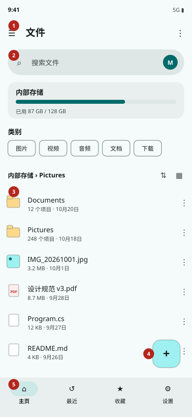
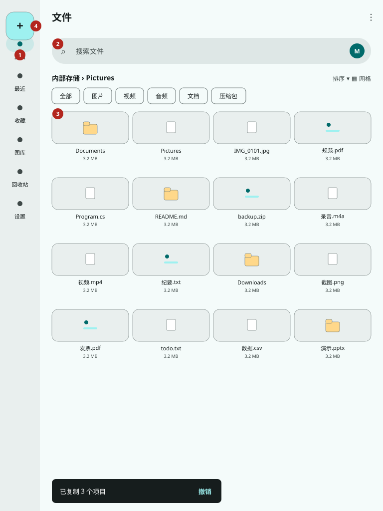
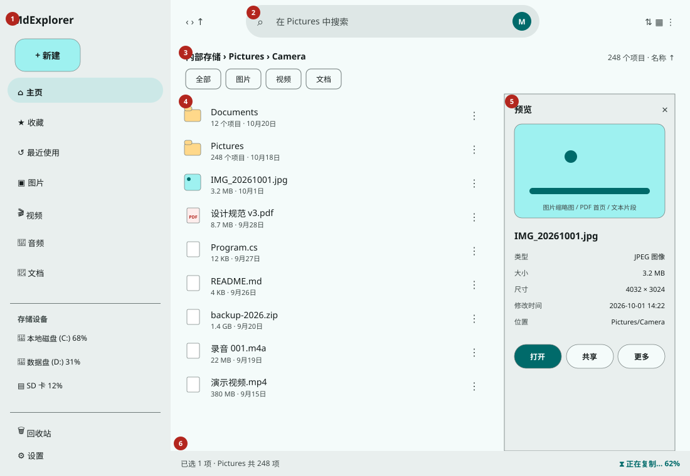
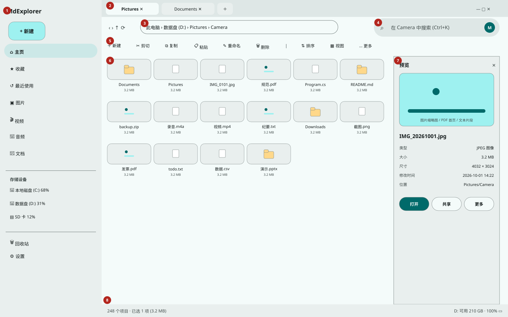
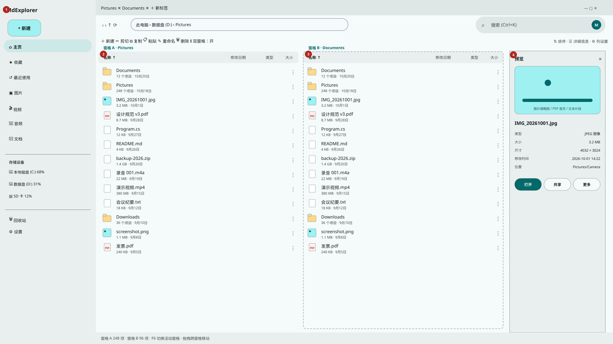

# MdExplorer 响应式布局设计

> 配套 [开发文档 §7](DEVELOPMENT.md#7-响应式adaptive设计总纲)。本文是**可直接对照实现的布局规格**：五档断点各有一张线框图（SVG，区域编号与正文图例一致）与一张组件/度量清单，外加状态变体与断点迁移规则。高保真 PNG 只定**视觉方向**（配色、质感、信息层级），像素尺寸与区域划分一律以 SVG 线框为准。

| 资产 | 说明 |
|---|---|
| [`assets/layouts/layout-compact-390.svg`](assets/layouts/layout-compact-390.svg) 等 5 张 | 规范线框图（源脚本 `scripts/generate-layout-wireframes.py`，改图改脚本后重跑、勿手编 SVG） |
| [`assets/mockups/mockup-compact-phone.png`](assets/mockups/mockup-compact-phone.png)、[`mockup-large-desktop.png`](assets/mockups/mockup-large-desktop.png) | AI 直接生成的 Compact/Large 浅色高保真概念图（青色种子 `#006A6A`），与 `assets/mockups/ai-v3/` 基线同步 |
| [`CONCEPT-DESIGN.md`](CONCEPT-DESIGN.md) + [`assets/mockups/v2/`](assets/mockups/v2/) | 深浅成对基线与下一阶段规划界面；主视觉为 `assets/mockups/ai-v3/` 直接生成图，`v2/` SVG/PNG 为结构参考；规划图不是已实现截图 |
| [`IMAGE-PROMPTS.md`](IMAGE-PROMPTS.md) | 用 GPT-image-2 复刻/扩展全套效果图的提示词（中英双语） |

---

## 1. 全局规格（五档共用）

### 1.1 断点与画布

| 断点 | 内容宽（dp） | 线框画布 | 边距 | 列数基准（12 列体系等效） |
|---|---|---|---|---|
| Compact | `< 600` | 390 × 844 | 16 | 4 |
| Medium | `600–839` | 768 × 1024 | 24 | 8 |
| Expanded | `840–1199` | 1100 × 760 | 24 | 12 |
| Large | `1200–1599` | 1440 × 900 | 24（内容区内边距）/ 抽屉 12 | 12 |
| ExtraLarge | `≥ 1600` | 1920 × 1080 | 32 | 12（正文阅读最大宽受限，列表除外） |

高度类：内容高 `< 480 dp`（如手机横屏）为紧凑高度——顶栏降为 48 dp、主页聚合卡折叠为一行、FAB 降为小 FAB(40 dp)，底栏在宽 ≥ 600 时提前转 Rail。高度类只调垂直度量，不改变导航目的地序。

判定宽取**窗口内容区**逻辑宽（扣除系统栏，含本应用一切区域），横竖屏/分屏/折叠姿态只影响这个数值，没有第二条「设备类型」判断路径（开发文档 §7.3）。

### 1.2 度量基线

| 元素 | 触控模式 | 指针模式（鼠标/触控板） |
|---|---|---|
| 最小命中区 | 48 × 48 dp（尾随 ⋮、芯片亦须达标） | 图标按钮 36–40 dp 可视、命中 40 dp |
| 文件列表行高 | 60 dp（两行文本）/ 网格卡缩略高 64 dp | 48 dp 列表（可再设「紧凑」40 dp） |
| 顶栏 | Small 64 dp（净 UI，不含系统状态栏） | 桌面复合顶区 48 + 56 dp（标签行 + 导航行） |
| 底栏 / 导轨 / 抽屉 | 80 dp 高 / 80 dp 宽 / 272–300 dp 宽 | 同（抽屉 288–300 dp） |
| FAB | 56 dp（距边 16，距底栏上沿 16） | Large 起被工具栏「新建」取代 |
| 分隔 | 列表行间**不使用**通栏分隔线，靠间距与表面色分组；详细信息视图可用低对比分隔 | 同 |

网格列数算法（五档一致）：`cols = clamp(floor((contentW + 8) / (minCard + 8)), minCols, maxCols)`，`minCard` 触控 96 / 指针 120（缩略卡），纯图标卡最小 76；列数变动时卡片宽连续吸收余量，**不用媒体查询硬写 3/4/6 列**以免拖窗跳变。

### 1.3 区域语义词典（全断点通用编号语义）

- **导航区（Nav）**：一级目的地；形态 ∈ {底部栏， 导轨， 抽屉（模态/永久）}。
- **寻址区（Locate）**：当前位置表达 + 历史（后退/前进/向上）；形态 ∈ {标题+溢出， 折叠面包屑， 完整面包屑， 面包屑胶囊（可编辑）}。
- **搜索区（Search）**：迷你搜索岛（入口）→ 悬浮搜索面板（内含 `MdSearchBar`；主页仍可直接使用搜索栏）。
- **动作区（Actions）**：当前上下文写操作；形态 ∈ {FAB+菜单， 顶栏图标， 工具栏， 选择态上下文栏}。
- **内容区（Content）**：文件列表/网格/详细信息，含其列头/分组头/状态（加载骨架、空态、无权态）。
- **洞察区（Insight）**：「预览 / 属性」双页签 + 主动作（打开/共享）；形态 ∈ {悬浮窗， 底部 Sheet， 侧栏窗格， 速览浮层}。
- **状态区（Status）**：条目计数、存储余量、在途任务入口；形态 ∈ {顶部卡片（主页）, 底状态条， 迷你任务条}。

红圈编号只保证**单张图内唯一**，每节图例为该图的准绳。

---

## 2. Compact（< 600 dp）· 手机竖屏

**区域图例：** ① 顶部小应用栏（导航抽屉入口 ☰ + 目的地标题 + 溢出 ⋮） ② 搜索入口（主页为胶囊搜索栏；文件夹页收进导航行迷你搜索岛，点击展开悬浮搜索面板：输入筛选、回车递归） ③ 文件列表（两行：名 16sp/注脚 12sp，右尾 ⋮ 单文件菜单，行高 60） ④ FAB（新建：文件/文件夹二项小菜单） ⑤ 底部导航栏（主页/最近/收藏/设置；分类与卷走 ☰ 模态抽屉与主页聚合卡）。

要点（规范）：

1. **主页与文件夹页是同一骨架换内容**：主页在 ③ 前多两段——存储卡（量条 + 「内部存储」)与类别 Chip 横滑行（图片/视频/音频/文档/下载/压缩包，点击即类别结果页）;进入文件夹后这两段消失，腾出空间给折叠面包屑单行（`卷 › 当前文件夹` + 右侧排序与视图切换，点面包屑以 Sheet 展开全路径逐段跳转）。
2. **打开 = 点按**；长按 ③ 任一行 → **选择模式**：① 变为上下文栏（✕ + 「已选 N」 + 全选 + 共享/删除/⋮,表面用 `secondaryContainer`)，行首出现圆形勾选标记区，④⑤ 收起；系统返回先退选择模式再退导航栈。
3. **单文件 ⋮ / 选集长菜单** 一律**底部工作表**(Sheet）承载（重命名/详细信息/压缩/删除…)，重命名等表单走全屏对话框，毁灭项 `error` 色 + 二级确认。
4. **预览**：点文件（非文件夹）默认以系统打开还是先进预览？定版：**点按先打开悬浮预览窗**（`MdFloatingWindow`：可拖/缩放/最小化，「预览 / 属性」双页签 + 底部主动作「打开」），文件夹点按进入；长按文件直接进入选择模式而非预览。此默认可在设置改「点按直接打开」。
5. **任务反馈**：复制类长任务在 ⑤ 上沿出迷你进度条（文件名 + 百分比 + ✕)，点开为任务 Sheet；短反馈 Snackbar 位于 FAB 之上避让。
6. **滚动收纳**：列表下滚时 ① 标题可收缩，② 不跟随消失（文件场景找文件优先，搜索恒近手）;FAB 滚动中保持可见。

---

## 3. Medium（600–839 dp）· 平板竖屏 / 折叠内屏

**区域图例：** ① 左侧导轨 Rail(80 dp：顶部 FAB，下方垂直导航项，激活项胶囊 `secondaryContainer`) ② 导航行迷你搜索岛（点击展开悬浮搜索面板，不离页；主页为通栏搜索栏） ③ 内容区（默认**网格 4 列**起，卡片缩略 64 dp 高 + 名/大小两行，信息密度高 Compact 一档） ④ Rail 顶的新建 FAB。

要点：

1. 面包屑完整可点（宽容纳 `卷 › 一级 › 当前` 三段，更深时中间段收为「…」下拉）;排序与视图切换迁为文字+图标按钮置同行右端。
2. 类别 Chip 行常驻（全部/图片/视频/音频/文档/压缩包）做**同集筛选**与 Compact 主页聚合的跳转有所区别：Medium 起 Chip 是当前集过滤而不是页面跳转（信息空间已够停靠）。实现注意两语义只此一处不同，ViewModel 以参数区分。
3. 预览在 Medium 仍全屏（内容最大宽 720 居中），不做侧栏：避免「半栏既挤列表又挤预览」。Large 手势/长按/选择模式规则与 Compact 同，但选集动作栏贴顶栏位。
4. 对话框真正居中悬浮（最大宽 480），不再用 Sheet（毁灭确认除外——Sheet 的拇指可达性仍优先，允许二者并存以保证确认成本一致，具体逐对话框在走查时定表）。

---

## 4. Expanded（840–1199 dp）· 平板横屏 / 桌面小窗口

**区域图例：** ① 永久抽屉（272 dp：品牌 + 「新建」扩展按钮 + 目的地组 + 存储设备组（量条）+ 回收站/设置） ② 顶栏搜索（限定当前目录的占位文案，与前进后退同行） ③ 可点面包屑（全路径显式） ④ 文件列表（默认回列表，行高 54，信息两行不变） ⑤ **预览侧栏**（272 dp，单选中自动出、可 ✕ 关，含主图区 + 元数据键值 + 打开/共享/更多三键） ⑥ 底状态条（左计数右任务入口）。

要点：

1. 这是「移动 ↔ 桌面心智」的分水岭：前进/后退/向上显化、状态条常驻、完整面包屑齐备；v0.19 起桌面 `MainWindow` 在 Expanded 即把文件标签放入 48px 窗口顶行，左侧与抽屉品牌同线，Android/普通单视图宿主仍用工作区回落标签条。触控平板横屏亦落于此：手势与命中仍按输入方式维（§1.2）走大目标，不得因宽像桌面就把行高压到指针档。
2. 预览侧栏 ⑤ 的开合做**布局挤压**（内容 ④ 收窄）而非浮层覆盖，宽持续 272–300 dp(可拖改宽为 P2)；未选中或多选时收栏，栏顶 ✕ 仅关栏不清选择。
3. 右键/长按菜单在本档开始可锚定光标出浮动 `Menu`，触控长按仍可用 Sheet——同动作双通道，开发时以输入方式选默一。

---

## 5. Large（1200–1599 dp）· 桌面主流窗口

**区域图例：** ① 永久抽屉（288 dp，含新建按钮，存储组可展开显细节） ② 窗口顶部 Chrome（浏览器式标签：加/关/拖拽重排，末尾 ＋；右端最小化/最大化或还原/关闭） ③ 面包屑胶囊（方角胶囊容器，点段跳转 / 点空白入编辑成路径输入 / 段间右键） ④ 全局搜索（右侧，`Ctrl+K` 焦点，激活停靠结果） ⑤ 命令工具栏（新建/剪切/复制/粘贴/重命名/删除 | 排序/视图/更多——图标+文字，溢出收「…」） ⑥ 内容（默认网格 6 列档或详细信息，由视图模式决定） ⑦ 预览侧栏（300 dp，可从 ⑥ 右缘切换开关，记忆开闭） ⑧ 状态栏（总数/已选大小/卷余量/缩放档）。

要点：

1. 桌面窗口 Chrome（v0.19 已落地）：Windows/Linux 的 `MainWindow` 使用无原生标题栏的扩展客户区，48px 顶行与永久抽屉品牌同线；浏览器页放同一标签模板，非浏览器页放页标题，右端放自有最小化/最大化或还原/关闭。空白区以 `TitleBar` 角色拖窗、双击切换最大化，普通状态提供 8 向边缘缩放，最大化/全屏关闭缩放热区；Compact/Medium 桌面窄窗把窗口按钮收进顶栏且选择模式预留按钮位，Android 单视图不渲染桌面按钮。无头测试覆盖角色、位置与状态切换，Snap/Wayland 等平台非客户区细节仍以真桌面会话验收。
2. FAB 与底栏/导轨在本档**退出**，主动作全进 ⑤；键盘流的 Tab 序：抽屉 → 标签 → 面包屑 → 搜索 → 工具栏 → 内容 → 预览 → 状态栏；`F6` 在导航区/内容区/预览区间轮转（双窗格时加窗格维度）。
3. 详细信息视图（名称/修改/类型/大小四列起，列表头点按排序、列宽可拖为 P2）建议为 Large 的默认备选视图；网格默认优先给图文目录（应用层可按目录启发建议但不擅自切换用户显式设置）。
4. 拖拽高亮：拖文件悬停 ① 目的地、② 标签、③ 面包屑段均显落点环，松手即任务入列。

---

## 6. ExtraLarge（≥ 1600 dp）· 大屏与可选双窗格

**区域图例：** ① 抽屉（300 dp） ② 窗格 A（详细信息 + 列头） ③ 窗格 B（与 A 独立目的地/独立选择，虚线示非活动） ④ 预览侧栏（300 dp，追随**活动窗格**选集）。

要点：双窗格第一切片已随 **v0.18** 落地（开发文档 D-06）：A/B 各带面包屑、历史与选集，活动窗格以 `primary` 描边与徽标标示并承接预览/键盘；`Ctrl+Shift+D` 开关、`F6` 切换活动；跨窗格拖放默认移动（按 `Ctrl` 变复制，投放提示写明语义）；宽跌回 `< 1600` 时双窗格自收为单窗格（活动回到 A，B 会话保留且其路径转后台标签）。全局文件标签在 v0.19 位于窗口顶行但仍只属于 A，搜索岛与地址编辑在第一切片仍只属于 A。

单窗格的 XLarge 只做「富余吸收」：详细信息加列（创建时间/维度/时长按内容自现）、网格上限列抬高，但单卡最大宽封顶（220 dp）防海报化；设置/属性等表单页最大读宽 720 居中不变。

---

## 7. 状态变体（五档共用，省 5 张重复图）

逐状态以「变的区域」为准描述，实现走查时以此覆盖：

| 状态 | Compact 呈现 | Medium/Expanded | Large+ |
|---|---|---|---|
| 加载（大目录） | 顶细进度条（不确定）；枚举每 250 项更新“正在读取”计数，完成排序后首屏只物化 120 项 | 同左，底部状态同步“已显示/总数” | 状态栏计数递增 + 细进度贴工具栏下沿；A/B 各自维护分页代次 |
| 下拉刷新/加载更多（v0.25） | 文件面顶部向下拖出现 Md3 刷新胶囊；底部页脚避开 FAB 84dp，显示已显示/总数与“加载更多” | 同一手势与页脚复用于列表/网格；距底约 320dp 自动追加下一页 | A 的列表/网格/详细信息及 B 的列表/网格各自独立包裹 `MdRefreshIndicator`，避免隐藏视图的 ScrollViewer 干扰到顶判定；刷新按钮和 F5/Ctrl+R 始终保留 |
| 对照窗格视图（v0.27） | 不适用（Compact/Medium 无双窗格） | 不适用 | ExtraLarge：B 具备列表/网格/详细信息三态，详细信息列按 B 宽度收缩（名称弹性、其余 96/120/150dp）；B 的视图与排序独立于 A，收窄到 360dp 时仍保留名称与大小两列可读 |
| 对照窗格地址栏（v0.28） | 不适用（Compact 只有 A 的地址栏） | 不适用 | ExtraLarge：B 的路径胶囊与 A 同一套交互（点分段跳转、点空白进编辑、Enter 提交、Esc 取消）；编辑态只替换 B 自己的面包屑，A 保持可见；`Ctrl+L` 编辑活动窗格。 |
| 抽屉品牌区（v0.26） | Compact 模态抽屉：Logo 与“Eidoria / 万象屿”固定在抽屉顶部，导航列表单独滚动，关闭按钮与表头同层 | 该断点用底部导航，无永久抽屉 | Expanded+ 永久抽屉同样固定表头并带下边线；宽度 216–440 时表头不换行、标题省略而不挤压 Logo |
| 列表密度（v0.26） | 舒适/紧凑只收紧列表行距、网格间距与详细信息行高；Compact 默认仍为舒适，触摸命中区不小于 40dp | 同一密度设置作用于列表/网格/详细信息 | A/B 两窗格共用同一密度与触发距离，避免同一窗口出现两套行高 || 空文件夹 | 居中空态（大图标 + 「这里还没有文件」 + 新建按钮） | 同左（最大宽 420） | 同 |
| 未授权（Android） | 全屏横幅卡（为什么 + 授权 CTA + 已授权位置入口） | 内容区上部 Banner + CTA | （桌面无此态）无权目录为错误卡 + 系统处理指引 |
| 搜索激活 | 悬浮搜索面板（近搜词/建议 Chip 可后补；面板内 `MdScrollViewer`，结果复用当前列表并带路径注脚） | 同一悬浮面板（不离页） | 同一悬浮面板 + 右列可直接出选集预览 |
| 选择模式 | 顶上下文栏 + 行首选框，FAB/底栏退场 | 顶/工具栏切换动作集（复制/剪切/共享/删除） | 工具栏变选集组 + 状态栏显已选体积 |
| 在途任务 | 底迷你条（点开任务 Sheet） | 状态条任务钮转圈显 % | 状态栏任务区 + 浮层任务面板（关窗仍跑、托盘 Later） |
| 冲突等待 | 全屏对话框（单项比对卡 + 三抉一 + 应用到其余勾选） | 居中对话框（480） | 同左（批量计数显「第 2/9 个」） |
| 预览失败 | 元数据卡 + 原因文（区分不支持/损坏/无权/已消失）+「用其他应用打开」 | 同卡落在侧栏位 | 同 |
| 文档工作台（v0.20；v0.22 光栅连续阅读；v0.23 Office；v0.24 PDF 直接优先） | 文本工具自动换行；PDF 默认由直接控件按整页宽度连续呈现并保留“兼容视图”动作，切到 PDFium 后隐缩略图轨与首末页/旋转/系统打开，留单页/连续切换、跳页、缩放、整页连续滚动与 PDF 图标回切；DOCX/PPTX 按整页宽度缩放后连续滚动，XLSX 按活动工作表逻辑宽度缩放并保留切表 | 工作面按自身宽度收敛次级事实与 PDF 次级动作，直接控件或光栅连续页都按可用纸宽呈现，Office 适配层按活动格式/工作表重算缩放，内容不被导航骨架挤没 | PDF 直接面保留页数、兼容视图、重载与系统打开；PDFium 面显示懒加载缩略图轨和完整阅读工具，单页与连续共用页码/缩放/旋转状态，并以 PDF 图标切回直接预览；Markdown 以源稿/渲染页签切换，不做同屏对照；Office 只创建一个当前格式 Viewer，宽面保留结构计数、重载与系统打开 |
| 自动化（v0.21） | 顶部名称/运行与节点添加动作换行；固定 380dp 高画布在上、节点检查器在下，整页以 `MdScrollViewer` 拖动滚动；覆盖上游整图自动塞屏，画布以 0.68 倍显示前段并靠拖动平移，入口只在导航抽屉，不挤占 Compact 底栏 | 页面自身宽 `<900dp` 时同 Compact 上下分工；画布可平移/缩放而非整页等比缩小 | 固定 520dp 高画布占弹性主列并以 0.82 倍总览，340dp 检查器并排；来源、校验结果与上次运行摘要贴在画布卡内 |
| 离线卷拔出 | 定位于该卷的视图弹回主页 + Snackbar 解释 | 同 | 标签显示离线斜纹并禁其操作组 |

深色模式不是新布局：同一骨架经 Md3 深色 Token 重染色；需要单独走查的是缩略图描边（深色下浅边保留 `outlineVariant`）、覆盖层与 Snackbar 的反色角色（`inverseSurface`)，列到 §8 效果图时请至少出一张深色 Large 做对照（提示词文档已备变体）。

---

## 8. 断点迁移规则（拖窗 / 旋转 / 折叠展开时行为的规范）

| 迁移 | 必须保留 | 允许变化 |
|---|---|---|
| Compact → Medium（折叠屏展开） | 当前目的地、滚动锚点（首个可见条目名）、选集、搜索词与已出结果 | 底栏→导轨、列表可保持或建议网格（不强切用户视图选择） |
| Medium → Expanded（转横屏） | 同上 + 预览中文件改到侧栏续播/续看（PDF 页码、图片缩放复位允许） | 悬浮预览收为侧栏、搜索面板保持悬浮 |
| Expanded → Large（窗口放宽） | 会话升格为首个标签、预览侧栏开闭位 | FAB/导轨记忆项并入抽屉 |
| 任意回落（变窄） | 活动标签变唯一会话，其余标签栈保留待再升格唤回（上限外逐出最久未触） | 侧栏预览回悬浮窗、对话框回 Sheet/全屏——**正在编辑的表单（如重命名半截输入）迁移时不得丢字**，实现让迁移延迟到模态关闭后再换 View |
| 同档内横竖互换 | 一切（含 PDF 页/图缩放状态尽量保持） | 仅列数按宽重算 |

滞回：正跨档阈值 +8 dp、回跨 −8 dp 施加 100 ms 合并（开发文档 §7.3），连续拖拽中不许每帧整树重排；迁移动画只做 120 ms 淡入。

---

## 9. 高保真方向图的采用说明（与规范的已知差异）

旧 AI 方向图已由概念设计 v2 的结构稿与经 Material 3 Skill 审计的 ai-v3 直接生成稿替代；以下规则继续作为所有概念图与宣发图的验收线：

1. 本产品**仅本地盘**：正式视觉只允许本地卷、已知文件夹、SD 卡与 Android 已授权目录，禁止云盘、账号头像和联网搜索暗示。
2. 文件夹页的搜索入口是导航行迷你搜索岛（主页可保留通栏搜索），预览是“预览 / 属性”双页签；不要退回整行搜索框或单页长属性列表。
3. Android 系统状态栏与桌面系统窗框可以在概念图中示意，但实现时由系统提供，不进入应用自绘层。
4. `assets/mockups/ai-v3/06–15` 高保真稿是规划预演：其中出现的索引、双窗格、播放器、插件与 AI 入口在功能真正落地前不得进入正式导航或商店实拍。
5. 文件夹/文档样例量级以概念稿的固定虚构数据为准（便于深浅与断点逐图比对），不要使用真实用户路径与私人文件名。

---

## 10. 实现映射备忘（给编码者）

- 视图文件：`Views/Shell/` 下按尺寸类建子目录放页面骨（`Compact/HomePageView.axaml` 等），复合子控件（存储卡、文件项、预览宿主）放 `Views/Shared/` 以密度参数区分，避免五份拷贝漂移；纯度量差异用 `Classes` + 样式达不成的结构差异才拆 View。
- 宽到列数绑定走 `IAdaptiveLayoutService` 发布的派生量（GridMinCard、IsRailVisible…)，XAML 中只绑布尔，不在 View 后置代码算 dp 分档（单测盯着派生表输出测即可）。
- 本文图与 Headless 截图画布一一对应（开发文档 §7.4）：断点或磁格数值调整须同改生成脚本、截图基线与本节数字三处。

